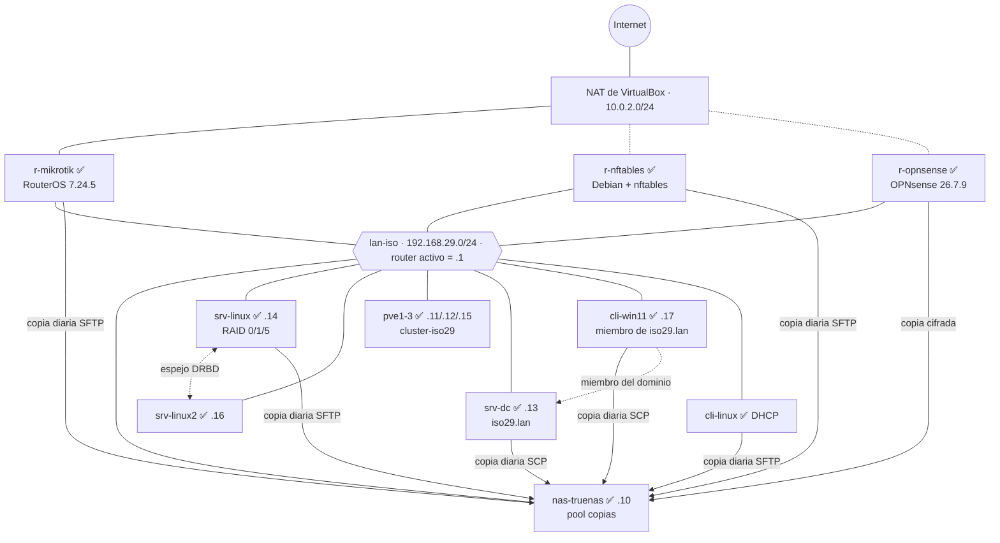

# ASIX ThinkLab · «Naix un sistema» — Laboratorio individual

**Implantación de Sistemas Operativos (ISO) · Fundamentos de Hardware (FDM) · 1.º ASIX · Curso 2026-27**
Alumno: **Mauro Bas Montes** · Grupo 3 · Puesto **29** → LAN `192.168.29.0/24`

Entorno de pruebas propio en VirtualBox que reproduce, a escala, la infraestructura del grupo: tres routers alternativos, NAS de copias, clúster de virtualización, dominio, servidor Linux con RAID y clientes. Todo lo que figura como hecho está **comprobado** y enlazado a su evidencia (captura o salida de orden). Lo que falta se indica como pendiente, con su guía.

> 📸 **[Índice de todas las evidencias](EVIDENCIAS.md)** — 110 capturas y 51 salidas de comandos, por máquina. Cada máquina muestra al final de su README su **galería completa**, en el orden en que se hizo el trabajo.

## Estado de un vistazo

| | |
|---|---|
| Máquinas virtuales | **12 creadas** (11 del diseño + `srv-linux2`) · **las 12 instaladas, configuradas y probadas** |
| Criterios de la rúbrica | **80 / 96 hechos** · 2 parciales (tests en el equipo de clase) · 14 se evalúan en la prueba presencial · 0 pendientes · [autoevaluación completa](rubrica/autoevaluacion.md) |
| Incidencias reales documentadas | **11** ([registro](incidencias/README.md)) |
| Copias de seguridad | 6 máquinas copian al NAS, 5 de forma automática; **restauradas de verdad** en pruebas de fallo (MikroTik 39 s · OPNsense 69 s · nftables 1,3 s) · [plan de copias](tareas/T5-plan-de-copias.md) |
| Imágenes | 6 de 7 verificadas por SHA256 contra el valor oficial ([anexo](anexos/sha256-imagenes-20261122.txt)) |

## Mapa del laboratorio



## Máquinas

| Máquina | Función | Sistema | Estado | Ficha |
|---|---|---|---|---|
| `r-mikrotik` | Router 1 | MikroTik RouterOS CHR 7.24.5 | ✅ Red, DHCP, DNS, NAT, cortafuegos con registro, copia y recuperación | [→](maquinas/r-mikrotik/README.md) |
| `r-opnsense` | Router 2 | OPNsense 26.7.9_3 | ✅ Actualizado, usuario, reglas con registro (y orden), copia cifrada y recuperación en 69 s | [→](maquinas/r-opnsense/README.md) |
| `r-nftables` | Router 3 | Debian 13.8 + nftables + dnsmasq | ✅ Igual que el MikroTik | [→](maquinas/r-nftables/README.md) |
| `nas-truenas` | NAS y copias | TrueNAS 25.10.7 | ✅ IP fija, pool `copias`, usuario y carpeta por máquina | [→](maquinas/nas-truenas/README.md) |
| `pve1`–`pve3` | Clúster de virtualización | Proxmox VE 9.2.2 | ✅ Clúster `cluster-iso29` con quórum probado, migración de CT y VM medida, `vzdump` | [→](maquinas/pve1/README.md) |
| `srv-dc` | Dominio `iso29.lan` | Windows Server 2025 | ✅ DC, OU y grupos por departamento, GPO y copia diaria de AD | [→](maquinas/srv-dc/README.md) |
| `srv-linux` | Servidor Linux | Debian 13.8 sin escritorio | ✅ IP fija, RAID 0/1/5 con avería y reconstrucción, copias | [→](maquinas/srv-linux/README.md) |
| `srv-linux2` | Espejo entre equipos | Debian 13.8 (clon) | ✅ DRBD: caída del primario y relevo en 3,5 s | [→](maquinas/srv-linux2/README.md) |
| `cli-win11` | Cliente Windows | Windows 11 | ✅ Windows 11 Pro 23H2, IP fija .17, unido a `iso29.lan`, copia diaria al NAS | [→](maquinas/cli-win11/README.md) |
| `cli-linux` | Cliente Linux | Debian 13.8 + GNOME | ✅ Reparado (INC-001), admin `adminlab`, DHCP y copia | [→](maquinas/cli-linux/README.md) |

## Tareas

| Tarea | Documento | Estado |
|---|---|---|
| T0 · Entorno de pruebas | [T0-entorno-de-pruebas](tareas/T0-entorno-de-pruebas.md) | ✅ (+ Apte+) |
| T1 · Necesidades y requisitos | [T1-necesidades-y-requisitos](tareas/T1-necesidades-y-requisitos.md) | ✅ |
| T2 · Equipos de clase y de casa | [T2-equipos-clase-y-casa](tareas/T2-equipos-clase-y-casa.md) | ✅ · Apte+ 🟡 (faltan los tests en clase) |
| T4 · Red individual | [T4-red-individual](tareas/T4-red-individual.md) | ✅ (+ Apte+) |
| T5 · Instalación y comunicaciones | [T5-sistemas-e-imagenes](tareas/T5-sistemas-e-imagenes.md) · [comparación de routers](tareas/T5-comparacion-routers.md) · [plan de copias](tareas/T5-plan-de-copias.md) + fichas | ✅ Routers, NAS, clúster Proxmox, dominio, servidores y clientes Linux y Windows 11 |
| T6 · Almacenamiento y recuperación | [T6-almacenamiento-y-recuperacion](tareas/T6-almacenamiento-y-recuperacion.md) | ✅ (+ Apte+: espejo DRBD entre dos equipos) |
| T7 · Rendimiento | [T7-rendimiento](tareas/T7-rendimiento.md) | ✅ (+ Apte+: dos optimizaciones medidas) |
| T8 · Prueba final | [T8-prueba-final](tareas/T8-prueba-final.md) · [chuleta de la defensa](defensa/resumen-por-vm.md) · [preguntas por RA](defensa/preguntas.md) | 📅 Preparada |

## Cómo está organizado el repositorio

```text
README.md                 ← esta portada
rubrica/autoevaluacion.md ← los 96 criterios de la rúbrica con estado y enlace a la evidencia
tareas/                   ← un documento por tarea del enunciado (T0…T8) + comparación de routers y plan de copias
defensa/                  ← chuleta de las máquinas y banco de preguntas por RA
maquinas/<vm>/            ← una carpeta por máquina virtual
   README.md              ←   ficha: qué es, cómo se instaló, qué se probó y estado por criterio
   capturas/              ←   capturas de consola y web numeradas en orden
   salidas/               ←   salidas completas de las órdenes (texto)
   config/                ←   ficheros de configuración reales y configuración de VirtualBox
incidencias/              ← INC-NNN: síntoma → diagnóstico → solución → verificación
anexos/                   ← hardware, pruebas, mediciones de rendimiento, SHA256 y memoria en PDF
scripts/                  ← scripts propios: medición, pruebas de hardware, copias, lectura de VDI
```

## Normas del repositorio

- **Sin secretos:** ninguna contraseña, clave privada ni hash. Las credenciales están en un fichero local con permisos `600`, fuera del repositorio. Donde un fichero las necesita, aparecen como marcadores (`CLAVE_SFTP`, `********`).
- **Sin ISO ni discos virtuales** ([.gitignore](.gitignore)).
- **Honestidad:** cada ✅ tiene evidencia. Cuando algo salió mal se cuenta (por ejemplo, el primer intento de cambio de IP de TrueNAS en [INC-005](incidencias/INC-005-truenas-cambio-de-ip-revertido.md)).
- Las correcciones a la documentación anterior se señalan como **«Corrección»** en cada documento.
- Trabajo de grupo: <https://github.com/varo010/asix-aula-grup-03-ISO>. Este repositorio es la parte **individual** y no reutiliza configuraciones del grupo.
