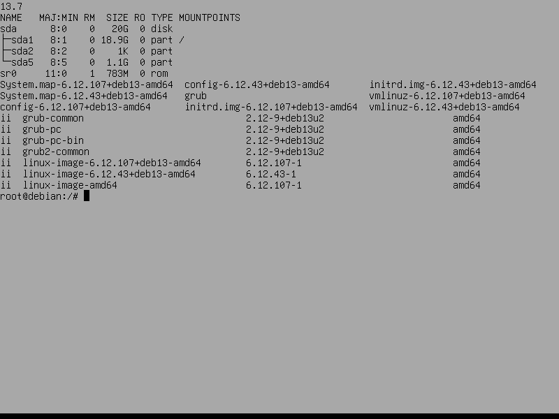
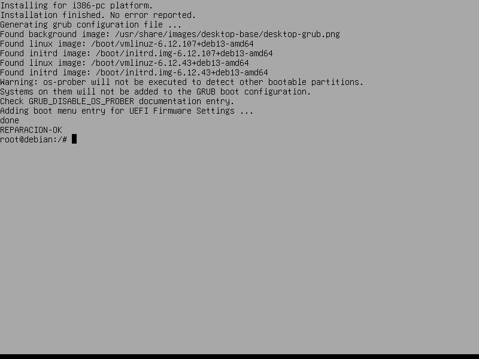
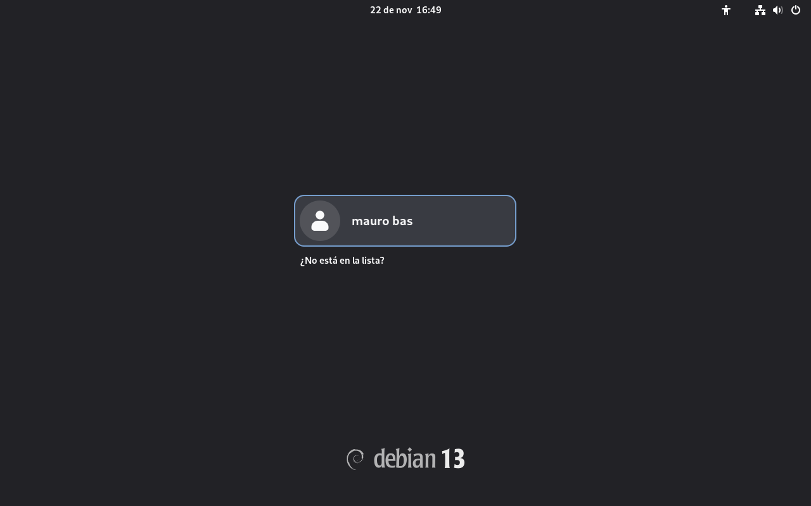

# INC-001 · `cli-linux` (antes «Debian 13.1») arranca en pantalla negra

> **Estado: RESUELTA el 22/11/2026.** Tipo: incidencia de **instalación / arranque** (ISO RA1, Tasca 8).
> Máquina: [`cli-linux`](../maquinas/cli-linux/README.md) · Equipo: casa (i5-11400F)

## Resumen en una línea

El instalador de Debian terminó **sin escribir GRUB en el disco** (`Installing grub on ''`); la BIOS virtual no encontraba nada que arrancar y se quedaba con el cursor parpadeando. Se arrancó la ISO en **modo rescate**, se ejecutó `grub-install /dev/sda` + `update-grub` y el sistema arrancó hasta GDM.

## 1. Síntoma

Al encender la VM aparece una pantalla negra con un guion parpadeando arriba a la izquierda. No hay menú de GRUB ni mensajes del núcleo. La incidencia venía arrastrándose desde septiembre (ver [T0](../tareas/T0-entorno-de-pruebas.md)).


## 2. Diagnóstico (de lo general a lo concreto)

| # | Hipótesis | Cómo la comprobé | Resultado |
|---|---|---|---|
| 1 | Cambio de firmware EFI ↔ BIOS después de instalar | `diff` entre `Debian 13.1.vbox-prev` y `.vbox`; buscar `EfiRom` en los 4 `VBox.log` | **Descartada**: siempre ha usado BIOS, 0 apariciones de EFI |
| 2 | Problema gráfico (VMSVGA sin *Guest Additions*) | `VBox.log`: la BIOS dice `Booting from Hard Disk...` y la pantalla se queda en modo texto 720×400 sin cambiar nunca de resolución | **Descartada**: el sistema ni siquiera llega a cargar el núcleo |
| 3 | No hay cargador de arranque en el MBR | Leí el disco VDI **en solo lectura** con un script Python (cabecera VDI → mapa de bloques → sector 0) | **Confirmada**: el MBR tiene tabla de particiones (`sda1` ext4 20 GB, extendida con swap) pero los sectores 1–2047, donde GRUB guarda su `core.img`, están **todos a cero** |
| 4 | ¿El sistema llegó a arrancar alguna vez? | Superbloque ext4 de `sda1`: `last mounted on = /target`, `mount count = 1` | **Nunca arrancó**: el último que lo montó fue el instalador |
| 5 | ¿Por qué no se instaló GRUB? | Busqué el registro del instalador dentro del disco (`grep -a 'grub-installer:'` sobre el VDI) | Línea clave: **`grub-installer: info: Installing grub on ''`** → en el paso «¿Instalar GRUB en el disco principal?» no se eligió `/dev/sda` |

Script usado para leer el VDI: [`scripts/vdi-leer-mbr.py`](../scripts/vdi-leer-mbr.py).

## 3. Solución aplicada

1. Insertar la ISO verificada `debian-13.1.0-amd64-netinst.iso` (SHA256 `658b28e2…c65568b3`, coincide con la oficial) en la unidad óptica IDE.
2. Arrancar → **Advanced options → Rescue mode** (capturas [01](../maquinas/cli-linux/capturas/inc001-01.png) – [03](../maquinas/cli-linux/capturas/inc001-03.png)).
3. Idioma, teclado y red por DHCP por defecto ([04](../maquinas/cli-linux/capturas/inc001-04.png) – [09](../maquinas/cli-linux/capturas/inc001-09.png)). Estos datos **no** cambian el sistema instalado.
4. Elegir `/dev/sda1` como sistema raíz ([10](../maquinas/cli-linux/capturas/inc001-10.png)) → **Execute a shell in /dev/sda1** ([11](../maquinas/cli-linux/capturas/inc001-11.png), [12](../maquinas/cli-linux/capturas/inc001-12.png)). Elegí la *shell* en vez de «Reinstall GRUB boot loader» para que los comandos y su salida quedaran a la vista.
5. Comprobación previa: el sistema está completo, solo falta el cargador:

   

   - `/etc/debian_version` → **13.7**
   - Núcleos `6.12.43` y `6.12.107` en `/boot`
   - Paquetes `grub-pc`, `grub-pc-bin` instalados (`ii`)

6. Reparación:

   ```bash
   grub-install /dev/sda      # escribe boot.img en el MBR y core.img en los sectores 1-2047
   update-grub                # genera /boot/grub/grub.cfg con los dos núcleos
   sync; exit
   ```

   

   `Installing for i386-pc platform. Installation finished. No error reported.`

7. *Reboot the system* y expulsar la ISO (`VBoxManage storageattach … --medium emptydrive`).

## 4. Verificación

- El núcleo carga desde el disco ([16](../maquinas/cli-linux/capturas/inc001-16.png)).
- Llega a la pantalla de inicio de sesión de GNOME (GDM) con el usuario «mauro bas» y la resolución pasa a 1280×800:

  

- Tiempo total de la reparación (desde arrancar la ISO hasta GDM): **≈ 4 min**.

## 5. Vuelta atrás

`grub-install` solo escribe en el MBR y en el hueco previo a la primera partición, que estaba vacío. No se tocó ningún dato. Si hubiera salido mal, bastaba con volver a arrancar en modo rescate.

## 6. Qué aprendí / cómo evitarlo

- En el instalador de Debian, en la pregunta **«Dispositivo donde instalar el cargador de arranque»**, hay que elegir el disco (`/dev/sda`), **no** «Introducir el dispositivo manualmente» dejándolo en blanco.
- Una pantalla negra con cursor **justo después de** `Booting from Hard Disk` apunta casi siempre a un MBR sin cargador. Si aparece el menú de GRUB y luego se queda en negro, el problema es otro (gráficos, núcleo).
- Se puede diagnosticar el disco de una VM **sin arrancarla**, leyendo el VDI en solo lectura.
