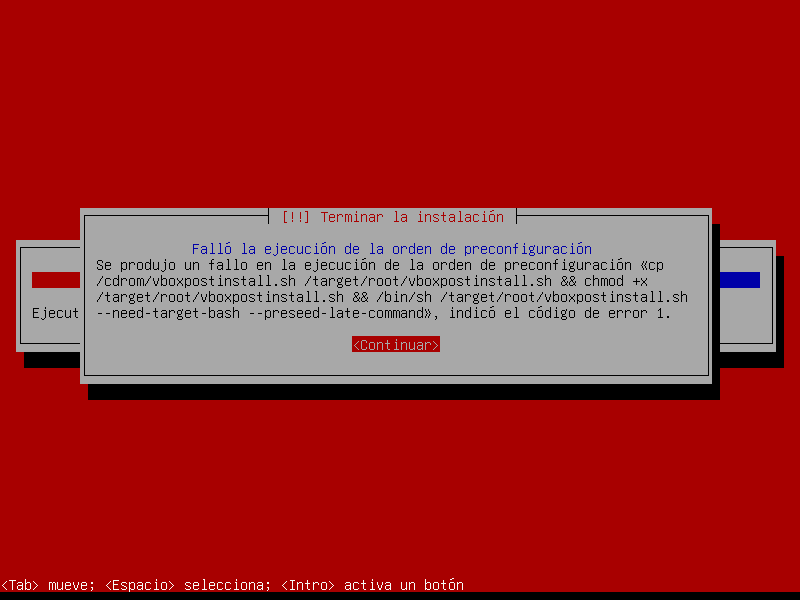
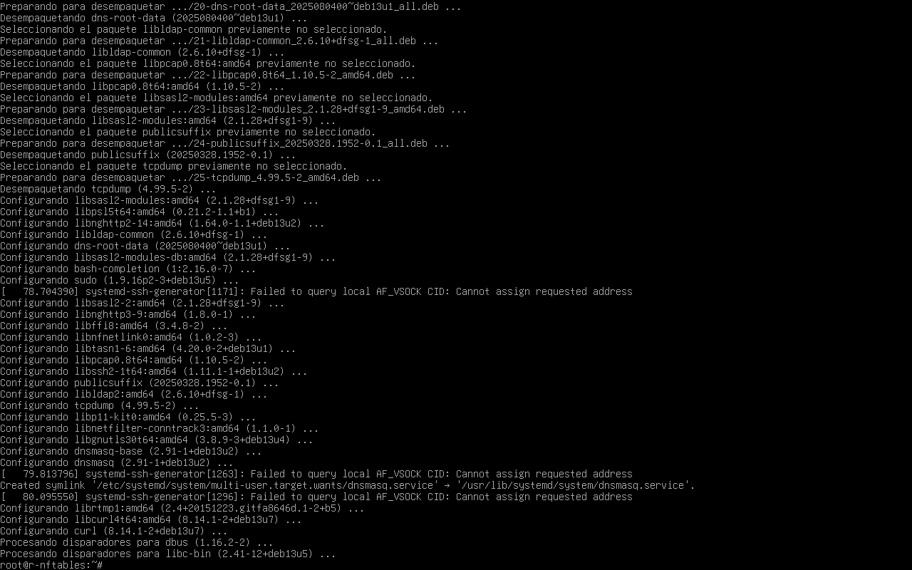

# INC-004 · La instalación desatendida de Debian termina con «Falló la ejecución de la orden de preconfiguración»

> **Estado: RESUELTA.** Tipo: **instalación** (ISO RA1). Máquinas: [`r-nftables`](../maquinas/r-nftables/README.md) y [`srv-linux`](../maquinas/srv-linux/README.md) · 22/11/2026

## 1. Síntoma

Las dos VM se instalaron con `VBoxManage unattended install` (instalación desatendida de VirtualBox con *preseed* de Debian). Al final del instalador apareció en las dos:



> *Se produjo un fallo en la ejecución de la orden de preconfiguración «cp /cdrom/vboxpostinstall.sh … --preseed-late-command», indicó el código de error 1.*

Se pulsó **Continuar** y el sistema terminó y arrancó, pero:

```text
mauro@r-nftables:~$ sudo
bash: sudo: orden no encontrada
mauro@r-nftables:~$ id
uid=1000(mauro) gid=1000(mauro) grupos=1000(mauro),100(users)     ← no está en sudo
mauro@r-nftables:~$ cat /etc/debian_version
13.1                                                                ← sin actualizar
```

## 2. Diagnóstico

Registro del script de VirtualBox, leído como root: [`/var/log/vboxpostinstall.log`](../maquinas/r-nftables/salidas/inc004-vboxpostinstall.log).

| Paso del script | Error | Causa |
|---|---|---|
| Instalar `linux-headers` para compilar las Guest Additions | `Err … cdrom://[Debian 13.1.0 NETINST] … linux-headers-6.12.43+deb13-amd64 … Fichero no encontrado` → `exit code: 100` | La ISO **netinst** no incluye las cabeceras del núcleo y el script solo miraba en el CD |
| Mi orden `--post-install-command="apt-get install -y openssh-server sudo …"` | `W: Unable to read /etc/apt/apt.conf.d/` · `E: Error reading the CPU table` → `exit code: 100` | La orden se ejecuta en el **entorno del instalador**, no dentro del sistema instalado (`/target`): allí no hay `apt` funcional |

## 3. Solución

1. Iniciar sesión en la consola como `mauro` y pasar a root con `su -`. La instalación desatendida da a root la misma contraseña.
2. Instalar lo que faltaba y dar permisos:

   ```bash
   apt-get update && apt-get install -y sudo dnsmasq tcpdump curl   # r-nftables
   apt-get update && apt-get install -y sudo mdadm rsync curl       # srv-linux
   usermod -aG sudo mauro
   ```

   

3. Actualizar antes de poner en producción (`apt-get full-upgrade` + reinicio): **13.1 → 13.8**, núcleo **6.12.43 → 6.12.117**, 0 paquetes pendientes ([r-nftables](../maquinas/r-nftables/salidas/01-actualizacion.txt), [srv-linux](../maquinas/srv-linux/salidas/01-repos-https-actualizacion.txt)).

## 4. Verificación

`id mauro` → grupos `sudo`, `adm`; `sudo -v` correcto; `apt list --upgradable` → 0.

## 5. Cómo evitarlo

- Con una ISO netinst, añadir `--install-additions=false` (los servidores sin escritorio no necesitan Guest Additions).
- Los paquetes extra se piden con `--package-selection-adjustment` o con `in-target apt-get install …` dentro de un *preseed* propio, no con `--post-install-command`.
- Después de cualquier instalación automática, **comprobar** que el resultado es el esperado antes de darla por buena.
