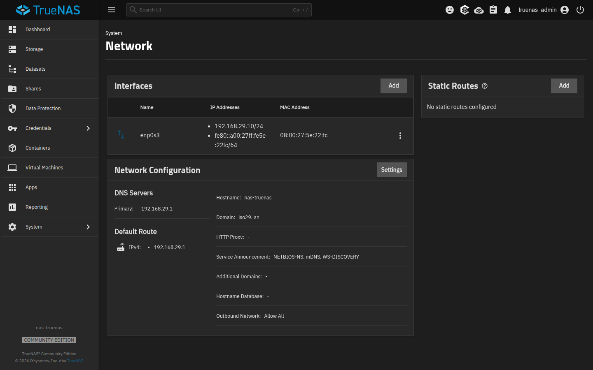

# INC-005 · El cambio a IP fija de TrueNAS se deshace solo

> **Estado: RESUELTA.** Tipo: **configuración de red** (ISO RA1). Máquina: [`nas-truenas`](../maquinas/nas-truenas/README.md) · 22/11/2026

## 1. Síntoma

Se cambió la interfaz `enp0s3` de DHCP (192.168.29.137) a **192.168.29.10/24** con la API (`interface.update` + `interface.commit`). Un par de minutos después, el NAS volvía a tener la IP antigua:

```text
mauro@r-nftables:~$ ping 192.168.29.10   → NO responde
mauro@r-nftables:~$ ping 192.168.29.137  → responde
```

## 2. Causa

TrueNAS tiene una **red de seguridad** para no quedarse incomunicado: `interface.commit` aplica la configuración nueva y espera un `interface.checkin` durante `checkin_timeout` segundos (90 s). Si no llega, entiende que el administrador ha perdido el acceso y **vuelve a la configuración anterior**.

En mi caso la sesión SSH que lanzó el *commit* iba por la IP antigua y se cortó al cambiar la IP. El túnel hacia la IP nueva no estuvo listo a tiempo y el *checkin* nunca llegó.

## 3. Solución

Todo en un único script que se ejecuta **dentro** de TrueNAS, de forma que el *checkin* use el socket local de la API, que no depende de la red:

```bash
midclt call interface.update enp0s3 '{"ipv4_dhcp":false,"aliases":[{"type":"INET","address":"192.168.29.10","netmask":24}]}'
midclt call interface.commit '{"checkin_timeout": 120}'
sleep 15
midclt call interface.checkin
```

Evidencia completa (primer intento fallido y segundo correcto): [03-red-ip-fija.txt](../maquinas/nas-truenas/salidas/03-red-ip-fija.txt).

## 4. Verificación

Dos minutos después, ya sin vuelta atrás pendiente (`interface.checkin_waiting` → `null`):

- `ip -br a` → `enp0s3 UP 192.168.29.10/24`
- `ip route` → `default via 192.168.29.1`
- `ping 192.168.29.1` y `ping 1.1.1.1` correctos



## 5. Qué aprendí

El mecanismo *commit/checkin* es la misma idea que el «Safe Mode» de MikroTik o el `commit confirmed` de los routers profesionales. Al cambiar la red de un equipo remoto hay que prever cómo se volverá a entrar **antes** de aplicar el cambio.
