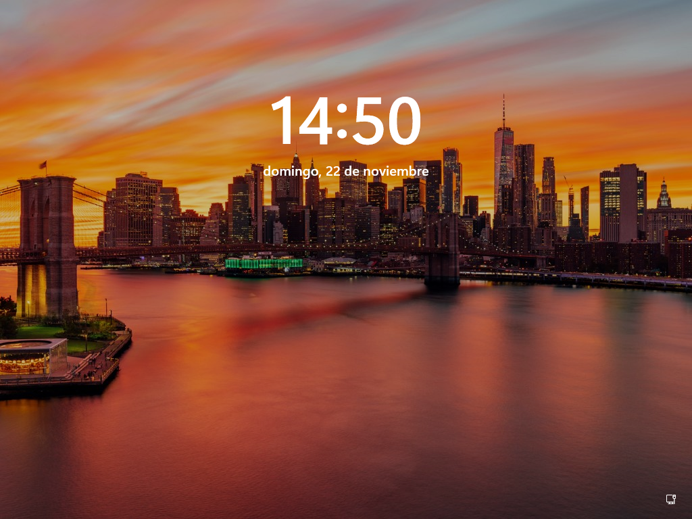
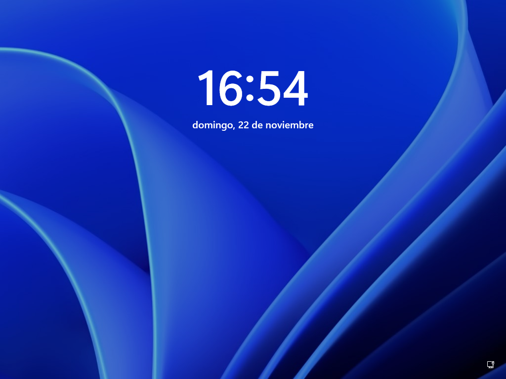

# `cli-win11` · Cliente Windows 11

| Dato | Valor |
|---|---|
| Función | Cliente Windows de la empresa (miembro previsto del dominio de `srv-dc`) |
| Sistema | Windows 11 (64 bits) instalado desde `w11.iso` |
| Recursos | 2 vCPU · 4 GB RAM · VDI dinámico de 80 GB (32,4 GB ocupados) |
| Firmware | **UEFI + Secure Boot + TPM 2.0** (requisitos obligatorios de Windows 11) |
| Gráfica | VBoxSVGA, 128 MB |
| Red | Adaptador 1: NAT (hoy) → previsto `lan-iso` por DHCP |
| Nombre anterior | «W11» (renombrada el 22/11) |
| Configuración VirtualBox | [config/virtualbox-showvminfo.txt](config/virtualbox-showvminfo.txt) |

> **Correcciones respecto a la documentación anterior:**
> 1. Se decía «instalación no verificada». **Está instalada y arranca**: el 22/11 llegó a la pantalla de bloqueo dos veces ([captura 1](capturas/w11-01-arranca-pantalla-bloqueo.png), [captura 2](capturas/w11-02-arranque-tras-apagado-forzado.png)). Los registros de VirtualBox muestran que Windows ya arrancaba en septiembre y octubre (`GIM: HyperV: Guest OS reported ID`).
> 2. El SHA256 documentado (`5f53774d…`, de un `win11.iso` 25H2) **no corresponde** a la imagen usada. La `w11.iso` del disco tiene `5210deed…89119dc8` (ver [T5](../../tareas/T5-sistemas-e-imagenes.md)). Microsoft no publica la suma de esa imagen, así que la integridad no se puede confirmar. Para una instalación nueva, usar la ISO de la web oficial y comparar con la suma que publica Microsoft en «Verificar la descarga».

## Estado por criterio

| Criterio | Estado | Evidencia |
|---|---|---|
| a247 Instalar y comprobar versión y funcionamiento | ✅ arranca · ⏳ falta captura de `winver` | Capturas de la pantalla de bloqueo |
| a248 Usuario de administración | ⏳ | Captura de `net user` / `whoami /groups` |
| a249 Parámetros de red | ⏳ | Pasar a `lan-iso` y captura de `ipconfig /all` |
| a250 Copiar configuraciones o imágenes al servidor de copias | ⏳ | Ver abajo |
| — Incidencia de apagado | ✅ diagnosticada y recuperada | [INC-003](../../incidencias/INC-003-cli-win11-apagado-colgado.md) |

## Pasos pendientes (dentro de Windows)

```powershell
winver                                   # captura de la versión y compilación
whoami /groups ; net localgroup Administradores
ipconfig /all                            # tras pasar el adaptador a lan-iso
# Copia de Documentos al NAS (cliente OpenSSH incluido en Windows 11):
Compress-Archive $env:USERPROFILE\Documents C:\Temp\cli-win11-docs.zip
scp C:\Temp\cli-win11-docs.zip cli-win11@192.168.29.10:/mnt/copias/cli-win11/
```

**Qué se copia y qué no:** solo los **datos del usuario** (Documentos, Escritorio). No se copia la imagen de 32 GB: Windows y las aplicaciones se reinstalan. En una empresa la reinstalación se automatizaría con una imagen maestra o Intune.

<!-- GALERIA:inicio -->

## Galería de evidencias

Todas las pruebas de esta máquina, en el orden en que se hicieron. Las capturas son de la propia VM; las salidas son el texto literal de los comandos ejecutados, con fecha y hora en la primera línea.

### Capturas

<details open><summary><b>01. Arranca pantalla bloqueo</b> · <code>w11-01-arranca-pantalla-bloqueo.png</code></summary>



</details>

<details open><summary><b>02. Arranque tras apagado forzado</b> · <code>w11-02-arranque-tras-apagado-forzado.png</code></summary>



</details>

<details open><summary><b>03. Apagado colgado pantalla negra</b> · <code>w11-03-apagado-colgado-pantalla-negra.png</code></summary>


</details>

<!-- GALERIA:fin -->
