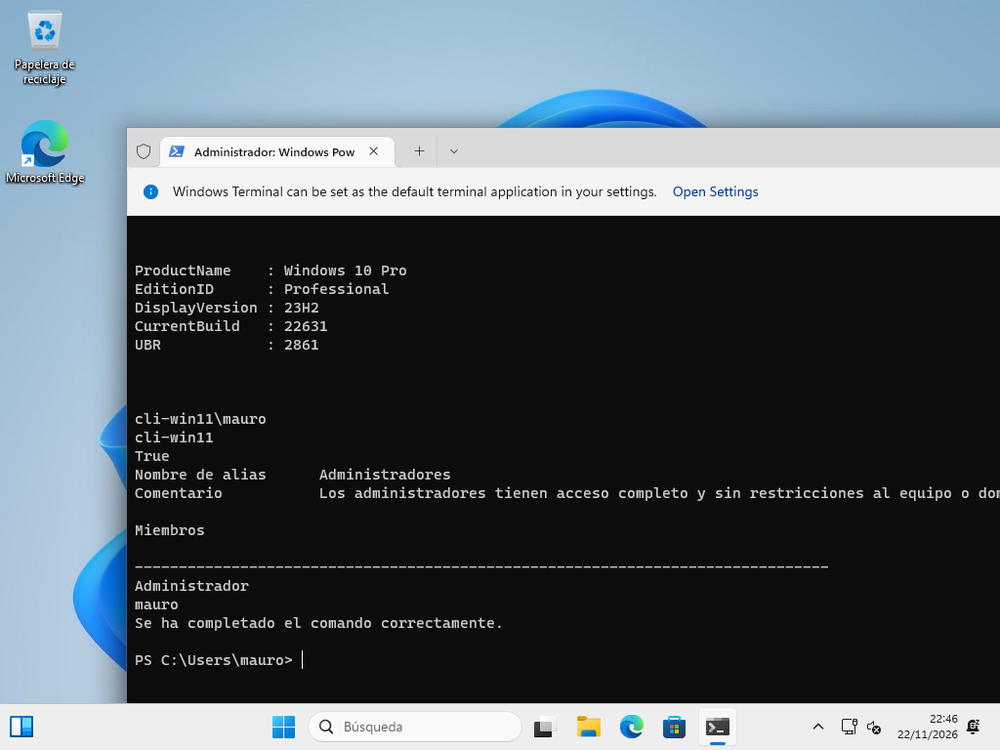
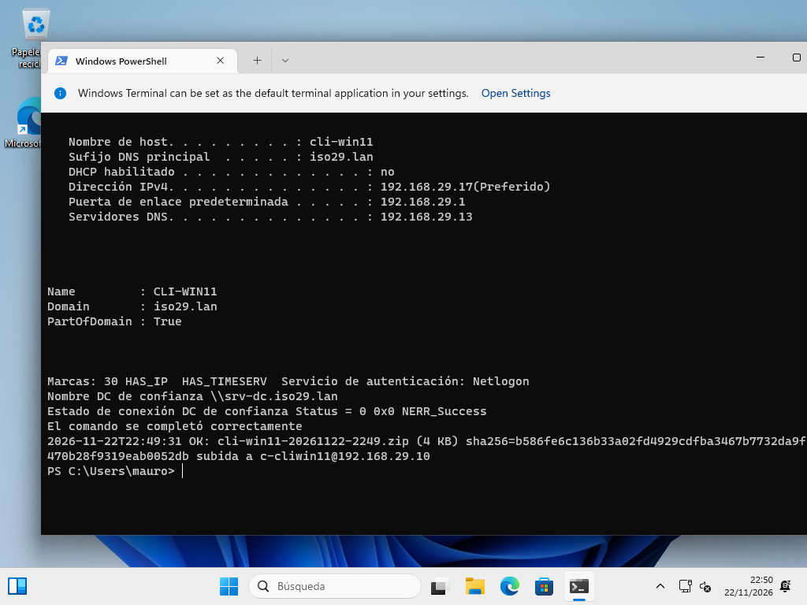
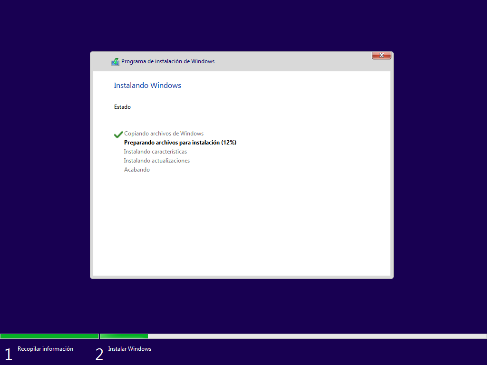
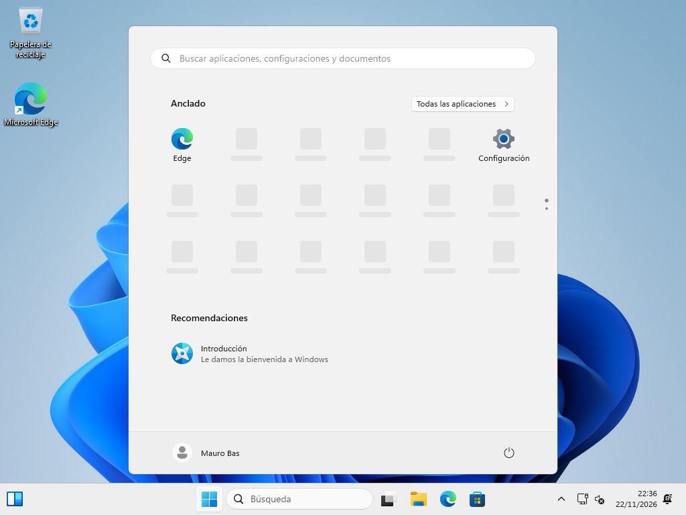

# `cli-win11` · Cliente Windows 11 (miembro del dominio `iso29.lan`)

| Dato | Valor |
|---|---|
| Función | Cliente Windows de la empresa, **unido al dominio** de `srv-dc` |
| Sistema | **Windows 11 Pro 23H2**, compilación **22631.2861** (es-ES), desde `isos/w11.iso` (índice 6 = Pro) |
| Instalación | **Desatendida** con `VBoxManage unattended install` (usuario, nombre de equipo, idioma, zona horaria y Guest Additions) |
| Recursos | 2 vCPU · 4 GB RAM · VDI dinámico de 64 GB · VBoxSVGA 128 MB |
| Firmware | UEFI + **TPM 2.0** (requisitos de Windows 11). Secure Boot **no activado** en esta VM (`Confirm-SecureBootUEFI` → `False`); Windows 11 exige un equipo *compatible* con Secure Boot, no que esté activo |
| Red | Adaptador 1 → red interna `lan-iso` · **192.168.29.17/24** fija · puerta .1 · DNS **.13** (`srv-dc`) · sufijo `iso29.lan` |
| Dominio | `iso29.lan`, cuenta de equipo en `OU=Equipos,OU=Empresa` |
| Copias | Tarea diaria 02:30 → `c-cliwin11@nas-truenas:/mnt/copias/cli-win11` |
| Configuración VirtualBox | [config/virtualbox-showvminfo.txt](config/virtualbox-showvminfo.txt) |

> **Por qué hay una VM nueva.** La VM original de septiembre se conserva intacta como `cli-win11-antiguo`: arrancaba hasta la pantalla de bloqueo ([w11-01](capturas/w11-01-arranca-pantalla-bloqueo.png)), pero no se conocía la contraseña de su cuenta, y saltarse el inicio de sesión no es una práctica aceptable. Se reinstaló de forma **desatendida** el 22/11. Problemas resueltos por el camino: la ISO se había movido a `isos/` (el UEFI daba *Boot failure*) y el archivo de respuesta necesitaba una clave de producto → se usó la **clave genérica de instalación de Windows 11 Pro** que publica Microsoft (instala, no activa).
>
> El SHA256 documentado antes (`5f53774d…`, de un `win11.iso` 25H2) **no corresponde** a la imagen usada (`5210deed…89119dc8`, ver [T5](../../tareas/T5-sistemas-e-imagenes.md)).

## Estado por criterio

| Criterio | Estado | Evidencia |
|---|---|---|
| **a247** Instalar y comprobar versión y funcionamiento | ✅ | [w11-04](capturas/w11-04-instalacion-desatendida-nueva.png) instalando · [w11-05](capturas/w11-05-escritorio-tras-instalar.png) escritorio · [w11-06](capturas/w11-06-version-23H2-y-mauro-administrador.png) versión · [01-version-y-usuario-admin.txt](salidas/01-version-y-usuario-admin.txt) |
| **a248** Usuario de administración | ✅ | [w11-06](capturas/w11-06-version-23H2-y-mauro-administrador.png) · [01-version-y-usuario-admin.txt](salidas/01-version-y-usuario-admin.txt) |
| **a249** Parámetros de red | ✅ | [w11-07](capturas/w11-07-red-fija-dominio-y-copia.png) · [02-red.txt](salidas/02-red.txt) · [03-union-dominio.txt](salidas/03-union-dominio.txt) |
| **a250** Copia al servidor de copias y qué se copia | ✅ | [04-copia-al-nas.txt](salidas/04-copia-al-nas.txt) · [script](config/copia-cli-win11.ps1) · [usuario en el NAS](../nas-truenas/salidas/06-usuario-copias-cli-win11.txt) |
| — Incidencia de apagado (VM antigua) | ✅ diagnosticada | [INC-003](../../incidencias/INC-003-cli-win11-apagado-colgado.md) |

## 1. Versión y funcionamiento (a247)

`Win32_OperatingSystem.Caption` = **Microsoft Windows 11 Pro**, `DisplayVersion` = **23H2**, compilación **22631.2861**, TPM presente y listo.

> Curiosidad que conviene saber explicar: el valor de registro `ProductName` sigue diciendo «Windows 10 Pro» (se ve en la captura). Es un resto conocido de Windows 11; lo que identifica la versión es la **compilación**: 22000+ = Windows 11 (22631 = 23H2). `winver` y `Win32_OperatingSystem` muestran «Windows 11».



## 2. Usuarios de administración (a248)

| Cuenta | Estado | Por qué |
|---|---|---|
| `mauro` (local) | Habilitada, grupo **Administradores** | Cuenta personal de administración, creada en la instalación desatendida |
| `Administrador` integrado | **Deshabilitada** | Nombre conocido y objetivo típico de ataques; solo para emergencias |
| `Invitado`, `DefaultAccount` | Deshabilitadas | No se usan |
| `ISO29\Domain Admins` | Añadido **automáticamente** a Administradores al unirse al dominio | Los administradores del dominio gestionan el equipo sin cuentas locales |

En el uso diario se trabaja con UAC: aunque `mauro` es administrador, los programas se ejecutan con permisos normales y Windows pide confirmación para elevar (por eso las órdenes de administración se lanzaron desde *Terminal (administrador)*).

## 3. Red (a249) y unión al dominio

```powershell
Rename-NetAdapter -Name Ethernet -NewName LAN-iso29
New-NetIPAddress -InterfaceAlias LAN-iso29 -IPAddress 192.168.29.17 -PrefixLength 24 -DefaultGateway 192.168.29.1
Set-DnsClientServerAddress -InterfaceAlias LAN-iso29 -ServerAddresses 192.168.29.13
Set-DnsClient -InterfaceAlias LAN-iso29 -ConnectionSpecificSuffix iso29.lan
Add-Computer -DomainName iso29.lan -OUPath "OU=Equipos,OU=Empresa,DC=iso29,DC=lan" -Credential ISO29\mauro -Restart
```

- **IP fija .17** (rango de servidores/equipos fijos .10–.19 de la [T4](../../tareas/T4-red-individual.md)): el equipo se localiza siempre en la misma IP.
- **DNS = `srv-dc` (.13)**, no el router: un cliente de dominio tiene que resolver los registros SRV (`_ldap._tcp.dc._msdcs.iso29.lan`) para encontrar el controlador; el DC reenvía el resto de consultas a Internet.
- Comprobado: ping al router, al DC y a 1.1.1.1 sin pérdidas, `tracert`, resolución de `srv-dc.iso29.lan`, del SRV LDAP y de un nombre de Internet, y LDAP (389/TCP) abierto en el DC.
- Tras el reinicio: `PartOfDomain = True`, `Test-ComputerSecureChannel` → `True`, `nltest /sc_query` → `NERR_Success` contra `\\srv-dc.iso29.lan`.



## 4. Copia al servidor de copias (a250)

| Qué | Cómo |
|---|---|
| Script | [`C:\ProgramData\copias\copia-cli-win11.ps1`](config/copia-cli-win11.ps1) |
| Cuándo | Tarea programada `\ISO29\Copia al NAS`, diaria a las 02:30, como **SYSTEM** (no depende de que haya nadie conectado) |
| Destino | `scp` a `c-cliwin11@192.168.29.10:/mnt/copias/cli-win11/` con **clave SSH** propia (sin contraseña; la clave privada solo la leen SYSTEM y Administradores) |
| Integridad | Se sube el `.sha256` junto al zip y se comprueba en el NAS con `sha256sum -c` → `OK` |
| Retención | Se guardan las **7** copias más recientes |
| Registro | `C:\ProgramData\copias\copia.log` |

**Qué se copia:** los **datos de los usuarios** (Documentos, Escritorio e Imágenes) y un **informe de configuración** (red, programas instalados, usuarios y grupos locales, dominio y versión).

**Qué no se copia, y por qué:**
- **Windows y los programas** (imagen de ~20 GB): se reinstalan en minutos con la misma instalación desatendida, y después se restauran los datos.
- **Temporales, cachés y el perfil completo**: se regeneran solos y ocupan mucho.
- **Credenciales y la clave de copia**: no deben salir del equipo.

En una empresa los datos de usuario estarían además en carpetas redirigidas al servidor (por GPO), y la reinstalación se haría con una imagen maestra o Intune.

<!-- GALERIA:inicio -->

## Galería de evidencias

Todas las pruebas de esta máquina, en el orden en que se hicieron. Las capturas son de la propia VM; las salidas son el texto literal de los comandos ejecutados, con fecha y hora en la primera línea.

### Salidas de comandos

| # | Fichero | Qué demuestra |
|---|---|---|
| 1 | [`01-version-y-usuario-admin.txt`](salidas/01-version-y-usuario-admin.txt) | cli-win11 · versión de Windows y usuario de administración — 2026-11-22T22:46:17 |
| 2 | [`02-red.txt`](salidas/02-red.txt) | cli-win11 · configuración de red (IP fija en lan-iso, DNS del dominio) — 2026-11-22T22:46:20 |
| 3 | [`03-union-dominio.txt`](salidas/03-union-dominio.txt) | cli-win11 · unión al dominio iso29.lan — 2026-11-22T22:46:54 |
| 4 | [`04-copia-al-nas.txt`](salidas/04-copia-al-nas.txt) | cli-win11 · copia automática al NAS (nas-truenas) — 2026-11-22T22:49:20 |

### Capturas

<details open><summary><b>01. Arranca pantalla bloqueo</b> · <code>w11-01-arranca-pantalla-bloqueo.png</code></summary>


</details>

<details open><summary><b>02. Arranque tras apagado forzado</b> · <code>w11-02-arranque-tras-apagado-forzado.png</code></summary>


</details>

<details open><summary><b>03. Apagado colgado pantalla negra</b> · <code>w11-03-apagado-colgado-pantalla-negra.png</code></summary>


</details>

<details open><summary><b>04. Instalacion desatendida nueva</b> · <code>w11-04-instalacion-desatendida-nueva.png</code></summary>



</details>

<details open><summary><b>05. Escritorio tras instalar</b> · <code>w11-05-escritorio-tras-instalar.png</code></summary>



</details>

<details open><summary><b>06. Version 23H2 y mauro administrador</b> · <code>w11-06-version-23H2-y-mauro-administrador.png</code></summary>


</details>

<details open><summary><b>07. Red fija dominio y copia</b> · <code>w11-07-red-fija-dominio-y-copia.png</code></summary>


</details>

<!-- GALERIA:fin -->
