# `nas-truenas` · NAS y servidor de copias (TrueNAS Community)

| Dato | Valor |
|---|---|
| Función | Servidor de copias de seguridad de todas las máquinas del laboratorio |
| Sistema | **TrueNAS 25.10.7 «Goldeye»** Community Edition |
| Imagen | `TrueNAS-SCALE-25.10.7.iso`, SHA256 `54ce9441…a007c8e` = **coincide** con el `.sha256` oficial |
| Recursos | 2 vCPU · **8 GB RAM** (mínimo oficial) · disco de sistema 20 GB · **disco de datos 20 GB** (`nas-truenas-copias.vdi`) · RTC en UTC |
| Red | `enp0s3` en `lan-iso`, **IP fija 192.168.29.10/24**, pasarela y DNS 192.168.29.1, nombre `nas-truenas.iso29.lan` |
| Administración | Web HTTPS y API (`midclt`), usuario `truenas_admin` (root sin contraseña de acceso); SSH solo con clave para administración |
| Pool | `copias` (ZFS, 1 disco, compresión LZ4) con **un dataset y un usuario por máquina** |

## Estado por criterio

| Criterio | Estado | Evidencia |
|---|---|---|
| **a224** Instalar, versión y funcionamiento | ✅ | Instalador [tn-01…05](capturas/) · panel con la versión [tn-06](capturas/tn-06-web-panel.png) |
| **a225** Usuarios de administración | ✅ | `truenas_admin` en la instalación ([tn-03](capturas/tn-03-usuario-truenas-admin.png)); root deshabilitado |
| **a226** Parámetros de red | ✅ | IP fija con *commit/checkin* · [03-red-ip-fija.txt](salidas/03-red-ip-fija.txt) · [tn-10](capturas/tn-10-web-red-ip-fija.png) · [INC-005](../../incidencias/INC-005-truenas-cambio-de-ip-revertido.md) |
| **a227** Disco adicional para las copias de los equipos críticos | ✅ | Disco de 20 GB separado del sistema → pool `copias` · [tn-07](capturas/tn-07-web-almacenamiento-pool.png) |
| **a259** Preparar el espacio de copias y justificar qué, cómo y dónde | ✅ | Datasets y usuarios por máquina · [01-pool-datasets.txt](salidas/01-pool-datasets.txt) · [02-usuarios-y-ssh.txt](salidas/02-usuarios-y-ssh.txt) · [tn-08](capturas/tn-08-web-datasets.png) · [tn-09](capturas/tn-09-web-usuarios.png) |
| Recibe copias reales | ✅ | `r-mikrotik`, `r-nftables`, `srv-linux`, `r-opnsense`, `srv-dc` y `cli-linux` · [04-copias-recibidas.txt](salidas/04-copias-recibidas.txt) y las salidas de cada máquina |

## 1. Instalación

Instalador de texto ([capturas tn-01…05](capturas/)): *Install/Upgrade* → disco `sda` para el sistema (el segundo disco se deja libre para datos) → usuario administrativo `truenas_admin` con contraseña → *Allow EFI boot: Yes* (arranque híbrido BIOS/UEFI) → *Installation Succeeded* → quitar la ISO y arrancar desde el disco.

## 2. Diseño del espacio de copias (a259)

| Decisión | Justificación |
|---|---|
| **Disco de datos aparte del de sistema** | Se puede reinstalar TrueNAS sin tocar las copias. El instalador reserva el disco de sistema entero |
| **ZFS con compresión LZ4** | Las configuraciones son texto y comprimen mucho (ratio 3,26×). ZFS guarda sumas de control y detecta corrupción |
| **Un dataset por máquina** (`copias/r-mikrotik`, `copias/r-nftables`, `copias/srv-linux`, `copias/srv-dc`, `copias/proxmox`, `copias/cli-win11`, `copias/cli-linux`, `copias/r-opnsense`) | Cuotas, instantáneas y permisos independientes para cada una |
| **Un usuario por máquina** (`c-mikrotik`, `c-nftables`, `c-srvlinux`…) con `home` = su dataset y permisos `700` | Si se compromete un equipo, solo puede leer o borrar **sus** copias (privilegio mínimo). `truenas_admin` tampoco puede listarlas sin la API |
| **SFTP con clave ed25519**, sin contraseña | No hay contraseñas guardadas en los servidores. Excepción: MikroTik (`/tool fetch` no admite claves) |
| SSH sin cifrados débiles | `weak_ciphers: []` (venían `AES128-CBC` y `NONE` activados) |

| Máquina | Qué copia | Cómo | Cuándo |
|---|---|---|---|
| `r-mikrotik` | Backup cifrado + export | `/tool fetch` SFTP (contraseña) | Diario 02:30 (`/system scheduler`) |
| `r-nftables` | Configuración del router (4 KB) | `copia-config.sh` → SFTP (clave) | Diario 02:00 (systemd) |
| `srv-linux` | `/etc` + paquetes + RAID (408 KB) | `copia-config.sh` → SFTP (clave) | Diario 02:00 (systemd) |
| `r-opnsense` | `config.xml` **cifrado AES-256** (44 KB) | `copia-opnsense.sh` → SFTP (clave) | Bajo demanda / antes de cada cambio |
| `srv-dc` | AD (`ntdsutil ifm`) + SYSVOL + GPO + CSV (4,7 MB) | `copia-ad.ps1` → SCP (clave) | Diario 02:30 (tarea programada, SYSTEM) |
| `cli-linux` | `/etc` + paquetes + `/home/mauro` (1,1 MB) | `copia-config.sh` → SFTP (clave) | Diario 02:00 (systemd) |
| `cli-win11` | Datos de usuario + informe de configuración (zip + SHA256) | `copia-cli-win11.ps1` → SCP (clave, usuario `c-cliwin11`) | Diario 02:30 (tarea programada, SYSTEM) |
| `proxmox` | `vzdump` de CT y VM (161 + 550 MB) + `/etc/pve` | **NFS** solo para los 3 nodos → almacenamiento `nas-copias` | Diario 03:00 (`copia-diaria-nas`) |

## 3. Limitaciones (honestas)

- **Un solo disco** (*stripe*): ZFS detecta errores pero no puede repararlos. En producción harían falta dos discos en espejo.
- El NAS está **en el mismo equipo físico** que lo que protege. La regla **3-2-1** pide además una copia fuera, por ejemplo otro disco o la nube.
- En casa (16 GB), TrueNAS con 8 GB obliga a apagar otras VM ([T7](../../tareas/T7-rendimiento.md)).

<!-- GALERIA:inicio -->

## Galería de evidencias

Todas las pruebas de esta máquina, en el orden en que se hicieron. Las capturas son de la propia VM; las salidas son el texto literal de los comandos ejecutados, con fecha y hora en la primera línea.

### Salidas de comandos

| # | Fichero | Qué demuestra |
|---|---|---|
| 1 | [`01-pool-datasets.txt`](salidas/01-pool-datasets.txt) | nas-truenas · zona horaria, pool y datasets con la API (midclt) — 2026-11-22T18:05:17+01:00 |
| 2 | [`02-usuarios-y-ssh.txt`](salidas/02-usuarios-y-ssh.txt) | nas-truenas · un usuario por máquina para las copias por SFTP — 2026-11-22T18:06:11+01:00 |
| 3 | [`03-red-ip-fija.txt`](salidas/03-red-ip-fija.txt) | nas-truenas · red con IP fija (commit + checkin) — 2026-11-22T18:06:28+01:00 |
| 4 | [`04-copias-recibidas.txt`](salidas/04-copias-recibidas.txt) | nas-truenas · copias recibidas en cada carpeta — 2026-11-22T18:22:35+01:00 |
| 5 | [`05-nfs-para-proxmox.txt`](salidas/05-nfs-para-proxmox.txt) | nas-truenas · recurso NFS para las copias del clúster Proxmox — 2026-11-22T21:46:28+01:00 |
| 6 | [`06-usuario-copias-cli-win11.txt`](salidas/06-usuario-copias-cli-win11.txt) | nas-truenas · dataset y usuario de copias para cli-win11 — 2026-11-22T22:44:35+01:00 |

### Capturas

<b>01. Instalador menu</b> · <code>tn-01-instalador-menu.png</code>

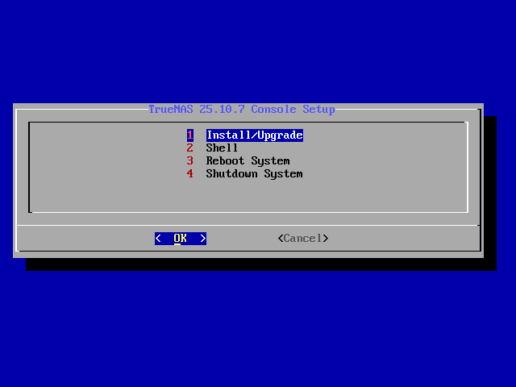

<b>02. Disco sistema sda</b> · <code>tn-02-disco-sistema-sda.png</code>

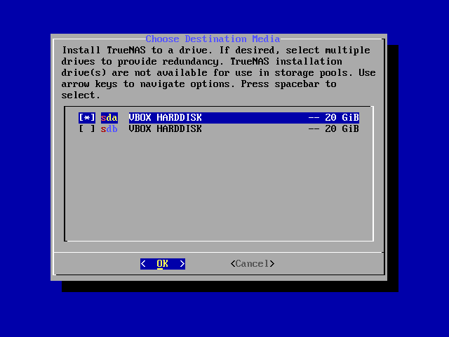

<b>03. Usuario truenas admin</b> · <code>tn-03-usuario-truenas-admin.png</code>

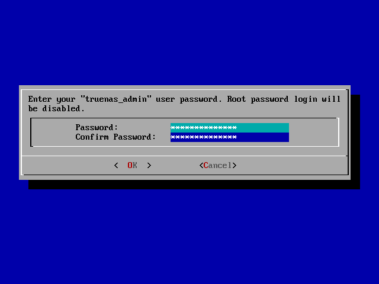

<b>04. Instalando</b> · <code>tn-04-instalando.png</code>

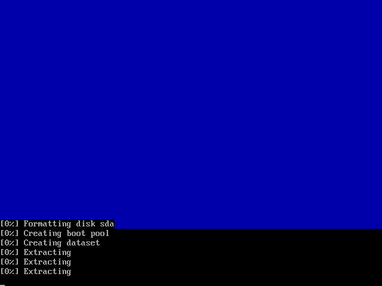

<b>05. Instalacion correcta</b> · <code>tn-05-instalacion-correcta.png</code>

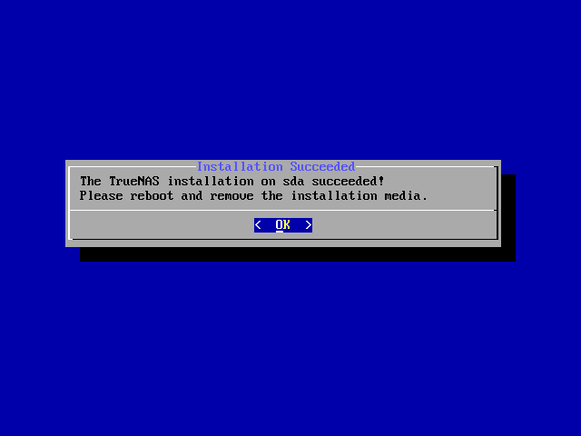

<b>06. Web panel</b> · <code>tn-06-web-panel.png</code>

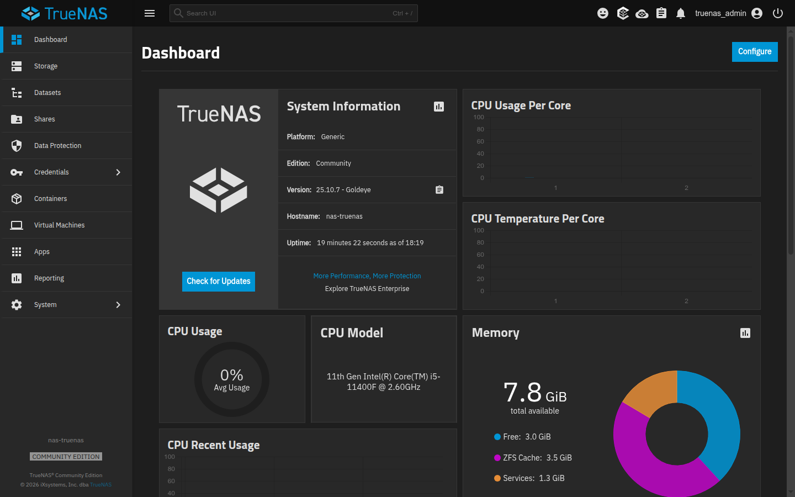

<b>07. Web almacenamiento pool</b> · <code>tn-07-web-almacenamiento-pool.png</code>

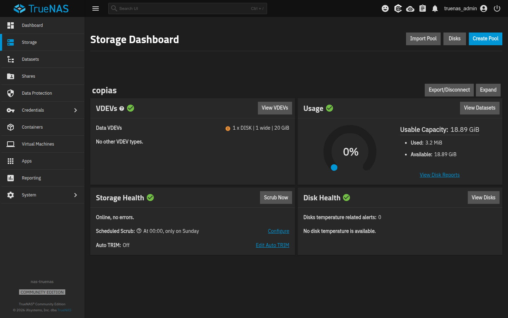

<b>08. Web datasets</b> · <code>tn-08-web-datasets.png</code>

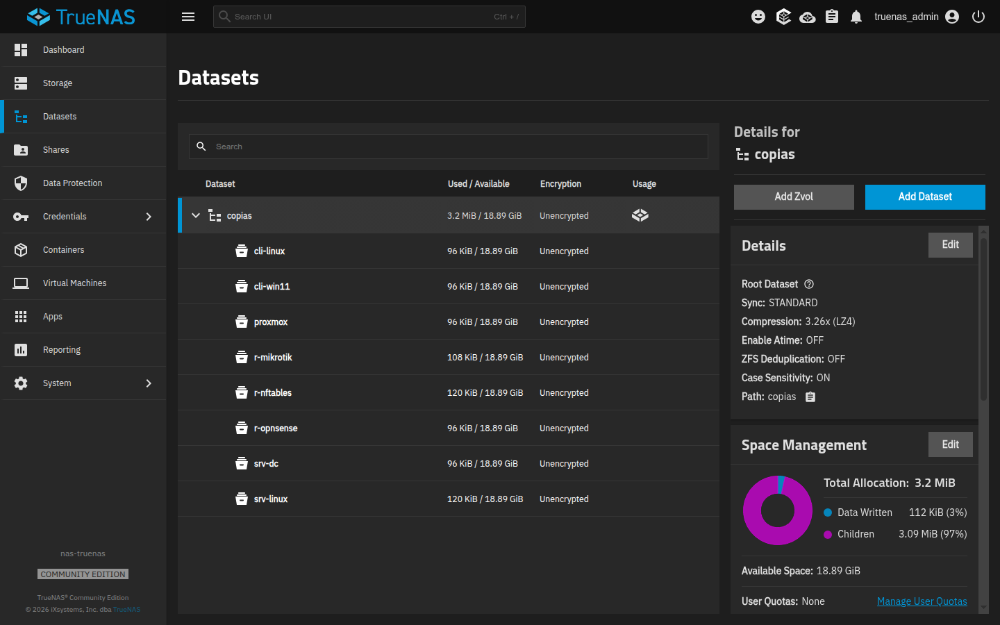

<b>09. Web usuarios</b> · <code>tn-09-web-usuarios.png</code>

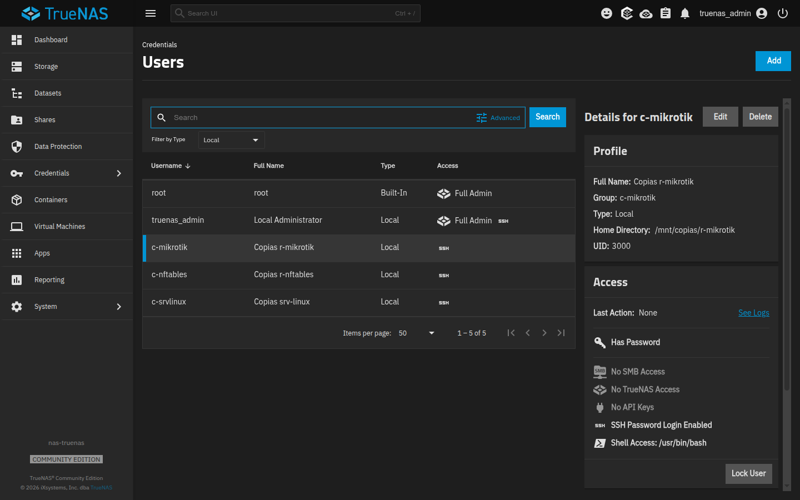

<b>10. Web red ip fija</b> · <code>tn-10-web-red-ip-fija.png</code>

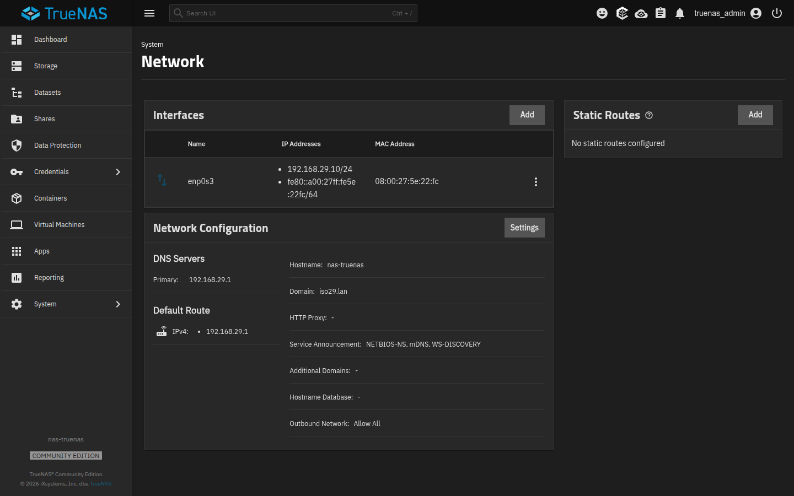

<b>11. Web servicios ssh</b> · <code>tn-11-web-servicios-ssh.png</code>

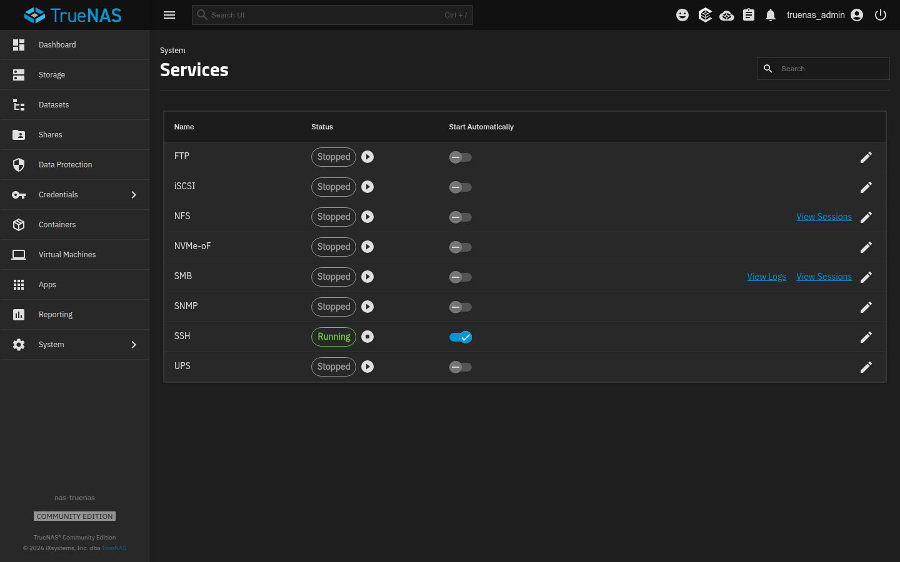

<!-- GALERIA:fin -->
