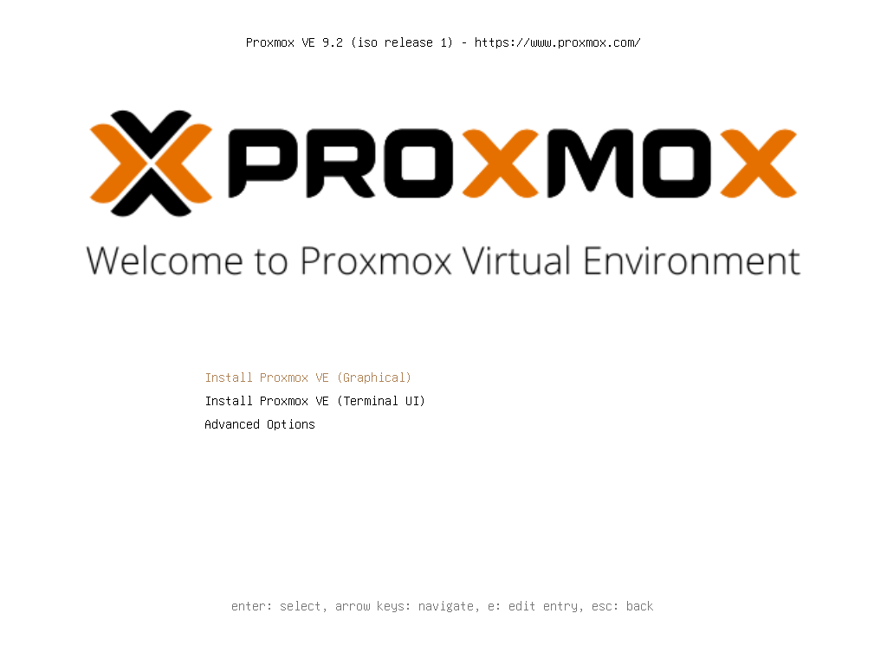
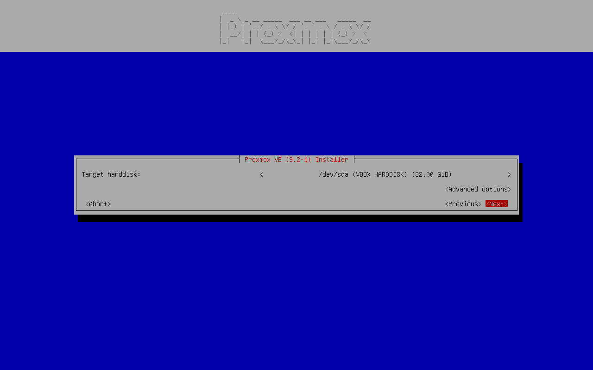
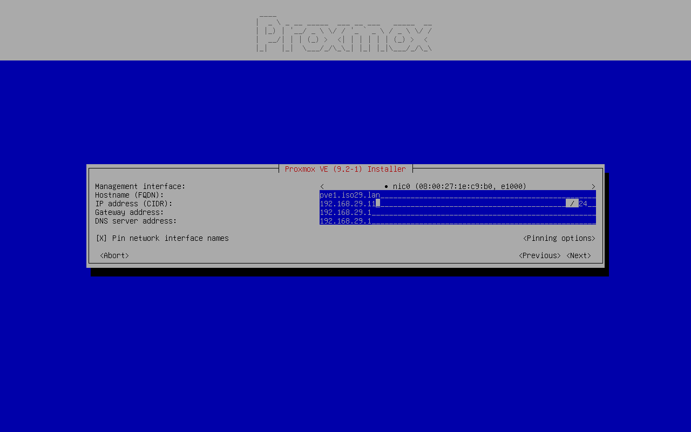
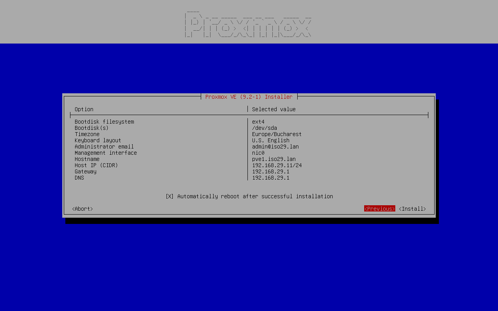
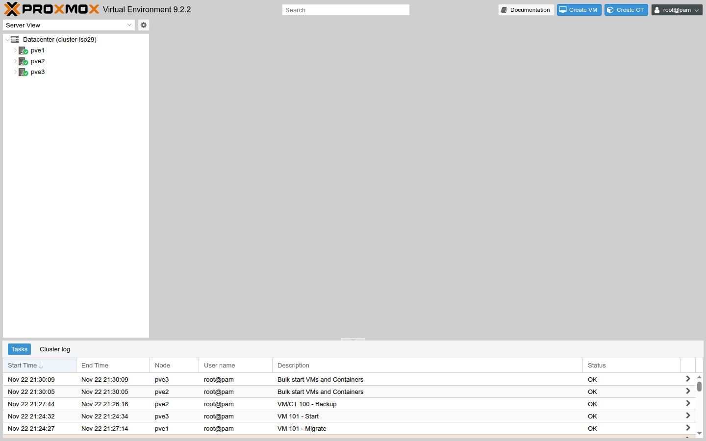
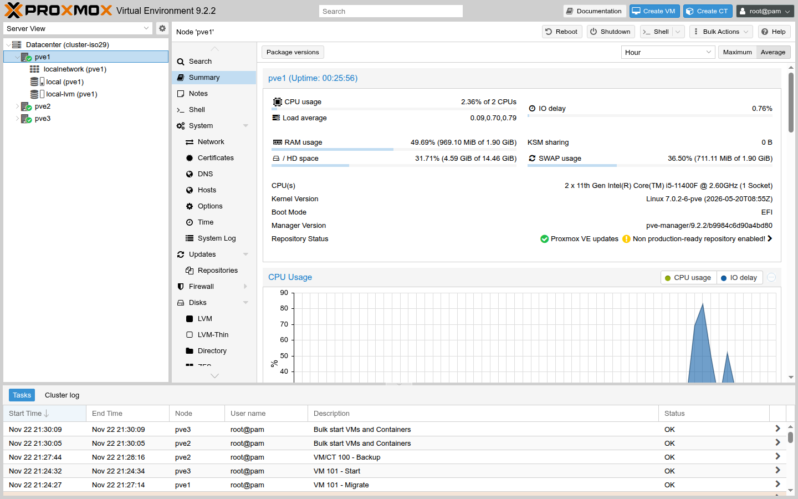
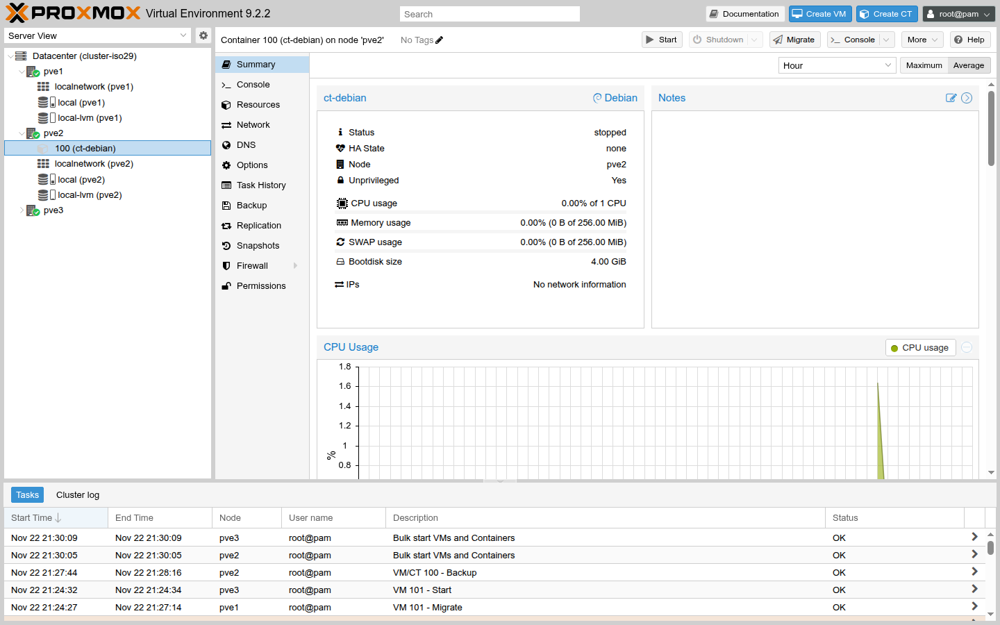
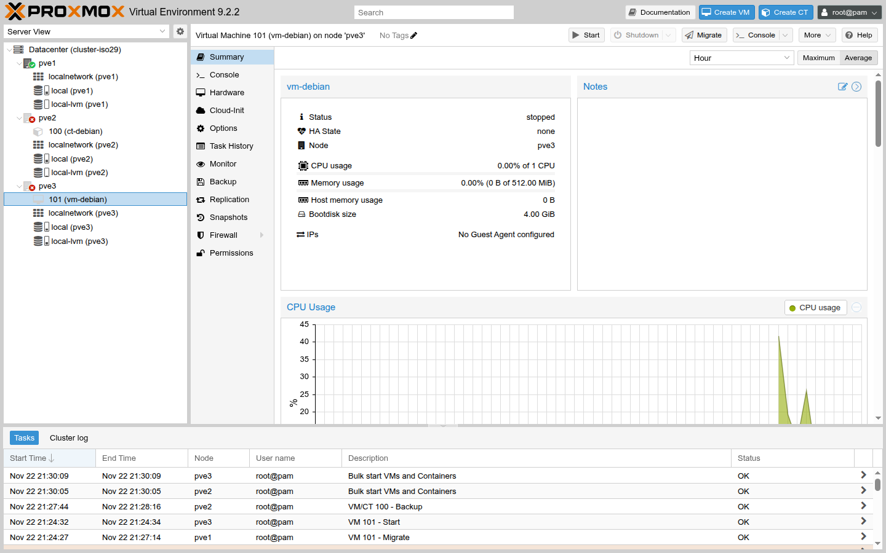

# `pve1` · `pve2` · `pve3` · Clúster Proxmox VE `cluster-iso29`

| Dato | `pve1` | `pve2` | `pve3` |
|---|---|---|---|
| Sistema | **Proxmox VE 9.2.32** (núcleo 7.0.14-30-pve; instalado como 9.2.2 y actualizado el 22/11) | igual | igual |
| IP fija (`vmbr0` sobre `nic0`) | 192.168.29.11 | 192.168.29.12 | 192.168.29.15 |
| Recursos | 2 vCPU · **2 GB** · 32 GB · UEFI · VT-x anidada | igual | igual |
| Imagen | `proxmox-ve_9.2-1.iso`, SHA256 `4e88fe41…3ef2c6c` = **coincide** con `SHA256SUMS` oficial | | |

> **Adaptación al equipo de casa:** el diseño preveía 4 GB por nodo (12 GB en total), que no caben junto al router en 16 GB. Se instalaron con **2 GB** (el mínimo práctico de Proxmox con VM pequeñas) y se apagaron TrueNAS y los clientes durante estas pruebas ([T7](../../tareas/T7-rendimiento.md)).

Toda la configuración posterior a la instalación se hizo por la **API REST de Proxmox** (`/api2/json`), desde el anfitrión y a través de un túnel SSH por la LAN. Cada orden y su respuesta están en `salidas/`.

## Estado por criterio

| Criterio | Estado | Evidencia |
|---|---|---|
| **a228** Instalar, versión y funcionamiento | ✅ | Instalador de texto ([pve-01…04](capturas/), [pve2](../pve2/capturas/), [pve3](../pve3/capturas/)) · `GET /version` → 9.2.2 · [01-nodos-version-zona-repos.txt](salidas/01-nodos-version-zona-repos.txt) |
| **a229** Usuario de administración | ✅ | `mauro@pve` con rol **Administrator** en `/`, replicado a los 3 nodos · [02-cluster.txt](salidas/02-cluster.txt) |
| **a230** Parámetros de red | ✅ | `vmbr0` con IP fija, pasarela y DNS .1 en los tres |
| **a232** Clúster con los nodos disponibles | ✅ | `cluster-iso29`: 3 nodos, `quorate=1` · [pve-05](capturas/pve-05-web-datacenter-cluster.png) |
| **a235** Migrar un contenedor y una VM (Debian sin escritorio) | ✅ | CT 100 pve1 → pve2 (restart) · VM 101 pve1 → pve3 **en caliente** · [04-migraciones-medidas.txt](salidas/04-migraciones-medidas.txt) |
| **a236** Tiempo y espacio de la migración; interpretar y proponer mejoras | ✅ | §4 |
| **a231** Copiar configuraciones o imágenes al servidor correspondiente | ✅ | `vzdump` del CT 100 (161 MB) y de la VM 101 (550 MB) **en el NAS** por NFS (`nas-copias`) + `/etc/pve` en tar.gz + tarea diaria `copia-diaria-nas` 03:00 (7 copias) · [06-copias-al-nas-nfs.txt](salidas/06-copias-al-nas-nfs.txt) · [05-copia-vzdump-y-quorum.txt](salidas/05-copia-vzdump-y-quorum.txt) |
| **a79** Actualizar y comprobar antes de producción | ✅ | Repositorio `pve-no-subscription`; **9.2.2 → 9.2.32**, núcleo **7.0.2-6 → 7.0.14-30** en los tres nodos; la primera actualización se cortó al apagar las VM y se **reparó** (`dpkg --configure -a`, `apt-get -f install`); reinicio de uno en uno sin perder el quórum; `dpkg --audit` vacío, 0 paquetes pendientes · [07-actualizacion-de-los-nodos.txt](salidas/07-actualizacion-de-los-nodos.txt) |

## 1. Instalación (Terminal UI)

ISO verificada → *Install Proxmox VE (Terminal UI)* → EULA → disco `/dev/sda` (ext4) → país y zona → contraseña de root y correo → red (FQDN `pveN.iso29.lan`, IP fija, pasarela y DNS .1) → resumen → instalar ([pve-04](capturas/pve-04-resumen-instalacion.png)).

Problemas encontrados (todos resueltos):

| Problema | Causa | Solución |
|---|---|---|
| País «Romania» y zona Bucharest (pve1); zona Vienna y **teclado alemán** (pve2 y pve3) | El instalador los propone por geolocalización IP | Zona corregida después con `PUT /nodes/{n}/time timezone=Europe/Madrid` |
| El correo salía `admin"iso29.lan` o `adminÄiso29.lan` | Con teclado alemán, `@` es AltGr+Q | Se escribió con AltGr+Q. La contraseña no tenía Y ni Z, así que no le afectó el intercambio Y/Z |
| pve3 con pasarela y DNS `192.168.100.1` | No recibió DHCP a tiempo y el instalador rellenó sus valores por defecto | Se corrigió en el resumen ([pve3-01](../pve3/capturas/pve3-01-resumen-instalacion.png)) |
| Plantillas y paquetes no se descargan | Proxmox usa **HTTP** y la LAN lo tiene bloqueado | En OPNsense, alias `nodos_proxmox` y regla 49 `PERMITIDO-HTTP-PROXMOX` **solo para los nodos** ([evidencia](../r-opnsense/salidas/05-http-para-nodos-proxmox.txt)) |

## 2. Clúster y quórum (a232)

```text
POST /cluster/config  clustername=cluster-iso29                      (pve1)
GET  /cluster/config/join                → huella del certificado de pve1
POST /cluster/config/join hostname=192.168.29.11 fingerprint=… password=…  (pve2 y pve3)
```

**Prueba de quórum** ([05-copia-vzdump-y-quorum.txt](salidas/05-copia-vzdump-y-quorum.txt)):

| Nodos encendidos | `quorate` | ¿Se puede cambiar la configuración? |
|---|---|---|
| 3 de 3 | 1 | Sí |
| **2 de 3** (pve3 apagado de golpe) | **1** | **Sí** (`PUT /cluster/options` → OK) |
| **1 de 3** (pve2 también apagado) | **0** | **No**: `cfs-lock … error: no quorum!` |
| 3 de 3 otra vez | 1 | Se recupera solo en ~40 s |

**Por qué 3 nodos:** el clúster solo funciona con **mayoría** de votos. Con 2 nodos, al caer uno el otro queda en minoría y se bloquea para no arriesgar un *split-brain* (que los dos lados arranquen la misma VM).

## 3. Contenedor y VM (Debian sin escritorio)

| ID | Tipo | Nombre | Origen | Recursos | IP |
|---|---|---|---|---|---|
| 100 | Contenedor LXC (sin privilegios) | `ct-debian` | Plantilla `debian-13-standard_13.6-1_amd64.tar.zst` (123 MB) | 1 CPU · 256 MB · 4 GB | 192.168.29.20 |
| 101 | VM KVM | `vm-debian` | Imagen oficial `debian-13-genericcloud-amd64.qcow2` (328 MB) + cloud-init | 1 vCPU · 512 MB · 4 GB | 192.168.29.21 |

Las dos respondieron al ping desde la LAN ([03-contenedor-y-vm.txt](salidas/03-contenedor-y-vm.txt)).

## 4. Migraciones medidas (a235, a236)

| | Contenedor 100 → pve2 | VM 101 → pve3 |
|---|---|---|
| Modo | `restart` (se para, se copia y se arranca) | **En caliente** (`online=1`, `with-local-disks=1`) |
| Duración total | **90,6 s** | **167,5 s** |
| Corte según Proxmox | — (se reinicia) | **172 ms** (*downtime*) |
| Tiempo sin responder al ping desde la LAN (cada 0,2 s) | **9,4 s** | **7,4 s** |
| Datos copiados | Disco de 4 GB (571 MB usados) | 459,7 MiB de memoria + disco de 4 GB (*mirror* por NBD) |
| Velocidad | — | 42,7 MiB/s de media |

**Interpretación:**

- El contenedor no puede migrar en caliente porque comparte el núcleo del nodo; se para y se arranca en el destino. Son unos 9 s sin servicio.
- La VM se migra mientras funciona: primero se copia el disco y la memoria, después solo lo que cambia, y al final se pausa **172 ms** para el último trozo. Los 7,4 s sin ping desde la LAN no son la VM parada: es lo que tarda la red virtual en enterarse de que la MAC está ahora en otro nodo (convergencia ARP del *switch* `lan-iso`).
- Casi todo el tiempo se va en **copiar el disco por la red**, porque el almacenamiento es local (`local-lvm`) en cada nodo.

**Mejoras propuestas:**
1. **Almacenamiento compartido** (NFS desde `nas-truenas` o Ceph): la migración solo copiaría la memoria (unos segundos en vez de casi 3 minutos).
2. Una red dedicada a la migración, separada de la de los usuarios.
3. Disco del laboratorio en USB 3 ([INC-002](../../incidencias/INC-002-ssd-portatil-en-usb2.md)): todos los «discos» de los nodos están en el mismo SSD.

## 5. Copia (a231)

`vzdump` del contenedor 100 en pve2 (modo *snapshot*, zstd): **160 MB en 32 s**. **Qué se copia:** las VM y los contenedores (`vzdump`) y `/etc/pve` (configuración del clúster, replicada en los tres nodos). **Qué no:** el propio Proxmox, que se reinstala desde la ISO en 10 minutos y se vuelve a unir al clúster. **Copia al NAS (22/11):** TrueNAS comparte `/mnt/copias/proxmox` por **NFS solo a las IP de los tres nodos** ([05-nfs-para-proxmox.txt](../nas-truenas/salidas/05-nfs-para-proxmox.txt)); en el clúster se añadió como almacenamiento `nas-copias` (`pvesm add nfs`, contenido `backup`, `prune-backups keep-last=7`). Se copiaron allí el CT 100 (161 MB) y la VM 101 (550 MB, 2 min 26 s), más un `tar.gz` de `/etc/pve`, y se programó la tarea de clúster `copia-diaria-nas` (todas las VM y CT, 03:00, *snapshot*, zstd) → [06-copias-al-nas-nfs.txt](salidas/06-copias-al-nas-nfs.txt).

> Tras la prueba de quórum, el contenedor 100 quedó parado ([pve-07](capturas/pve-07-web-contenedor-100-en-pve2.png)) porque pve2 se apagó en frío y el contenedor no tiene `onboot=1`.

<!-- GALERIA:inicio -->

## Galería de evidencias

Todas las pruebas de esta máquina, en el orden en que se hicieron. Las capturas son de la propia VM; las salidas son el texto literal de los comandos ejecutados, con fecha y hora en la primera línea.

### Salidas de comandos

| # | Fichero | Qué demuestra |
|---|---|---|
| 1 | [`01-nodos-version-zona-repos.txt`](salidas/01-nodos-version-zona-repos.txt) | Clúster Proxmox · preparación de los 3 nodos por la API REST (/api2/json) — 2026-11-22T21:14:10+01:00 |
| 2 | [`02-cluster.txt`](salidas/02-cluster.txt) | Clúster Proxmox cluster-iso29 — 2026-11-22T21:15:48+01:00 |
| 3 | [`03-contenedor-y-vm.txt`](salidas/03-contenedor-y-vm.txt) | Clúster · contenedor 100 y VM 101 en pve1 — 2026-11-22T21:18:59+01:00 |
| 4 | [`04-migraciones-medidas.txt`](salidas/04-migraciones-medidas.txt) | Clúster · migraciones medidas — 2026-11-22T21:22:48+01:00 |
| 5 | [`05-copia-vzdump-y-quorum.txt`](salidas/05-copia-vzdump-y-quorum.txt) | Clúster · copia vzdump del contenedor y prueba de quórum — 2026-11-22T21:27:43+01:00 |
| 6 | [`06-copias-al-nas-nfs.txt`](salidas/06-copias-al-nas-nfs.txt) | Clúster Proxmox · copias al NAS por NFS — 2026-11-22T21:46:39+01:00 |
| 7 | [`07-actualizacion-de-los-nodos.txt`](salidas/07-actualizacion-de-los-nodos.txt) | Clúster Proxmox · actualización de los tres nodos antes de producción — 2026-11-22T23:20:28+01:00 |

### Capturas

<details open><summary><b>01. Arranque iso 9.2</b> · <code>pve-01-arranque-iso-9.2.png</code></summary>



</details>

<details open><summary><b>02. Disco destino</b> · <code>pve-02-disco-destino.png</code></summary>



</details>

<details open><summary><b>03. Red ip fija</b> · <code>pve-03-red-ip-fija.png</code></summary>



</details>

<details open><summary><b>04. Resumen instalacion</b> · <code>pve-04-resumen-instalacion.png</code></summary>



</details>

<details open><summary><b>05. Web datacenter cluster</b> · <code>pve-05-web-datacenter-cluster.png</code></summary>



</details>

<details open><summary><b>06. Web nodo pve1</b> · <code>pve-06-web-nodo-pve1.png</code></summary>



</details>

<details open><summary><b>07. Web contenedor 100 en pve2</b> · <code>pve-07-web-contenedor-100-en-pve2.png</code></summary>



</details>

<details open><summary><b>08. Web vm 101 en pve3</b> · <code>pve-08-web-vm-101-en-pve3.png</code></summary>



</details>

<!-- GALERIA:fin -->
