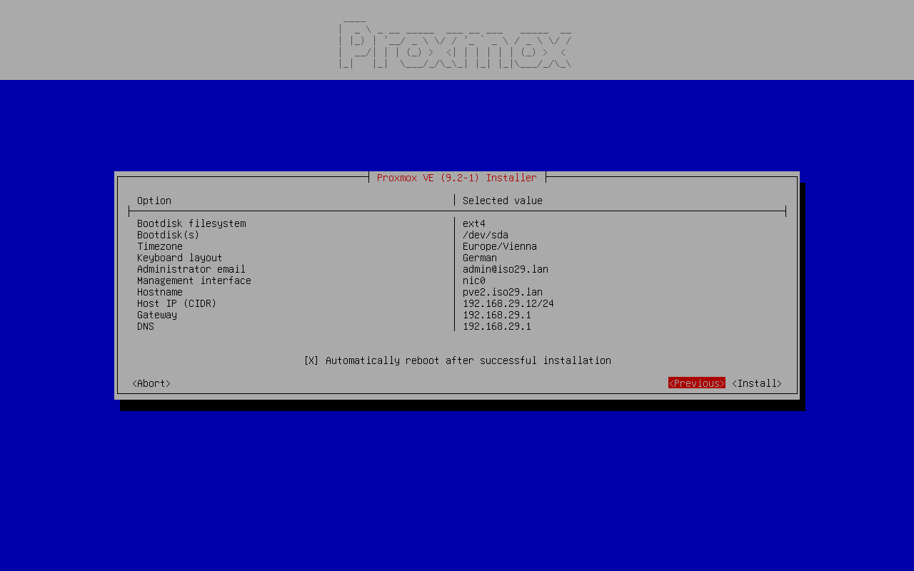

# `pve2` · Nodo del clúster Proxmox `cluster-iso29`

Ficha completa del clúster (instalación, quórum, migraciones y copias): [pve1](../pve1/README.md).

| Dato | Valor |
|---|---|
| IP | 192.168.29.12 |
| Captura del resumen de instalación | [capturas/](capturas/) |
| Configuración VirtualBox | [config/virtualbox-showvminfo.txt](config/virtualbox-showvminfo.txt) |

<!-- GALERIA:inicio -->

## Galería de evidencias

Todas las pruebas de esta máquina, en el orden en que se hicieron. Las capturas son de la propia VM; las salidas son el texto literal de los comandos ejecutados, con fecha y hora en la primera línea.

### Capturas

<b>01. Resumen instalacion</b> · <code>pve2-01-resumen-instalacion.png</code>

<!-- GALERIA:fin -->
