# `r-mikrotik` · Router 1 · MikroTik RouterOS CHR

| Dato | Valor |
|---|---|
| Función | Router y cortafuegos de la LAN (alternativa 1 de 3) |
| Sistema | MikroTik **RouterOS 7.24.5 (stable)**, imagen CHR (*Cloud Hosted Router*) para x86-64 |
| Imagen | `chr-7.24.5.vdi.zip`, SHA256 `c5e33cbc…f643c4c66` = **coincide** con el `.sha256` oficial de download.mikrotik.com |
| Licencia | CHR gratuita (*free*): todas las funciones, subida limitada a 1 Mbit/s por interfaz. Suficiente para el laboratorio |
| Recursos | 1 vCPU · 256 MB RAM (usa ~183 MB reales en el anfitrión) · disco de 89 MB |
| Red | `ether1` = WAN (NAT de VirtualBox, DHCP 10.0.2.15) · `ether2` = LAN `lan-iso` **192.168.29.1/24** |
| Administración | SSH con clave y WebFig (reenvíos de VirtualBox: `127.0.0.1:2211→22`, `127.0.0.1:8011→80`) |
| Configuración | [config/r-mikrotik-export.rsc](config/r-mikrotik-export.rsc) (export completo, sin contraseñas) · [VirtualBox](config/virtualbox-showvminfo.txt) |

## Estado por criterio de la rúbrica

| Criterio | Estado | Evidencia |
|---|---|---|
| **a203** Instalar, comprobar versión y funcionamiento | ✅ | [mk-01](capturas/mk-01-arranque-chr-7.24.5.png) · [mk-04](capturas/mk-04-version-recursos.png) · [01-version-estado-inicial.txt](salidas/01-version-estado-inicial.txt) |
| **a204** Usuarios de administración | ✅ | Usuario `mauro` (grupo *full*, clave SSH) y `admin` **desactivado** · [mk-09](capturas/mk-09-usuarios.png) · [03-usuarios.txt](salidas/03-usuarios.txt) |
| **a205** Red WAN y LAN | ✅ | [mk-05](capturas/mk-05-interfaces-ip.png) · [mk-11](capturas/mk-11-webfig-interfaces.png) · [mk-12](capturas/mk-12-webfig-direcciones.png) |
| **a206** Acceso a Internet desde la LAN | ✅ | DHCP, DNS y NAT ([mk-06a](capturas/mk-06a-dhcp.png), [mk-06b](capturas/mk-06b-dns.png), [mk-07](capturas/mk-07-nat.png), [mk-14](capturas/mk-14-webfig-nat.png)); `srv-linux` sale a Internet ([T4](../../tareas/T4-red-individual.md)) |
| **a207** Conexión permitida y bloqueada; interpretar el registro | ✅ | [mk-08](capturas/mk-08-reglas-filtro.png) · [mk-10](capturas/mk-10-log-permitido-y-bloqueado.png) · [mk-13](capturas/mk-13-webfig-reglas-filtro.png) · [mk-15](capturas/mk-15-webfig-log.png) · [04-registro-cortafuegos.txt](salidas/04-registro-cortafuegos.txt) |
| **a208** Copia de la configuración en el servidor de copias | ✅ | Script + planificador diario → SFTP a `nas-truenas` · [06-copia-al-nas.txt](salidas/06-copia-al-nas.txt) · [INC-006](../../incidencias/INC-006-mikrotik-sftp-status-4.md) |
| **a209** Fallo provocado y recuperación | ✅ | NAT borrada → restaurado desde el NAS en **39 s** · [07-fallo-y-recuperacion.txt](salidas/07-fallo-y-recuperacion.txt) · [mk-16…19](capturas/) |
| a105 (Apte+) Automatizar las copias | ✅ | `/system scheduler` `copia-diaria` a las 02:30 |

## 1. Instalación

RouterOS CHR se distribuye como **disco virtual ya instalado**, no como ISO: se descarga el `.vdi`, se comprueba el SHA256 y se conecta a la VM.

```bash
sha256sum chr-7.24.5.vdi.zip          # c5e33cbc…  =  chr-7.24.5.vdi.zip.sha256 (oficial)
VBoxManage storageattach r-mikrotik --storagectl SATA --port 0 --type hdd --medium r-mikrotik.vdi
```

Primer arranque → `admin` sin contraseña → RouterOS **obliga** a poner una nueva ([mk-02](capturas/mk-02-primer-login-cambio-password.png)).

## 2. Configuración

```routeros
/system identity set name=r-mikrotik
/system clock set time-zone-name=Europe/Madrid
# LAN
/ip address add address=192.168.29.1/24 interface=ether2 comment=LAN
/ip pool add name=pool-lan ranges=192.168.29.100-192.168.29.200
/ip dhcp-server add name=dhcp-lan interface=ether2 address-pool=pool-lan lease-time=8h
/ip dhcp-server network add address=192.168.29.0/24 gateway=192.168.29.1 dns-server=192.168.29.1 domain=iso29.lan
# DNS para la LAN (reenvía al DNS de la WAN)
/ip dns set allow-remote-requests=yes
# NAT de salida
/ip firewall nat add chain=srcnat out-interface=ether1 action=masquerade comment=NAT-salida-LAN
# Cortafuegos
/ip firewall filter add chain=input in-interface=ether1 protocol=udp dst-port=53 action=drop comment=No-DNS-desde-WAN
/ip firewall filter add chain=forward in-interface=ether2 protocol=tcp dst-port=443 action=accept log=yes log-prefix=PERMITIDO-HTTPS comment=Permitir-HTTPS
/ip firewall filter add chain=forward in-interface=ether2 protocol=tcp dst-port=80  action=drop   log=yes log-prefix=BLOQUEO-HTTP    comment=Bloquear-HTTP
# Usuario propio y fuera el usuario por defecto
/user add name=mauro group=full password=********
/user disable admin
```

**Por qué cada regla:**

- `No-DNS-desde-WAN`: con `allow-remote-requests=yes` el router contesta DNS. Sin esta regla también lo haría a quien preguntara desde la WAN, y podría usarse en ataques de amplificación.
- `in-interface=ether2` (y no `out-interface`): la regla debe coincidir con el tráfico que **entra** desde la LAN. Es el error que tuvo el grupo con el MikroTik físico ([práctica del grupo](https://github.com/varo010/asix-aula-grup-03-ISO)).
- Las reglas se leen **de arriba abajo** y gana la primera que coincide.

## 3. Prueba de conexión permitida y bloqueada (a207)

Desde `srv-linux` (192.168.29.14):

| Prueba | Resultado en el cliente | Registro del router | Contador |
|---|---|---|---|
| `curl https://www.debian.org` | `HTTPS 200` | `PERMITIDO-HTTPS forward: in:ether2 out:ether1 … 192.168.29.14:… → 130.89.148.77:443` | regla 1: 22 paquetes |
| `curl http://www.debian.org` | sin respuesta (timeout 8 s) | 7 × `BLOQUEO-HTTP … proto TCP (SYN) … → 130.89.148.77:80` | regla 2: 7 paquetes |

**Interpretación del registro:** en lo bloqueado solo aparecen paquetes **SYN** (inicio de conexión TCP), repetidos cada 1–2 s, que son los reintentos de `curl` porque el router los descarta (*drop*) sin contestar. En lo permitido aparece primero el SYN (`connection-state:new`) y después paquetes `established`, señal de que la conexión llegó a abrirse. El campo `snat` confirma que se aplicó la NAT.

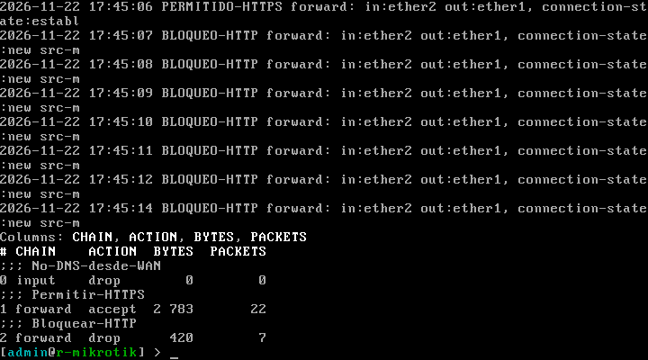

## 4. Copia de seguridad (a208, a105)

| Qué | Formato | Por qué |
|---|---|---|
| `/system backup save … password=…` | `.backup` binario **cifrado** (24 KB) | Restauración exacta, incluidos usuarios y certificados, pero solo en el mismo modelo o versión |
| `/export file=…` | `.rsc` de texto (2,5 KB) | Se lee, se compara entre versiones y sirve para otro router |

Script [`copia-al-nas.rsc`](config/copia-al-nas.rsc), ejecutado a diario a las 02:30 por `/system scheduler`. Sube los dos ficheros por **SFTP** al usuario `c-mikrotik` de `nas-truenas`, que solo tiene acceso a `/mnt/copias/r-mikrotik`.

> ⚠️ Límite conocido: `/tool fetch` no admite claves SSH, así que la contraseña SFTP va dentro del script, y el `export` la incluye. El riesgo se reduce porque ese usuario solo ve su propia carpeta.

## 5. Fallo provocado y recuperación (a209)

| Paso | Qué se hizo | Resultado |
|---|---|---|
| Antes | `curl https://…` desde `srv-linux` | `HTTPS 200` |
| Fallo | `/ip firewall nat remove [find]` + borrar las copias locales del router | `srv-linux`: **SIN INTERNET** ([mk-16](capturas/mk-16-fallo-nat-borrado.png)) |
| Recuperación | `/tool fetch mode=sftp … src-path=/mnt/copias/r-mikrotik/r-mikrotik-20261122.backup` ([mk-17](capturas/mk-17-backup-bajado-del-nas.png)) → `/system backup load` → **reinicio** ([mk-18](capturas/mk-18-restaurar-y-reiniciar.png)) | — |
| Después | Regla NAT de vuelta, uptime 23 s | `srv-linux`: `HTTPS 200` ([mk-19](capturas/mk-19-recuperado-nat-vuelve.png)) |

**Tiempo de recuperación: 39 s** desde que se empieza a bajar la copia hasta la primera conexión correcta del cliente.

<!-- GALERIA:inicio -->

## Galería de evidencias

Todas las pruebas de esta máquina, en el orden en que se hicieron. Las capturas son de la propia VM; las salidas son el texto literal de los comandos ejecutados, con fecha y hora en la primera línea.

### Salidas de comandos

| # | Fichero | Qué demuestra |
|---|---|---|
| 1 | [`01-version-estado-inicial.txt`](salidas/01-version-estado-inicial.txt) | r-mikrotik · versión y recursos — 2026-11-22T17:14:18+01:00 |
| 2 | [`02-configuracion.txt`](salidas/02-configuracion.txt) | r-mikrotik · configuración de red, DHCP, DNS, NAT y cortafuegos — 2026-11-22T17:14:30+01:00 |
| 3 | [`03-usuarios.txt`](salidas/03-usuarios.txt) | r-mikrotik · usuarios de administración — 2026-11-22T18:29:23+01:00 |
| 4 | [`04-registro-cortafuegos.txt`](salidas/04-registro-cortafuegos.txt) | r-mikrotik · registro y contadores tras las pruebas desde srv-linux — 2026-11-22T17:44:35+01:00 |
| 5 | [`05-copias-locales.txt`](salidas/05-copias-locales.txt) | r-mikrotik · copias locales — 2026-11-22T17:59:17+01:00 |
| 6 | [`06-copia-al-nas.txt`](salidas/06-copia-al-nas.txt) | r-mikrotik · copia al NAS (script + planificador) — 2026-11-22T18:27:10+01:00 |
| 7 | [`07-fallo-y-recuperacion.txt`](salidas/07-fallo-y-recuperacion.txt) | r-mikrotik · fallo provocado y recuperación desde el NAS — 2026-11-22T18:27:25+01:00 |

### Capturas

<details open><summary><b>01. Arranque chr 7.24.5</b> · <code>mk-01-arranque-chr-7.24.5.png</code></summary>

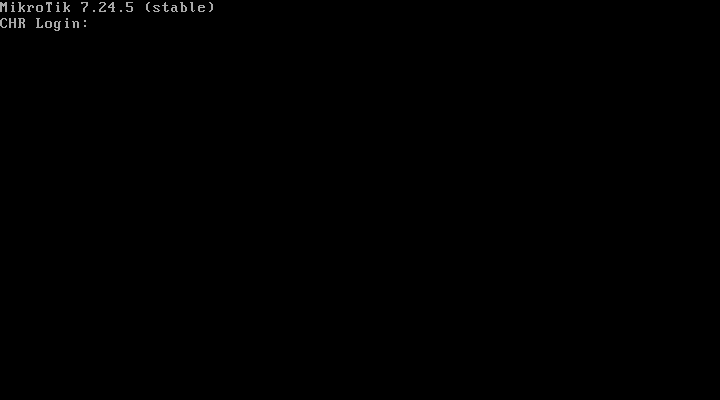

</details>

<details open><summary><b>02. Primer login cambio password</b> · <code>mk-02-primer-login-cambio-password.png</code></summary>

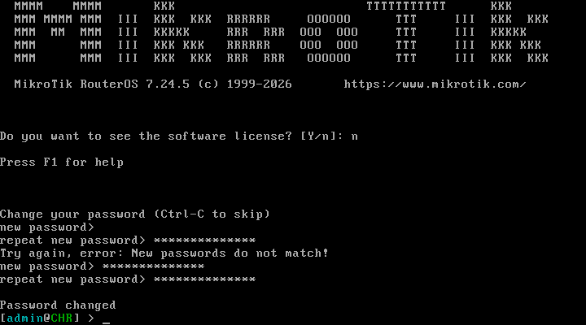

</details>

<details open><summary><b>03. Importar clave ssh</b> · <code>mk-03-importar-clave-ssh.png</code></summary>

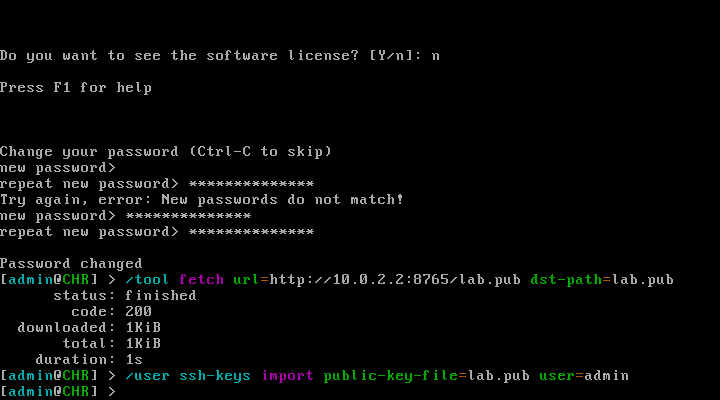

</details>

<details open><summary><b>04. Version recursos</b> · <code>mk-04-version-recursos.png</code></summary>

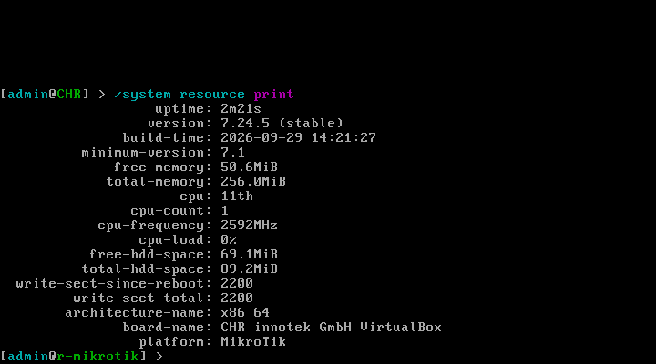

</details>

<details open><summary><b>05. Interfaces ip</b> · <code>mk-05-interfaces-ip.png</code></summary>

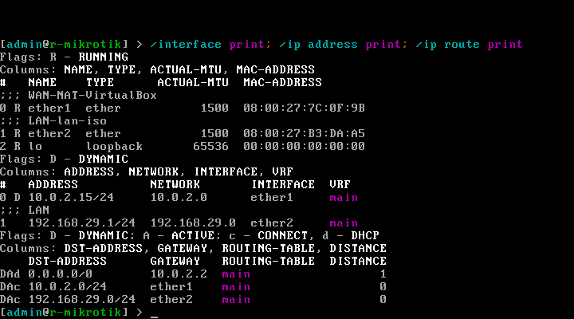

</details>

<details open><summary><b>06. A dhcp</b> · <code>mk-06a-dhcp.png</code></summary>

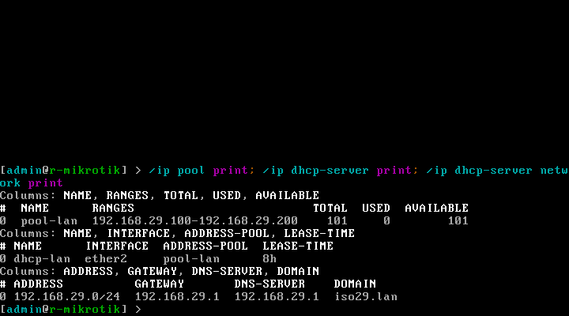

</details>

<details open><summary><b>06. B dns</b> · <code>mk-06b-dns.png</code></summary>

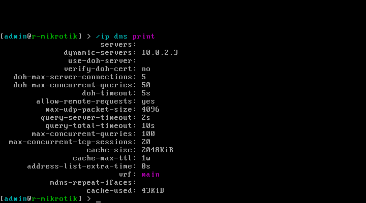

</details>

<details open><summary><b>07. Nat</b> · <code>mk-07-nat.png</code></summary>

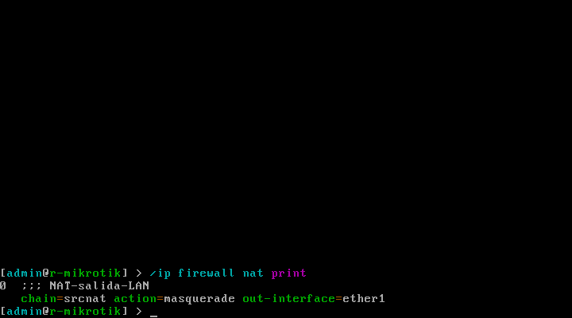

</details>

<details open><summary><b>08. Reglas filtro</b> · <code>mk-08-reglas-filtro.png</code></summary>

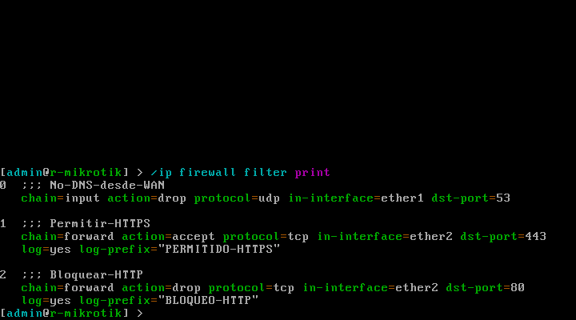

</details>

<details open><summary><b>09. Usuarios</b> · <code>mk-09-usuarios.png</code></summary>

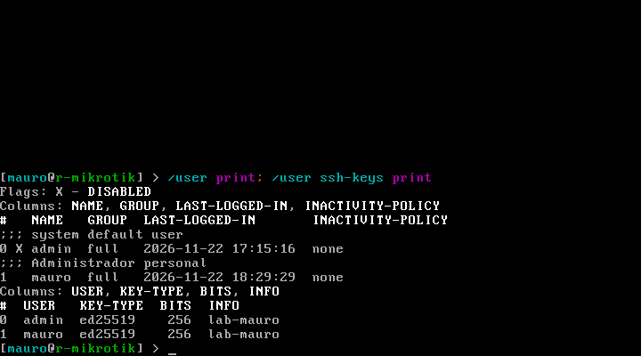

</details>

<details open><summary><b>10. Log permitido y bloqueado</b> · <code>mk-10-log-permitido-y-bloqueado.png</code></summary>


</details>

<details open><summary><b>11. Webfig interfaces</b> · <code>mk-11-webfig-interfaces.png</code></summary>


</details>

<details open><summary><b>12. Webfig direcciones</b> · <code>mk-12-webfig-direcciones.png</code></summary>

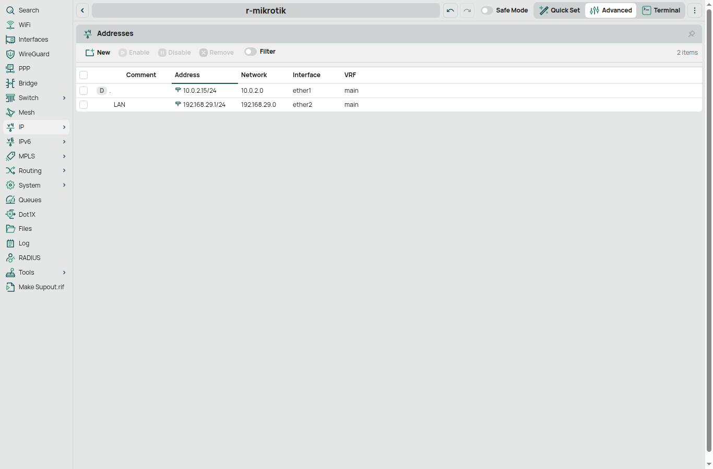

</details>

<details open><summary><b>13. Webfig reglas filtro</b> · <code>mk-13-webfig-reglas-filtro.png</code></summary>

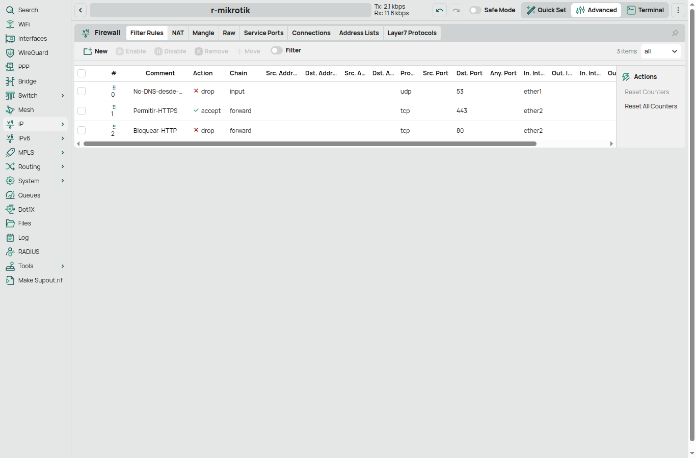

</details>

<details open><summary><b>14. Webfig nat</b> · <code>mk-14-webfig-nat.png</code></summary>

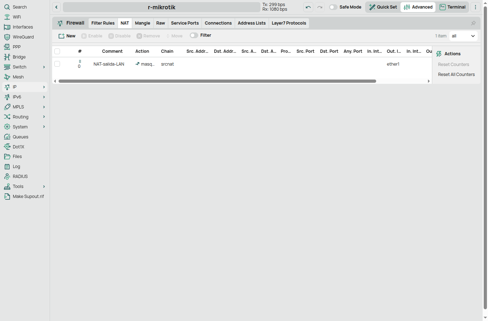

</details>

<details open><summary><b>15. Webfig log</b> · <code>mk-15-webfig-log.png</code></summary>

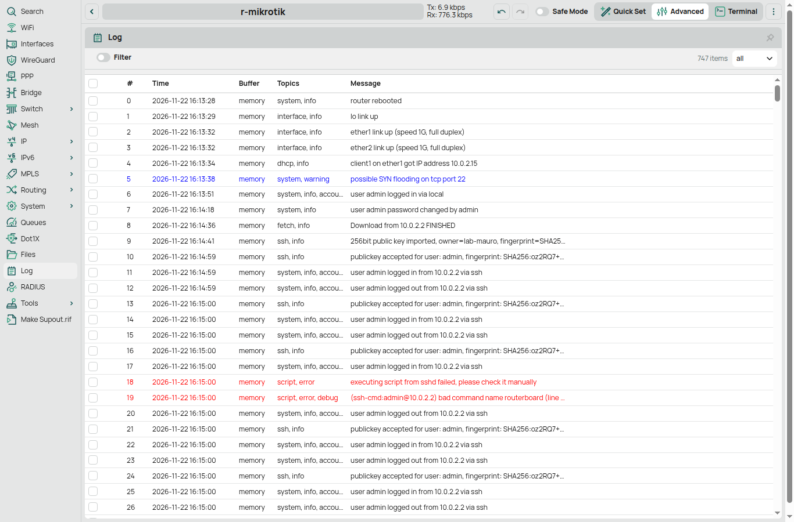

</details>

<details open><summary><b>16. Fallo nat borrado</b> · <code>mk-16-fallo-nat-borrado.png</code></summary>

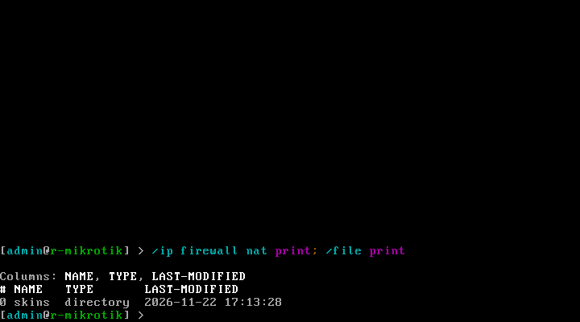

</details>

<details open><summary><b>17. Backup bajado del nas</b> · <code>mk-17-backup-bajado-del-nas.png</code></summary>

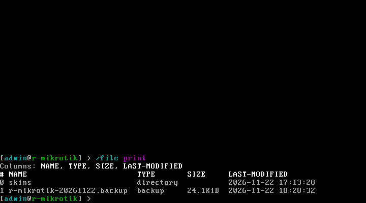

</details>

<details open><summary><b>18. Restaurar y reiniciar</b> · <code>mk-18-restaurar-y-reiniciar.png</code></summary>

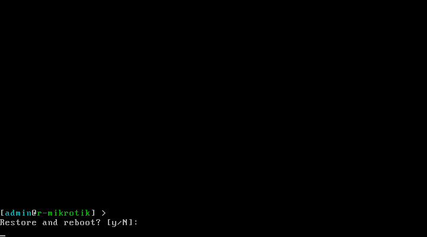

</details>

<details open><summary><b>19. Recuperado nat vuelve</b> · <code>mk-19-recuperado-nat-vuelve.png</code></summary>

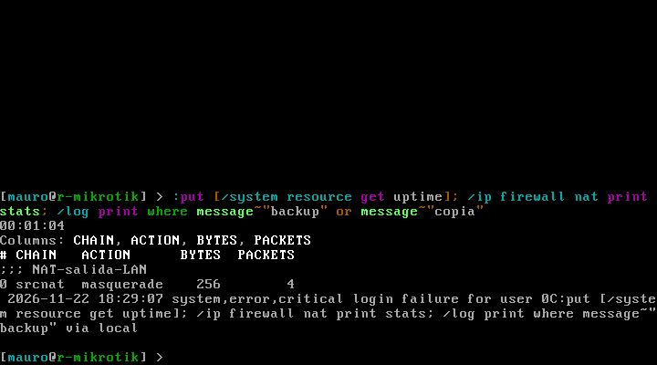

</details>

<!-- GALERIA:fin -->
