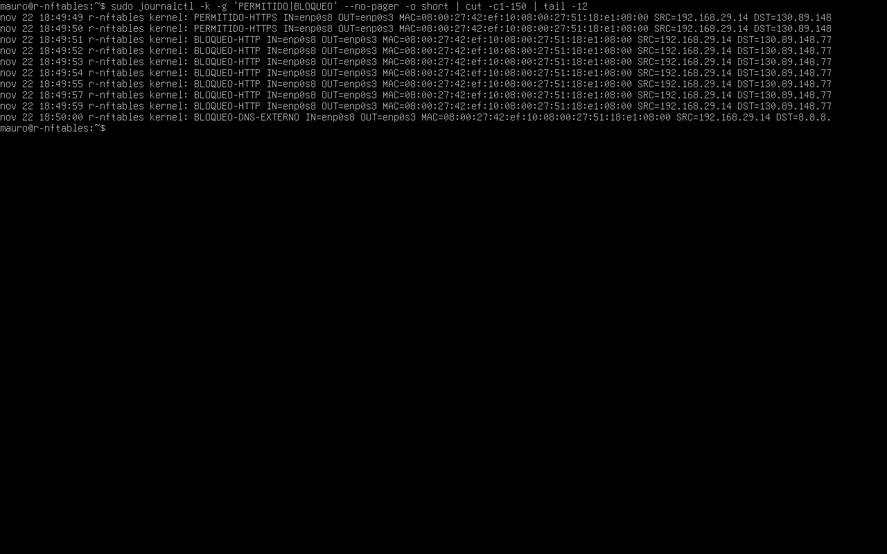
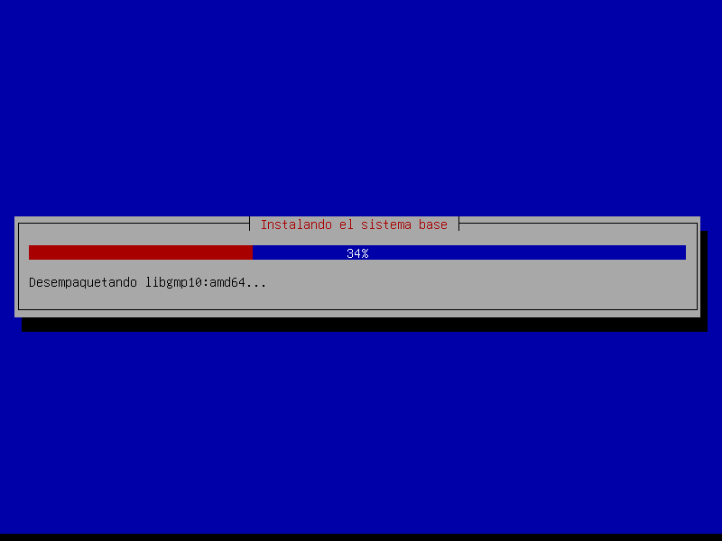
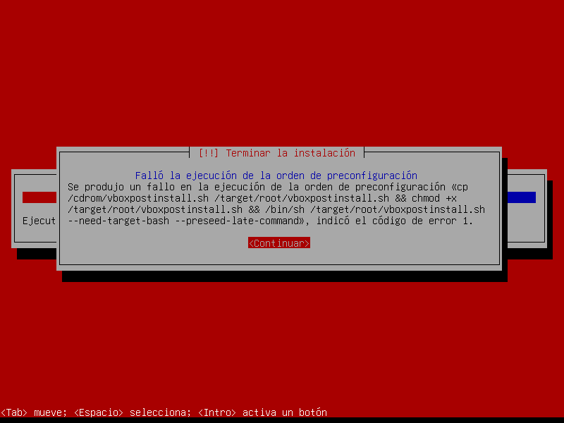
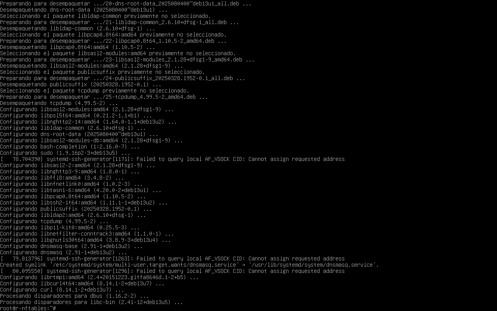
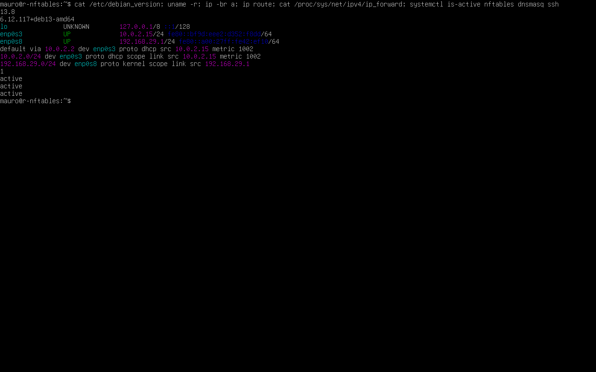
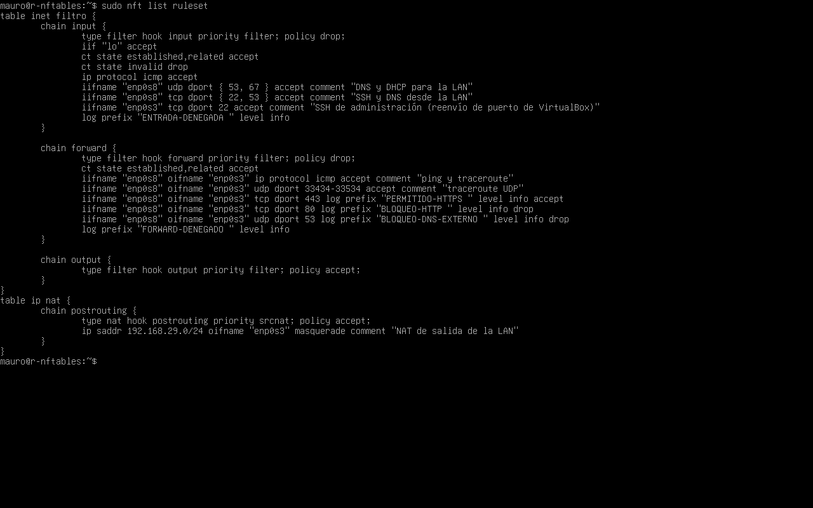
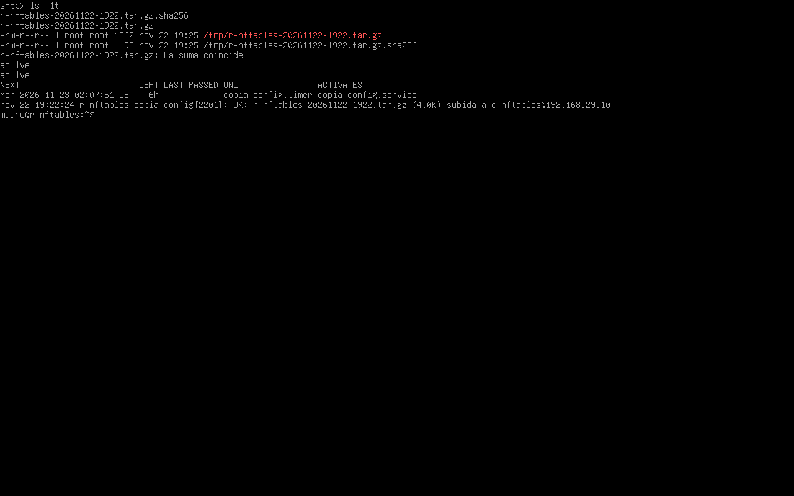

# `r-nftables` · Router 3 · Debian 13 + nftables + dnsmasq

| Dato | Valor |
|---|---|
| Función | Router y cortafuegos de la LAN (alternativa 3 de 3), hecho «a mano» con software libre |
| Sistema | Debian GNU/Linux **13.8** «trixie», **sin entorno gráfico**, núcleo 6.12.117 |
| Imagen | `debian-13.1.0-amd64-netinst.iso`, SHA256 `658b28e2…c65568b3` = **coincide** con `SHA256SUMS` de cdimage.debian.org |
| Instalación | Desatendida con `VBoxManage unattended install` (*preseed*) → [INC-004](../../incidencias/INC-004-instalacion-desatendida-postinstall-fallido.md) |
| Recursos | 1 vCPU · 1 GB RAM · 8 GB VDI dinámico · BIOS · RTC en UTC |
| Red | `enp0s3` = WAN (NAT, DHCP 10.0.2.15) · `enp0s8` = LAN `lan-iso` **192.168.29.1/24** |
| Servicios | `nftables` (cortafuegos + NAT) · `dnsmasq` (DHCP .100–.200 y DNS) · `ssh` |
| Usuario | `mauro` (grupo `sudo`, **pide contraseña**), acceso SSH solo con clave. Durante la configuración automatizada tuvo `sudo` sin contraseña de forma temporal; se retiró al terminar (`/etc/sudoers.d/90-lab-mauro` borrado) |
| Configuración | [interfaces](config/interfaces) · [nftables.conf](config/nftables.conf) · [lan.conf (dnsmasq)](config/lan.conf) · [99-router.conf (sysctl)](config/99-router.conf) · [copia-config.conf](config/copia-config.conf) · [VirtualBox](config/virtualbox-showvminfo.txt) |

## Estado por criterio

| Criterio | Estado | Evidencia |
|---|---|---|
| **a217** Instalar, versión y funcionamiento | ✅ | [nft-01](capturas/nft-01-instalador-sistema-base.png) · [nft-04](capturas/nft-04-interfaces-rutas-forward.png) |
| **a79** Actualizar y comprobar antes de producción | ✅ | 13.1 → **13.8**, 40 paquetes, núcleo nuevo, 0 pendientes · [01-actualizacion.txt](salidas/01-actualizacion.txt) |
| **a218** Usuarios de administración | ✅ | `mauro` en `sudo`; `root` sin acceso SSH (Debian no permite login de root por contraseña) |
| **a219** Red WAN y LAN | ✅ | [02-router-configurado.txt](salidas/02-router-configurado.txt) · [nft-04](capturas/nft-04-interfaces-rutas-forward.png) |
| **a220** Acceso a Internet desde la LAN | ✅ | `ip_forward=1` + NAT *masquerade*; `srv-linux` sale a Internet ([T4 §5.2](../../tareas/T4-red-individual.md)) |
| **a221** Conexión permitida y bloqueada; registro | ✅ | [nft-05](capturas/nft-05-reglas-nftables.png) · [nft-06](capturas/nft-06-log-permitido-bloqueado.png) · [03-registro-cortafuegos.txt](salidas/03-registro-cortafuegos.txt) |
| **a222** Copia de la configuración en el servidor de copias | ✅ | Temporizador diario → SFTP con clave a `nas-truenas` · [copia-automatica-al-nas.txt](salidas/copia-automatica-al-nas.txt) |
| **a223** Fallo provocado y recuperación | ✅ | Reglas y configuración borradas → restaurado desde el NAS en **1,3 s** · [04-fallo-y-recuperacion.txt](salidas/04-fallo-y-recuperacion.txt) · [nft-07](capturas/nft-07-recuperacion-desde-nas.png) |
| a105 (Apte+) Automatizar las copias | ✅ | `copia-config.timer` (02:00 cada día, `Persistent=true`) |

## 1. Cómo funciona el router

1. **Reenvío:** `net.ipv4.ip_forward = 1` ([99-router.conf](config/99-router.conf)). Sin esto, Linux descarta los paquetes que no van dirigidos a él.
2. **NAT** (`table ip nat`, cadena `postrouting`): todo lo que sale por la WAN desde 192.168.29.0/24 sale con la IP del router (*masquerade*).
3. **Filtrado** (`table inet filtro`), con **política por defecto `drop`** en `input` y `forward`: solo pasa lo que se permite explícitamente.

| Cadena | Regla | Acción | Registro |
|---|---|---|---|
| forward | `ct state established,related` | accept | — |
| forward | ICMP y traceroute UDP LAN → WAN | accept | — |
| forward | TCP 443 LAN → WAN | **accept** | `PERMITIDO-HTTPS` |
| forward | TCP 80 LAN → WAN | **drop** | `BLOQUEO-HTTP` |
| forward | UDP 53 LAN → WAN (DNS externo) | **drop** | `BLOQUEO-DNS-EXTERNO` |
| forward | todo lo demás | drop (política) | `FORWARD-DENEGADO` |
| input | DNS, DHCP y SSH desde la LAN; SSH desde la WAN (reenvío de VirtualBox) | accept | — |

Bloquear el DNS externo obliga a los clientes a usar el DNS del router (dnsmasq), lo que permite controlar y registrar la resolución de nombres.

## 2. Prueba de conexión permitida y bloqueada (a221)

Desde `srv-linux`, con el cable LAN del MikroTik desconectado y el de r-nftables conectado:

| Prueba | Cliente | Registro (`journalctl -k`) |
|---|---|---|
| `curl https://www.debian.org` | `HTTPS 200` | `PERMITIDO-HTTPS IN=enp0s8 OUT=enp0s3 SRC=192.168.29.14 DST=130.89.148.77 … DPT=443` |
| `curl http://www.debian.org` | timeout | `BLOQUEO-HTTP IN=enp0s8 OUT=enp0s3 … DPT=80` (6 reintentos del SYN) |
| `dig @8.8.8.8 www.debian.org` | `communications error … timed out` | `BLOQUEO-DNS-EXTERNO … DST=8.8.8.8 … DPT=53` |



## 3. Copia de seguridad (a222, a105)

Script común [`scripts/copia-config.sh`](../../scripts/copia-config.sh) + [`copia-config.timer`](../../scripts/copia-config.timer):

- **Qué se copia** ([copia-config.conf](config/copia-config.conf)): `nftables.conf`, `interfaces`, `dnsmasq.d/`, `sysctl.d/99-router.conf`, `hostname` y `hosts`. Ocupa **4 KB** y basta para reconstruir el router sobre un Debian recién instalado.
- **Qué no se copia:** el sistema operativo (se reinstala en minutos) ni los registros.
- **Cómo:** `tar.gz` + `.sha256` → **SFTP con clave ed25519** al usuario `c-nftables` del NAS, que no tiene contraseña y solo ve su carpeta. Se conservan 7 copias locales en `/var/backups/copia-config/`.
- **Cuándo:** cada día a las 02:00 (`systemctl list-timers`). Con `Persistent=true`, si la VM estaba apagada a esa hora la copia se hace al arrancar.

## 4. Fallo provocado y recuperación (a223)

```bash
# Fallo
sudo nft flush ruleset; sudo rm /etc/nftables.conf /etc/dnsmasq.d/lan.conf
# → srv-linux: SIN INTERNET (curl timeout)

# Recuperación
U=$(echo "ls -1t *.tar.gz" | sudo sftp -q -b - -i /root/.ssh/copia_nas c-nftables@192.168.29.10 | head -1)
printf "get %s\nget %s.sha256\n" $U $U | sudo sftp -q -b - -i /root/.ssh/copia_nas c-nftables@192.168.29.10
sha256sum -c $U.sha256            # La suma coincide
sudo tar xzf $U -C /
sudo systemctl restart nftables dnsmasq
# → srv-linux: HTTPS 200
```

**Tiempo de recuperación: 1,3 s** (bajar del NAS + verificar SHA256 + restaurar + reiniciar los servicios). La comprobación SHA256 garantiza que no se restaura una copia dañada.

<!-- GALERIA:inicio -->

## Galería de evidencias

Todas las pruebas de esta máquina, en el orden en que se hicieron. Las capturas son de la propia VM; las salidas son el texto literal de los comandos ejecutados, con fecha y hora en la primera línea.

### Salidas de comandos

| # | Fichero | Qué demuestra |
|---|---|---|
| 1 | [`01-actualizacion.txt`](salidas/01-actualizacion.txt) | r-nftables · actualización antes de producción — 2026-11-22T17:29:45+01:00 |
| 2 | [`02-router-configurado.txt`](salidas/02-router-configurado.txt) | r-nftables · estado del router — 2026-11-22T17:32:12+01:00 |
| 3 | [`03-registro-cortafuegos.txt`](salidas/03-registro-cortafuegos.txt) | r-nftables · registro del cortafuegos y contadores — 2026-11-22T17:50:04+01:00 |
| 4 | [`04-fallo-y-recuperacion.txt`](salidas/04-fallo-y-recuperacion.txt) | r-nftables · fallo provocado y recuperación desde el NAS — 2026-11-22T18:24:50+01:00 |
| 5 | [`copia-automatica-al-nas.txt`](salidas/copia-automatica-al-nas.txt) | r-nftables · copia automática de la configuración al NAS — 2026-11-22T18:22:24+01:00 |
| 6 | [`inc004-vboxpostinstall.log`](salidas/inc004-vboxpostinstall.log) | ****************************************************************************** |

### Capturas

<details open><summary><b>01. Instalador sistema base</b> · <code>nft-01-instalador-sistema-base.png</code></summary>



</details>

<details open><summary><b>02. Inc004 fallo postinstall</b> · <code>nft-02-inc004-fallo-postinstall.png</code></summary>



</details>

<details open><summary><b>03. Inc004 instalar sudo como root</b> · <code>nft-03-inc004-instalar-sudo-como-root.png</code></summary>



</details>

<details open><summary><b>04. Interfaces rutas forward</b> · <code>nft-04-interfaces-rutas-forward.png</code></summary>



</details>

<details open><summary><b>05. Reglas nftables</b> · <code>nft-05-reglas-nftables.png</code></summary>



</details>

<details open><summary><b>06. Log permitido bloqueado</b> · <code>nft-06-log-permitido-bloqueado.png</code></summary>


</details>

<details open><summary><b>07. Recuperacion desde nas</b> · <code>nft-07-recuperacion-desde-nas.png</code></summary>



</details>

<!-- GALERIA:fin -->
