# `r-opnsense` · Router 2 · OPNsense

| Dato | Valor |
|---|---|
| Función | Router y cortafuegos de la LAN (alternativa 2 de 3), administrado por web y API REST |
| Sistema | **OPNsense 26.7.9_3** (FreeBSD 15), instalado desde 26.7 y actualizado |
| Imagen | `OPNsense-26.7-dvd-amd64.iso.bz2` SHA256 `95cafedd…186bfb` = **coincide** con el valor oficial; ISO descomprimida `1efd5dc9…d5dcd` |
| Recursos | 2 vCPU · 2 GB RAM (**3 GB solo durante la instalación**, ver §1) · 20 GB · BIOS · sistema de ficheros UFS |
| Red | `em0` = WAN (NAT, DHCP 10.0.2.15) · `em1` = LAN `lan-iso` **192.168.29.1/24**, DHCP .100–.200 |
| Usuarios | `root` (consola) y **`mauro`** (grupo `admins`) · clave de API de `root` para la automatización (fuera del repositorio) |
| Configuración | [VirtualBox](config/virtualbox-showvminfo.txt) · copia cifrada: [scripts/copia-opnsense.sh](../../scripts/copia-opnsense.sh) |

## Estado por criterio

| Criterio | Estado | Evidencia |
|---|---|---|
| **a210** Instalar, versión y funcionamiento | ✅ | [opn-01…04](capturas/) (instalador) · [opn-13 panel](capturas/opn-13-panel.png) · [01-usuario-y-version.txt](salidas/01-usuario-y-version.txt) |
| **a79** Actualizar antes de producción | ✅ | 26.7 con **96 actualizaciones pendientes** ([opn-08](capturas/opn-08-actualizaciones-pendientes.png)) → **26.7.9_3** ([opn-12](capturas/opn-12-version-actualizada.png)) |
| **a211** Usuarios de administración | ✅ | `mauro` en `admins` · [opn-11](capturas/opn-11-usuarios-root-y-mauro.png) |
| **a212** Red WAN y LAN | ✅ | Consola: asignación `em0`/`em1` e IP de la LAN · [opn-06](capturas/opn-06-asignar-wan-em0-lan-em1.png) · [opn-07](capturas/opn-07-lan-192.168.29.1-dhcp.png) |
| **a213** Acceso a Internet desde la LAN | ✅ | NAT de salida automático; `srv-linux`, `srv-dc` y `cli-linux` salen a Internet |
| **a214** Conexión permitida y bloqueada; registro | ✅ | [02-reglas-y-orden.txt](salidas/02-reglas-y-orden.txt) · [opn-09](capturas/opn-09-reglas-lan-orden-correcto.png) · [opn-10 Live View](capturas/opn-10-registro-permitido-y-bloqueado.png) |
| **a215** Copia en el servidor de copias | ✅ | `config.xml` **cifrado AES-256** → SFTP con clave a `c-opnsense` · [03-copia-al-nas.txt](salidas/03-copia-al-nas.txt) |
| **a216** Fallo provocado y recuperación | ✅ | Reglas borradas → restaurado desde el NAS en **69 s** · [04-fallo-y-recuperacion.txt](salidas/04-fallo-y-recuperacion.txt) · [opn-14…17](capturas/) |

## 1. Instalación

1. Arranque de la ISO en modo *live* ([opn-01](capturas/opn-01-arranque-live-26.7.png)); por defecto asigna `em0` = LAN y `em1` = WAN, al revés que en mi diseño.
2. Login `installer` → teclado por defecto → **Install (UFS)** ([opn-02](capturas/opn-02-instalador-ufs.png)). Elijo UFS en vez de ZFS porque ZFS gasta más RAM y un router de 2 GB no necesita instantáneas.
3. El instalador avisa: *«detected only 2047MB of RAM … requires at least 3000MB»* (copia el sistema *live* a la RAM). **Decisión:** apagar, subir la RAM a 3 GB solo para instalar y volver a dejarla en 2 GB después.
4. Disco `ada0` ([opn-03](capturas/opn-03-disco-ada0.png)) → contraseña de root → *Complete Install* → quitar la ISO.
5. Consola, **opción 1** (asignar interfaces): WAN = `em0`, LAN = `em1` ([opn-06](capturas/opn-06-asignar-wan-em0-lan-em1.png)). **Opción 2**: LAN 192.168.29.1/24, sin IPv6, DHCP .100–.200 ([opn-07](capturas/opn-07-lan-192.168.29.1-dhcp.png)).
6. Como en las otras alternativas, **un solo router a la vez**: se desconecta la LAN de los demás (`VBoxManage controlvm r-mikrotik setlinkstate2 off`).

## 2. Administración por API REST

Desde la sesión web de `root` se generó una clave de API (`/api/auth/user/add_api_key/root`). Con ella todo lo demás se hizo **por API**, que es reproducible y queda registrado:

| Acción | Llamada |
|---|---|
| Comprobar y aplicar actualizaciones | `POST /api/core/firmware/check` · `POST /api/core/firmware/update` |
| Crear el usuario `mauro` | `POST /api/auth/user/add` (grupo 1999 = `admins`) |
| Reglas | `POST /api/firewall/filter/add_rule` · `set_rule` · `del_rule` · `apply` |
| Registro del cortafuegos | `GET /api/diagnostics/firewall/log` |
| Copia de la configuración | `GET /api/core/backup/download/this` |

## 3. Reglas y **orden de evaluación** (a214)

| Prueba | Reglas | `curl http://` desde srv-linux | Registro |
|---|---|---|---|
| 1 | Mis reglas con secuencia 50 y 51, **detrás** de *Default allow LAN to any* (secuencia 1) | **302: pasa** ❌ | Nada: coincide antes la regla por defecto, que no registra |
| 2 | *Default allow* movidas a la secuencia 100 y 101 | **Bloqueado** ✅ | 7 × `block … :80 … BLOQUEO-HTTP` |

**Lección:** igual que en MikroTik y nftables, las reglas se evalúan **en orden y gana la primera que coincide**. Una regla de bloqueo colocada detrás de un «permitir todo» no sirve de nada.

| Secuencia | Acción | Qué | Registro |
|---|---|---|---|
| 50 | pass | TCP LAN → any:443 | `PERMITIDO-HTTPS` |
| 51 | block | TCP LAN → any:80 | `BLOQUEO-HTTP` |
| 100 | pass | LAN → any (por defecto) | — |

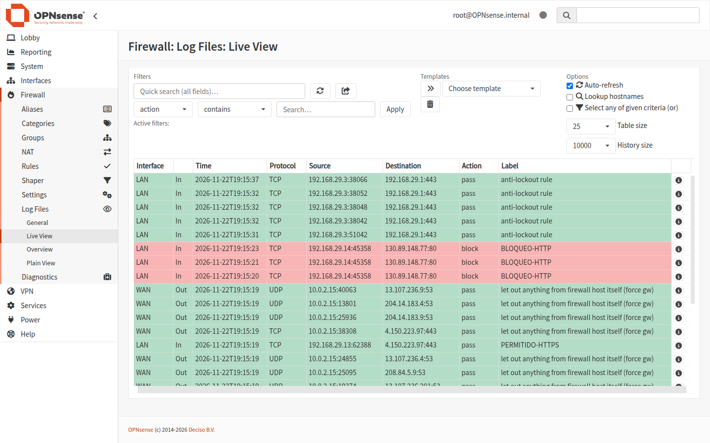

**Interpretación:** las líneas rojas son SYN de `192.168.29.14` hacia `130.89.148.77:80`, descartados por `BLOQUEO-HTTP` (`curl` reintenta cada segundo). La línea verde `PERMITIDO-HTTPS` de `192.168.29.13` es el controlador de dominio saliendo por HTTPS. Las líneas `anti-lockout rule` hacia 192.168.29.1:443 son mi propia sesión web, que esa regla protege para no quedarme sin acceso.

> Efecto secundario descubierto: al bloquear HTTP, Windows no puede comprobar la revocación de certificados (CRL/OCSP van por el puerto 80) → [INC-008](../../incidencias/INC-008-windows-crl-bloqueada-por-http.md).

## 4. Copia de seguridad (a215)

[`scripts/copia-opnsense.sh`](../../scripts/copia-opnsense.sh):

1. Descarga `config.xml` por la API.
2. Lo **cifra con AES-256-CBC + PBKDF2 (200 000 iteraciones)**, porque contiene los hashes de contraseñas y los secretos de la API.
3. Calcula el SHA256 y lo sube por **SFTP con clave ed25519** al usuario `c-opnsense` del NAS, que solo ve `/mnt/copias/r-opnsense`.

| Qué se copia | Qué no | Por qué |
|---|---|---|
| `config.xml` (44 KB): interfaces, reglas, NAT, DHCP, usuarios y certificados | El sistema (se reinstala en 15 min) y los gráficos RRD | Toda la configuración de OPNsense está en ese único fichero |

## 5. Fallo provocado y recuperación (a216)

| Paso | Qué | Resultado |
|---|---|---|
| Fallo | Borrar mis reglas y **desactivar** las *Default allow LAN* por API → la LAN no tiene ninguna regla de paso | [opn-14](capturas/opn-14-fallo-reglas-borradas.png) |
| Efecto | `srv-dc` → **SIN INTERNET** | |
| Recuperación | `sftp get` del NAS → `sha256sum -c` (coincide) → `openssl enc -d` → *System › Configuration › Backups › Restore* con reinicio ([opn-15](capturas/opn-15-restaurar-config-desde-nas.png), [opn-16](capturas/opn-16-restaurada-reiniciando.png)) | |
| Después | Reglas 50/51/100/101 de vuelta y activas ([opn-17](capturas/opn-17-recuperado-reglas.png)) · `srv-dc` → **HTTPS 200** | **69 s** |

<!-- GALERIA:inicio -->

## Galería de evidencias

Todas las pruebas de esta máquina, en el orden en que se hicieron. Las capturas son de la propia VM; las salidas son el texto literal de los comandos ejecutados, con fecha y hora en la primera línea.

### Salidas de comandos

| # | Fichero | Qué demuestra |
|---|---|---|
| 1 | [`01-usuario-y-version.txt`](salidas/01-usuario-y-version.txt) | r-opnsense · versión, actualización y usuario de administración (API REST) — 2026-11-22T20:14:14+01:00 |
| 2 | [`02-reglas-y-orden.txt`](salidas/02-reglas-y-orden.txt) | r-opnsense · reglas de la LAN y orden de evaluación — 2026-11-22T20:14:28+01:00 |
| 3 | [`03-copia-al-nas.txt`](salidas/03-copia-al-nas.txt) | r-opnsense · copia cifrada de la configuración al NAS — 2026-11-22T20:24:38+01:00 |
| 4 | [`04-fallo-y-recuperacion.txt`](salidas/04-fallo-y-recuperacion.txt) | r-opnsense · fallo provocado y recuperación desde el NAS — 2026-11-22T20:25:24+01:00 |
| 5 | [`05-http-para-nodos-proxmox.txt`](salidas/05-http-para-nodos-proxmox.txt) | r-opnsense · excepción: HTTP permitido solo a los nodos Proxmox — 2026-11-22T21:06:42+01:00 |

### Capturas

<b>01. Arranque live 26.7</b> · <code>opn-01-arranque-live-26.7.png</code>

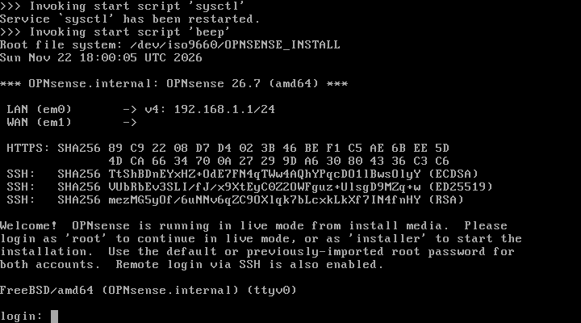

<b>02. Instalador ufs</b> · <code>opn-02-instalador-ufs.png</code>

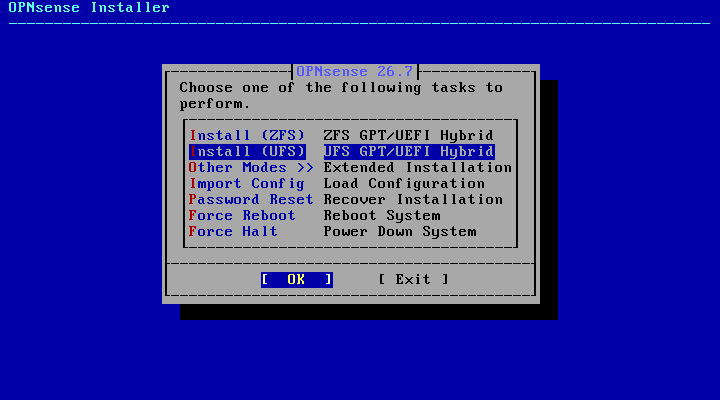

<b>03. Disco ada0</b> · <code>opn-03-disco-ada0.png</code>

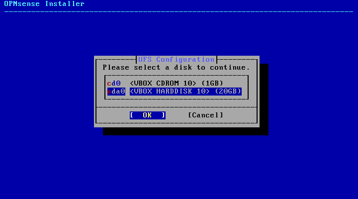

<b>04. Configuracion final</b> · <code>opn-04-configuracion-final.png</code>

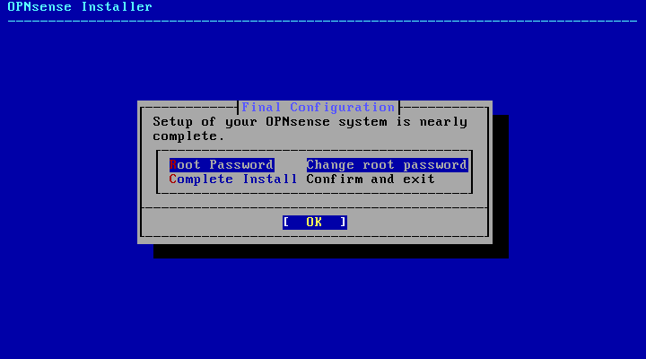

<b>05. Consola interfaces por defecto</b> · <code>opn-05-consola-interfaces-por-defecto.png</code>

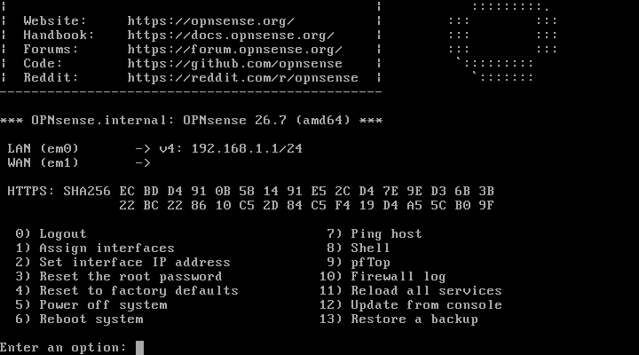

<b>06. Asignar wan em0 lan em1</b> · <code>opn-06-asignar-wan-em0-lan-em1.png</code>

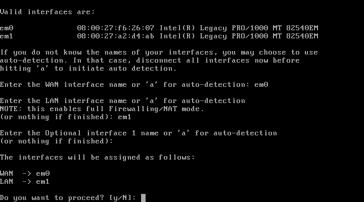

<b>07. Lan 192.168.29.1 dhcp</b> · <code>opn-07-lan-192.168.29.1-dhcp.png</code>

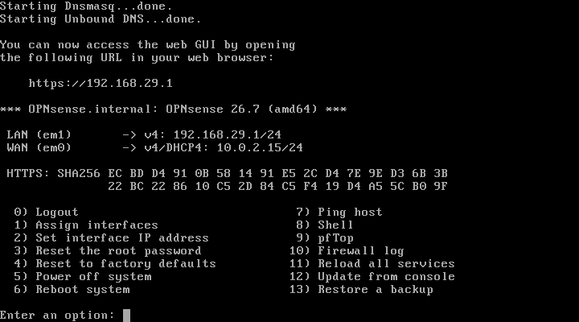

<b>08. Actualizaciones pendientes</b> · <code>opn-08-actualizaciones-pendientes.png</code>

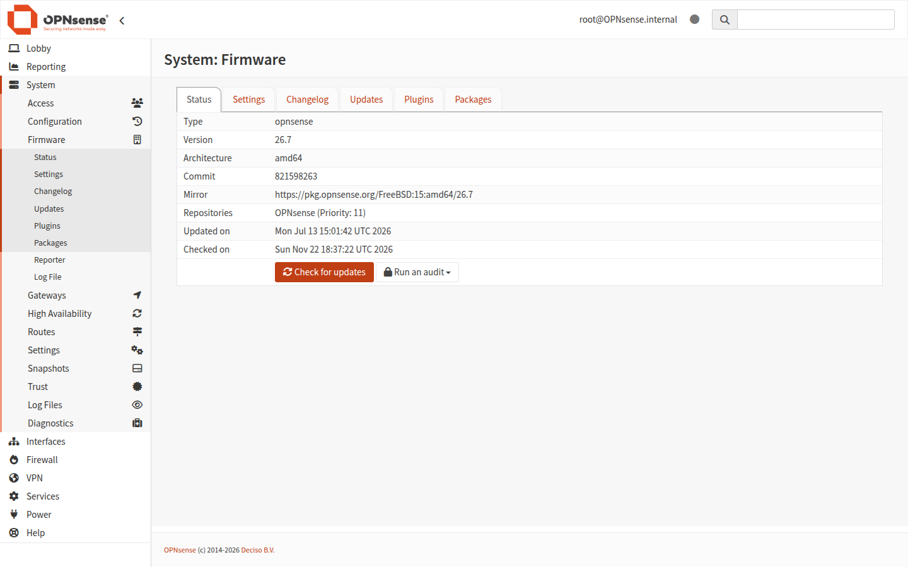

<b>09. Reglas lan orden correcto</b> · <code>opn-09-reglas-lan-orden-correcto.png</code>

<b>10. Registro permitido y bloqueado</b> · <code>opn-10-registro-permitido-y-bloqueado.png</code>

<b>11. Usuarios root y mauro</b> · <code>opn-11-usuarios-root-y-mauro.png</code>

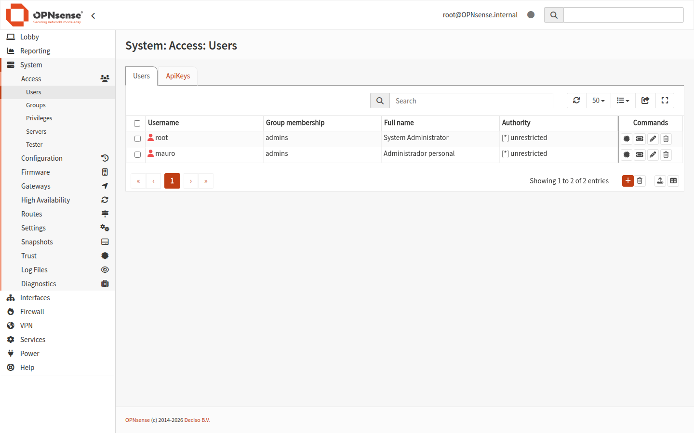

<b>12. Version actualizada</b> · <code>opn-12-version-actualizada.png</code>

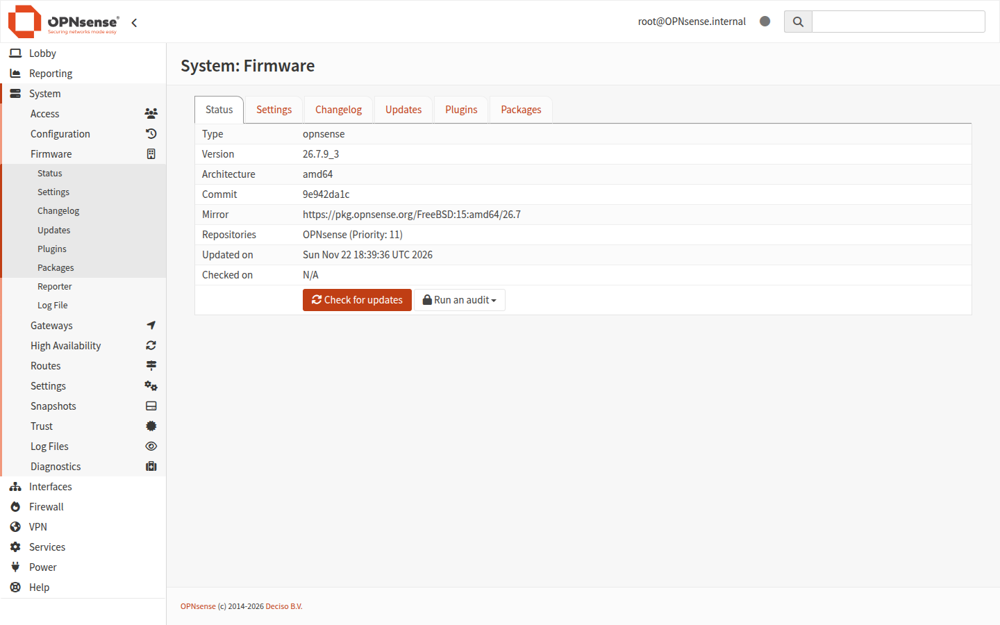

<b>13. Panel</b> · <code>opn-13-panel.png</code>

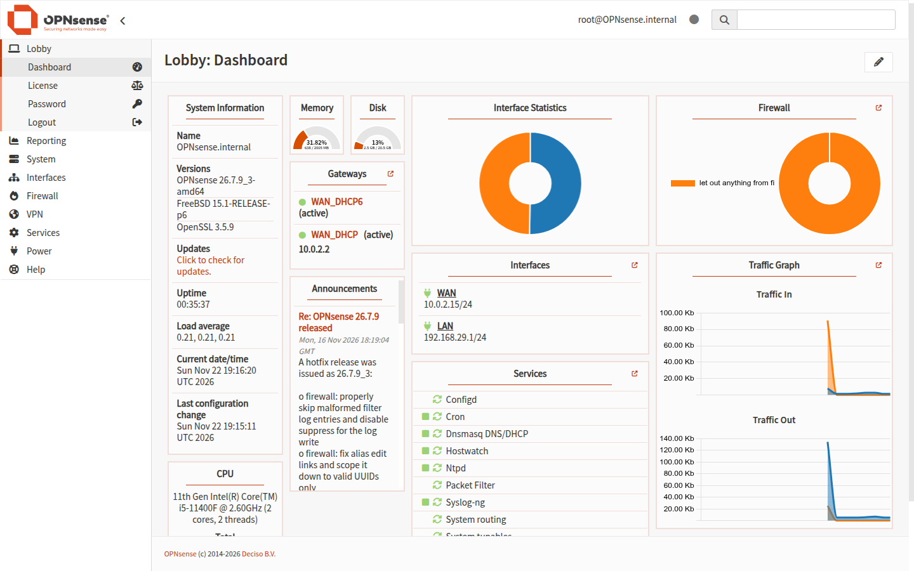

<b>14. Fallo reglas borradas</b> · <code>opn-14-fallo-reglas-borradas.png</code>

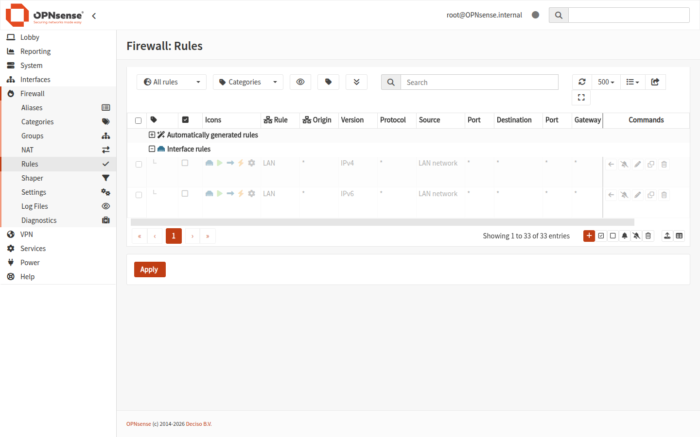

<b>15. Restaurar config desde nas</b> · <code>opn-15-restaurar-config-desde-nas.png</code>

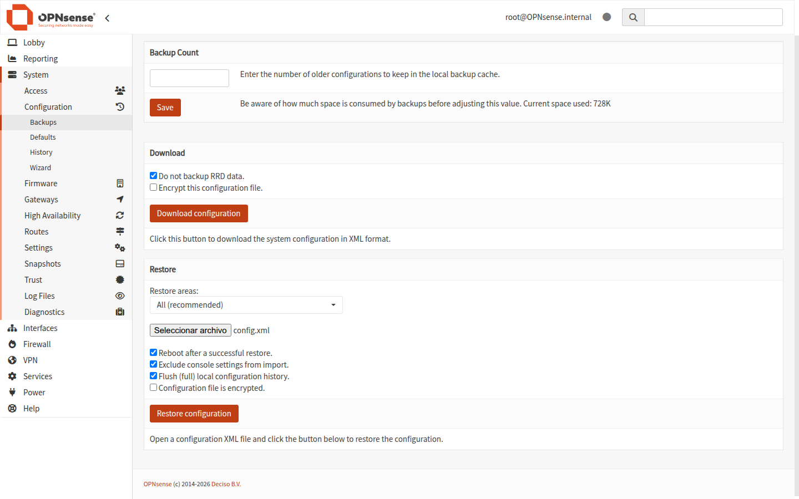

<b>16. Restaurada reiniciando</b> · <code>opn-16-restaurada-reiniciando.png</code>

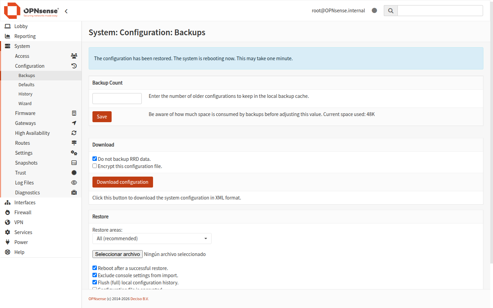

<b>17. Recuperado reglas</b> · <code>opn-17-recuperado-reglas.png</code>

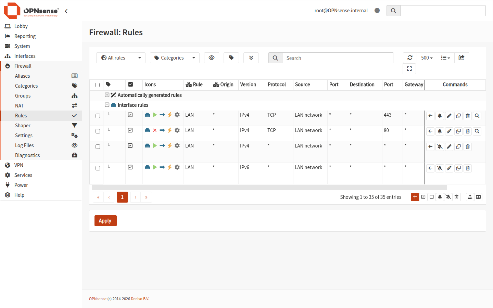

<!-- GALERIA:fin -->
