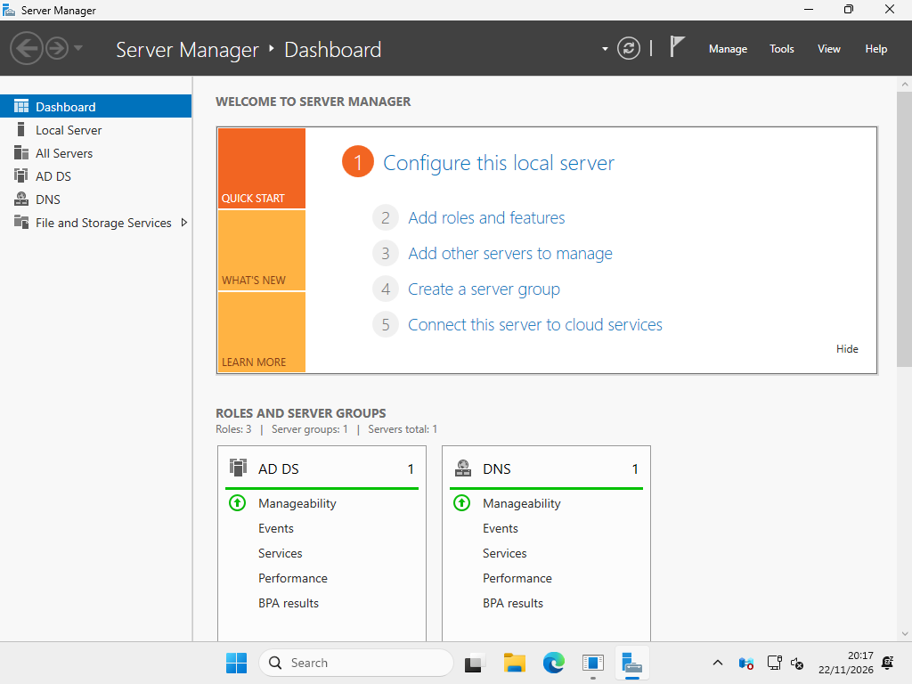
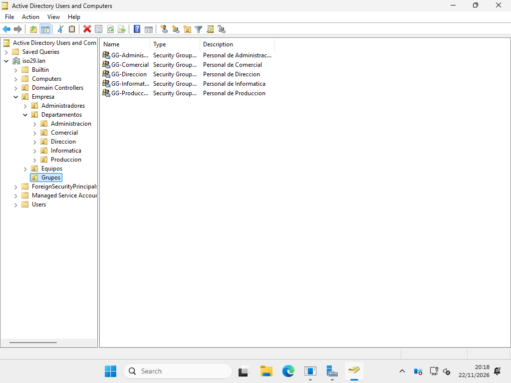
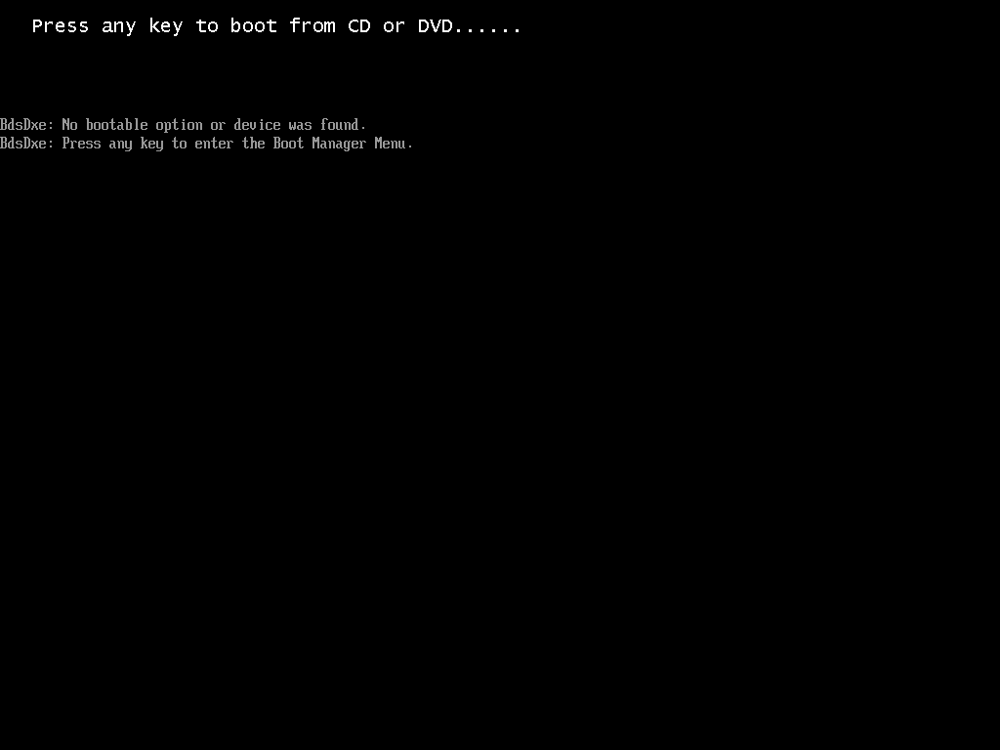
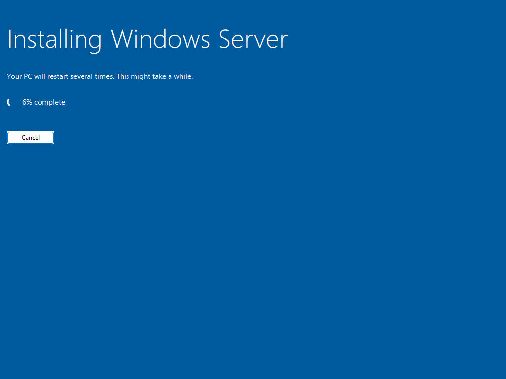
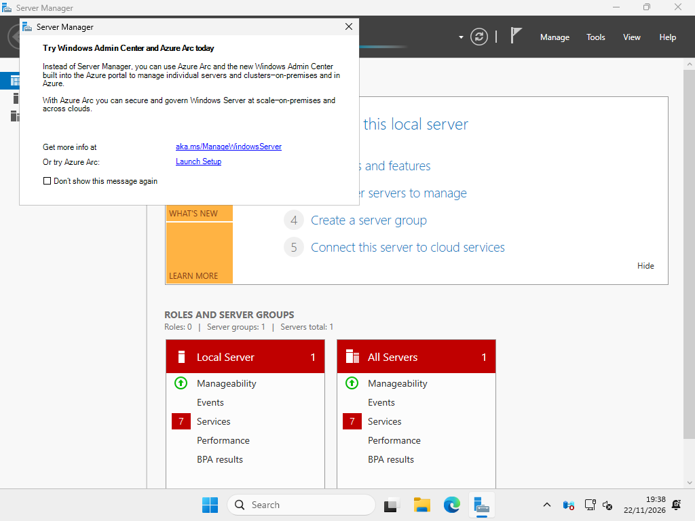
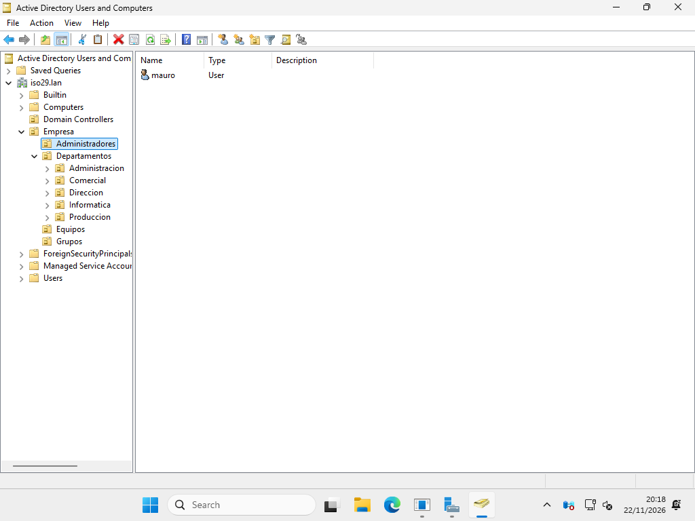
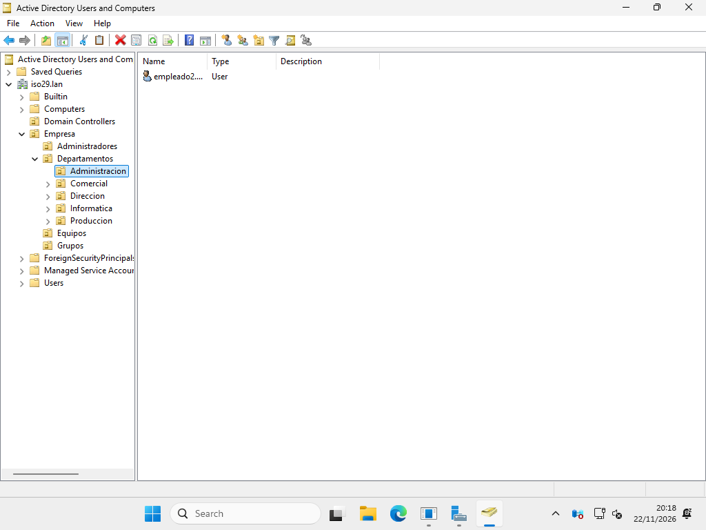
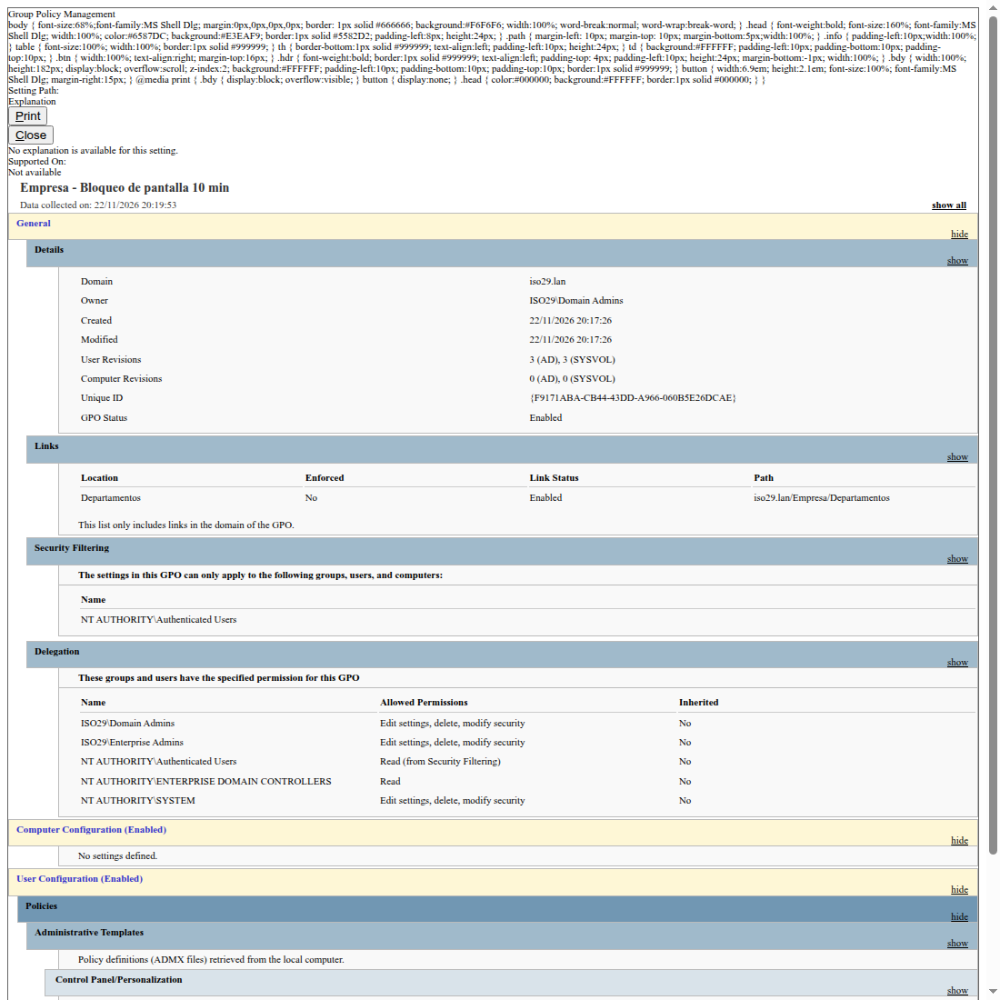

# `srv-dc` · Windows Server 2025 · Controlador del dominio `iso29.lan`

| Dato | Valor |
|---|---|
| Función | Gestión centralizada: Active Directory, DNS y directivas de grupo (GPO) |
| Sistema | **Windows Server 2025 Standard Evaluation** (con escritorio), compilación 26100 |
| Imagen | `26100.1742…SERVER_EVAL_x64FRE_en-us.iso` descargada del Evaluation Center de Microsoft (`go.microsoft.com/fwlink/?linkid=2293312`). SHA256 `d0ef4502…9b23d`. Microsoft **no publica** la suma: N/C |
| Instalación | Desatendida (`VBoxManage unattended install --image-index 2` → *Standard (Desktop Experience)*) con Guest Additions |
| Recursos | 2 vCPU · 4 GB · 50 GB · **UEFI + TPM 2.0** · caché de E/S del anfitrión activada ([INC-002](../../incidencias/INC-002-ssd-portatil-en-usb2.md)) |
| Red | `Ethernet` en `lan-iso`, **IP fija 192.168.29.13/24**, pasarela .1, DNS **127.0.0.1** (él mismo) con reenviador a 192.168.29.1 |
| Dominio | **`iso29.lan`** (NetBIOS `ISO29`), nivel funcional **Windows2025Forest** |
| Administración | Desde el anfitrión con `VBoxManage guestcontrol` + PowerShell (las órdenes completas están en `salidas/`) |

## Estado por criterio

| Criterio | Estado | Evidencia |
|---|---|---|
| **a237** Instalar, versión y funcionamiento | ✅ | [dc-02](capturas/dc-02-instalacion-desatendida.png) · [dc-03](capturas/dc-03-instalado-server-manager.png) · [01-version-red-ip-fija.txt](salidas/01-version-red-ip-fija.txt) |
| **a238** Usuarios de administración | ✅ | `mauro` en **Domain Admins** (OU `Administradores`); `Administrator` integrado solo para emergencias · [dc-06](capturas/dc-06-aduc-administradores-mauro.png) |
| **a239** Parámetros de red | ✅ | IP fija, DNS propio y reenviador · [01-version-red-ip-fija.txt](salidas/01-version-red-ip-fija.txt) |
| **a240** Copia al servidor de copias, qué sí y qué no | ✅ | Tarea diaria «Copia AD al NAS» → SCP con clave a `c-srvdc` · [05-copia-automatica-ad-al-nas.txt](salidas/05-copia-automatica-ad-al-nas.txt) · [INC-009](../../incidencias/INC-009-scp-como-system-clave-desprotegida.md) |
| **a241** Qué es un dominio y qué aporta | ✅ | §3 |
| a105 (Apte+) Automatizar copias | ✅ | Tarea programada a las 02:30 como SYSTEM |

## 1. Promoción a controlador de dominio

```powershell
Install-WindowsFeature AD-Domain-Services, Windows-Server-Backup -IncludeManagementTools
Install-ADDSForest -DomainName iso29.lan -DomainNetbiosName ISO29 -InstallDns -SafeModeAdministratorPassword <DSRM>
```

Tras el reinicio, `dcdiag` → *passed* Connectivity, Advertising, NetLogons y Services ([02-dominio-ad-ds.txt](salidas/02-dominio-ad-ds.txt)). El DNS publica `_ldap._tcp.iso29.lan → srv-dc.iso29.lan:389`.

> Durante los primeros minutos tras la promoción, `Get-ADDomain` daba *«Unable to find a default server with Active Directory Web Services running»* y `dcdiag` fallaba en *Advertising*: el DC aún no se anunciaba. A los pocos minutos todo pasaba. Durante el reinicio también se repitió el cuelgue por E/S de [INC-003](../../incidencias/INC-003-cli-win11-apagado-colgado.md) (`AHCI#0: Port 0 reset`). Como mitigación se activó, al apagar la VM, la caché de E/S del anfitrión (`VBoxManage storagectl srv-dc --name SATA --hostiocache on`); con ella, 0 reinicios AHCI en el arranque y en dos copias de AD ([medida](../../anexos/rendimiento/opt2-cache-io-srv-dc-20261122.txt)).



## 2. Estructura: departamentos de la empresa

| Objeto | Detalle |
|---|---|
| OU | `Empresa` → `Departamentos` (`Direccion`, `Administracion`, `Comercial`, `Produccion`, `Informatica`) · `Equipos` · `Grupos` · `Administradores` |
| Grupos | Un grupo global de seguridad por departamento: `GG-Direccion`, `GG-Administracion`, `GG-Comercial`, `GG-Produccion` y `GG-Informatica` |
| Usuarios | Uno de ejemplo por departamento (`empleado1.direccion`, `empleado2.admon`…), que **debe cambiar la contraseña** al entrar |
| GPO | «Empresa - Bloqueo de pantalla 10 min» enlazada a `Departamentos` (salvapantallas con contraseña a los 600 s) · [informe](salidas/04-informe-gpo-bloqueo-pantalla.html) |
| Contraseñas del dominio | Mínimo 10 caracteres, complejidad, bloqueo tras 5 intentos durante 15 min |

> Error real: `empleado2.administracion` (24 caracteres) no se pudo crear. El `sAMAccountName` (nombre de inicio de sesión anterior a Windows 2000) admite como **máximo 20 caracteres** → [INC-011](../../incidencias/INC-011-ad-samaccountname-20-caracteres.md).



## 3. ¿Qué es un dominio y qué aporta? (a241)

Un **dominio de Active Directory** es una base de datos central de **usuarios, equipos, grupos y políticas**, gestionada por uno o varios **controladores de dominio** (aquí, `srv-dc`), que además hacen de **DNS** y autentican con **Kerberos**.

| Sin dominio (grupo de trabajo) | Con dominio |
|---|---|
| Cada equipo tiene sus propios usuarios | **Una cuenta por persona**, válida en cualquier equipo |
| Configurar equipo por equipo | Las **GPO** aplican normas a todos a la vez (aquí, el bloqueo de pantalla en los 5 departamentos) |
| Dar de baja a alguien = ir equipo por equipo | Se desactiva **una** cuenta y pierde el acceso a todo |
| Permisos por usuario en cada carpeta | Permisos por **grupo** (`GG-Comercial` → carpeta de Comercial) |
| Sin directiva común de contraseñas | Directiva única: longitud, complejidad y bloqueo |

Para la empresa del proyecto (5 departamentos) supone menos trabajo, más seguridad y altas y bajas inmediatas.

## 4. Copia de seguridad (a240)

[`config/copia-ad.ps1`](config/copia-ad.ps1), ejecutado por la tarea programada **«Copia AD al NAS»** (diaria a las 02:30, como SYSTEM):

| Se copia | Cómo | No se copia (y por qué) |
|---|---|---|
| Base de datos de AD (`ntds.dit`), SYSVOL y registro | `ntdsutil "ifm" "create sysvol full"` | La imagen del sistema (50 GB): se reinstala Windows y se restaura AD |
| Listas de usuarios y grupos (CSV) y todas las GPO | `Export-Csv`, `Backup-GPO -All` | Archivos temporales y registros |
| Todo en un `.zip` (4,7 MB) + `.sha256` | `scp -i copia_nas c-srvdc@192.168.29.10:/mnt/copias/srv-dc/` | |

Se guardan 7 copias locales. Resultado: `LastTaskResult 0` · `OK: srv-dc-ad-20261122-2033.zip (4.7 MB) subida a c-srvdc@nas-truenas`.

<!-- GALERIA:inicio -->

## Galería de evidencias

Todas las pruebas de esta máquina, en el orden en que se hicieron. Las capturas son de la propia VM; las salidas son el texto literal de los comandos ejecutados, con fecha y hora en la primera línea.

### Salidas de comandos

| # | Fichero | Qué demuestra |
|---|---|---|
| 1 | [`01-version-red-ip-fija.txt`](salidas/01-version-red-ip-fija.txt) | srv-dc · versión, zona horaria e IP fija — 2026-11-22T19:56:31+01:00 |
| 2 | [`02-dominio-ad-ds.txt`](salidas/02-dominio-ad-ds.txt) | srv-dc · instalación de AD DS y creación del bosque iso29.lan — 2026-11-22T19:56:59+01:00 |
| 3 | [`03-ou-usuarios-grupos-gpo.txt`](salidas/03-ou-usuarios-grupos-gpo.txt) | srv-dc · unidades organizativas, grupos, usuarios y GPO — 2026-11-22T20:17:23+01:00 |
| 4 | [`05-copia-automatica-ad-al-nas.txt`](salidas/05-copia-automatica-ad-al-nas.txt) | srv-dc · copia automática de Active Directory al NAS — 2026-11-22T20:31:15+01:00 |

### Capturas

<details open><summary><b>01. Uefi sin pulsar tecla</b> · <code>dc-01-uefi-sin-pulsar-tecla.png</code></summary>



</details>

<details open><summary><b>02. Instalacion desatendida</b> · <code>dc-02-instalacion-desatendida.png</code></summary>



</details>

<details open><summary><b>03. Instalado server manager</b> · <code>dc-03-instalado-server-manager.png</code></summary>



</details>

<details open><summary><b>04. Server manager ad ds dns</b> · <code>dc-04-server-manager-ad-ds-dns.png</code></summary>


</details>

<details open><summary><b>05. Aduc ou grupos</b> · <code>dc-05-aduc-ou-grupos.png</code></summary>


</details>

<details open><summary><b>06. Aduc administradores mauro</b> · <code>dc-06-aduc-administradores-mauro.png</code></summary>



</details>

<details open><summary><b>07. Aduc departamento administracion</b> · <code>dc-07-aduc-departamento-administracion.png</code></summary>



</details>

<details open><summary><b>08. Informe gpo bloqueo</b> · <code>dc-08-informe-gpo-bloqueo.png</code></summary>



</details>

<!-- GALERIA:fin -->
