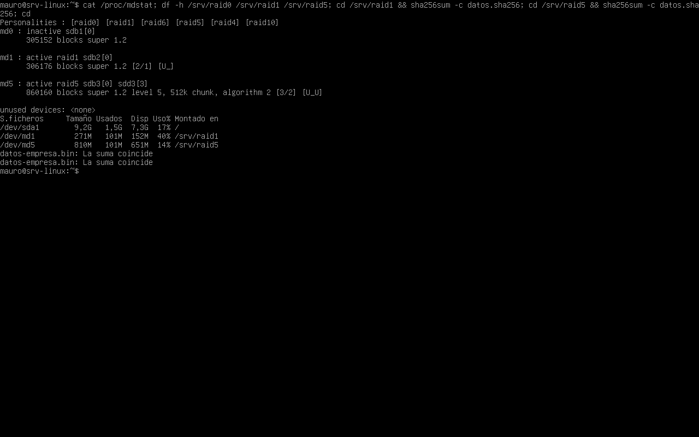
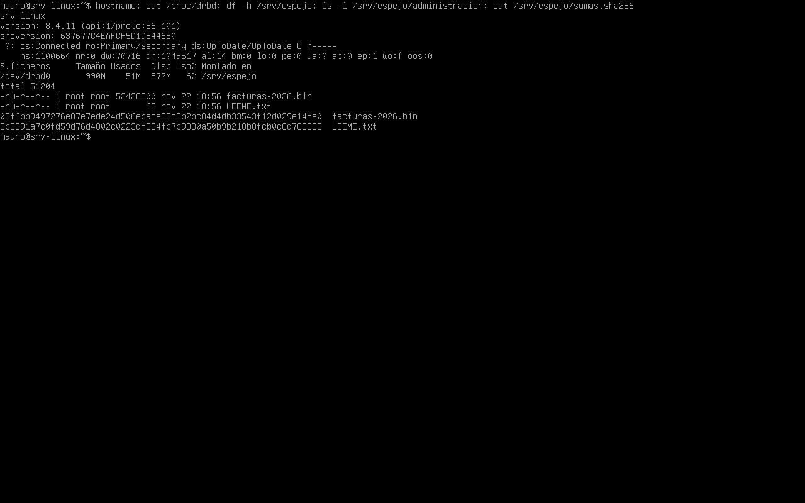
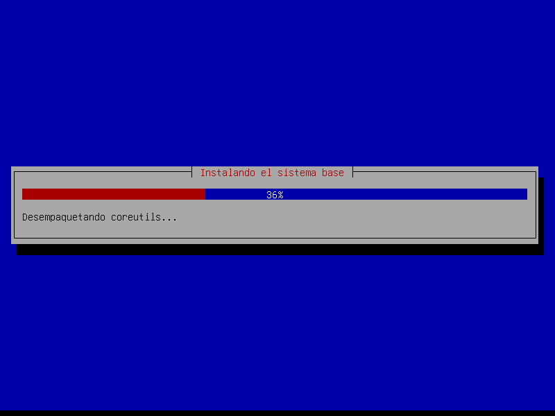
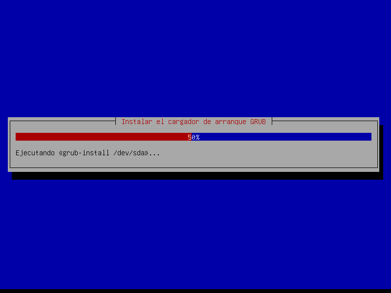
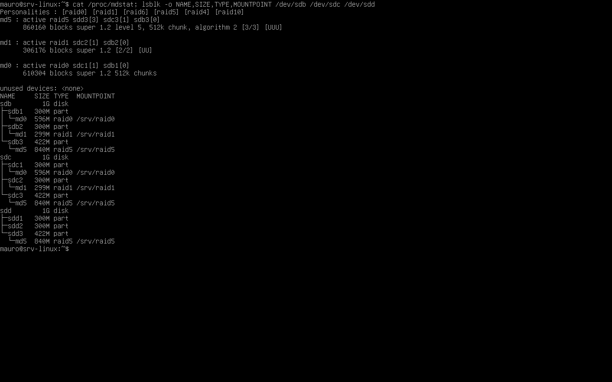
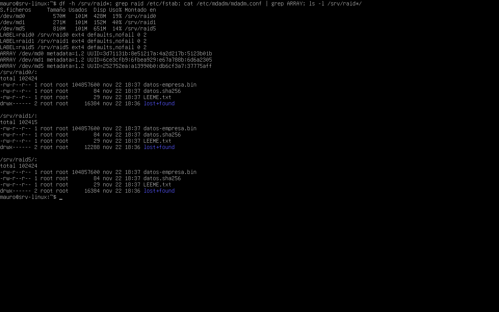
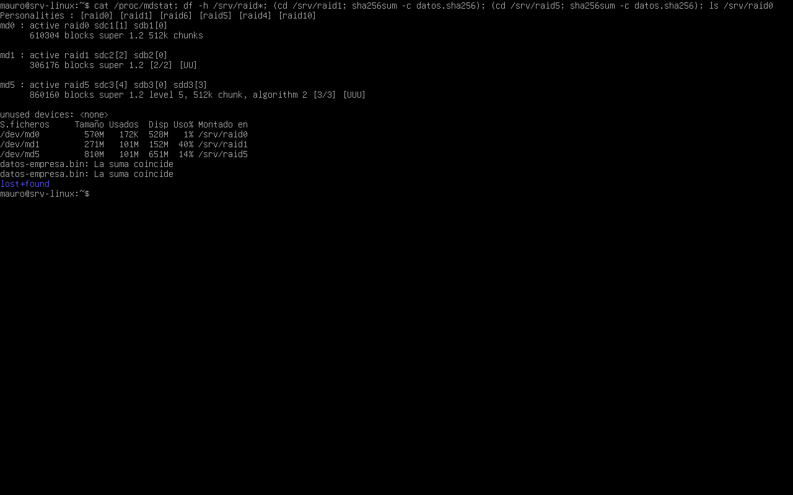
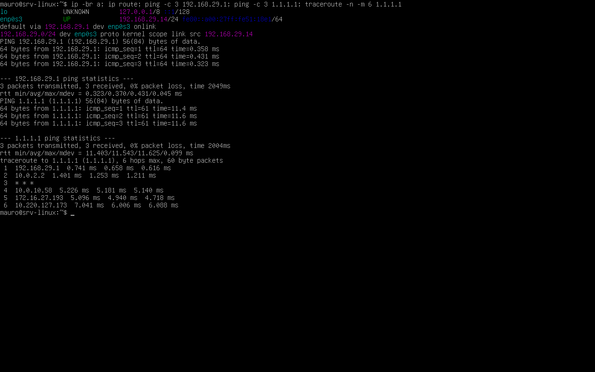
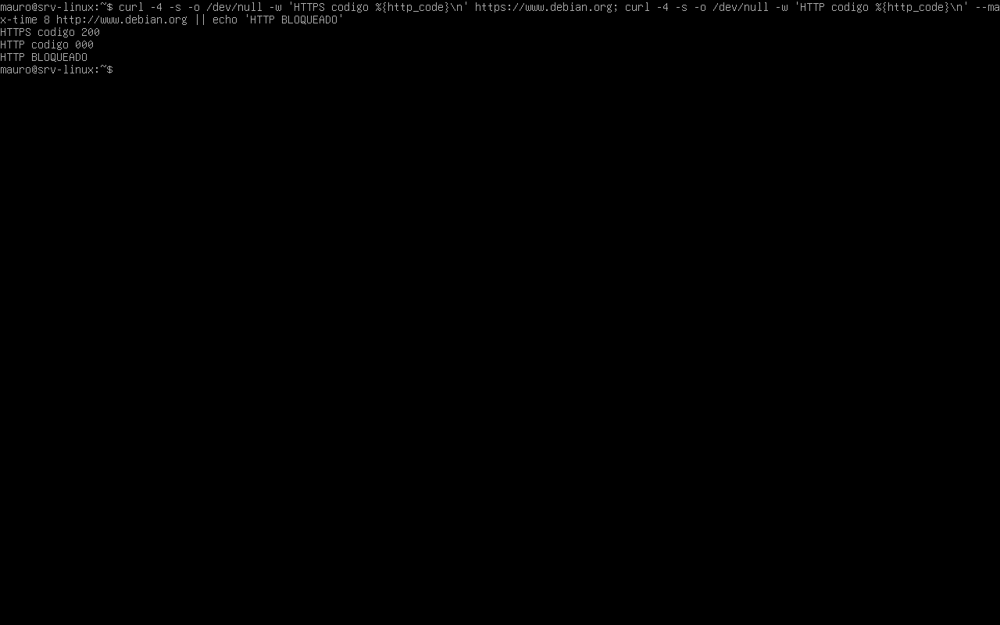
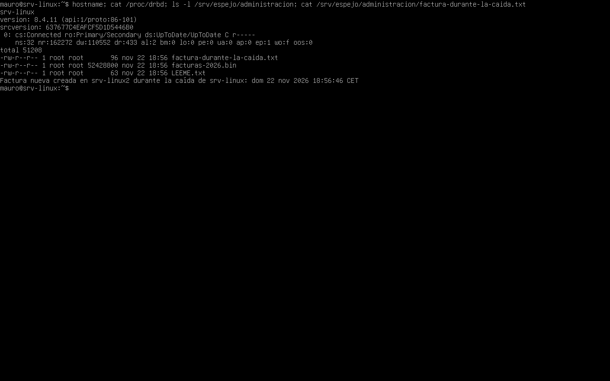

# `srv-linux` · Servidor GNU/Linux de infraestructura (Debian 13) y RAID

| Dato | Valor |
|---|---|
| Función | Servidor Linux de infraestructura · banco de pruebas de RAID (T6) |
| Sistema | Debian GNU/Linux **13.8** «trixie», **sin entorno gráfico**, núcleo 6.12.117 |
| Imagen | `debian-13.1.0-amd64-netinst.iso` (SHA256 verificado, ver [T5](../../tareas/T5-sistemas-e-imagenes.md)) |
| Instalación | Desatendida (`VBoxManage unattended install`) → [INC-004](../../incidencias/INC-004-instalacion-desatendida-postinstall-fallido.md) |
| Recursos | 1 vCPU · 1 GB RAM · disco de sistema 10 GB · **4 discos de 1 GB** para RAID (`raid1…4.vdi`) + **1 disco de 1 GB para DRBD** · BIOS · RTC en UTC |
| Red | `enp0s3` en `lan-iso`, **IP fija 192.168.29.14/24**, pasarela y DNS 192.168.29.1 |
| Usuario | `mauro` (grupos `sudo`, `adm`; `sudo` **pide contraseña**), SSH solo con clave. El `sudo` sin contraseña temporal de la configuración automatizada se retiró al terminar |
| Paquetes añadidos | `openssh-server`, `sudo`, `mdadm`, `rsync`, `curl`, `traceroute`, `dnsutils` |
| Configuración | [interfaces](config/interfaces) · [copia-config.conf](config/copia-config.conf) · [VirtualBox](config/virtualbox-showvminfo.txt) |

## Estado por criterio

| Criterio | Estado | Evidencia |
|---|---|---|
| **a242** Instalar, versión y funcionamiento | ✅ | [srv-01](capturas/srv-01-instalador-sistema-base.png) · [srv-02](capturas/srv-02-instalador-grub-en-sda.png) · `systemd-analyze` 7,5 s |
| **a79** Actualizar antes de producción | ✅ | Repositorios por **HTTPS** + `full-upgrade` → 13.8 · [01-repos-https-actualizacion.txt](salidas/01-repos-https-actualizacion.txt) |
| **a243** Usuarios de administración | ✅ | `mauro` con `sudo` |
| **a244** Parámetros de red | ✅ | IP fija, rutas y DNS · [srv-07](capturas/srv-07-red-ping-traceroute-rutas.png) · [INC-007](../../incidencias/INC-007-debian-hora-y-dns-tras-cambiar-red.md) |
| **a245** Copiar la configuración al servidor de copias y justificar | ✅ | Temporizador diario → SFTP con clave → `nas-truenas:/mnt/copias/srv-linux` · [copia-automatica-al-nas.txt](salidas/copia-automatica-al-nas.txt) |
| **a246** Software necesario para su función | ✅ | Base mínima + SSH + `mdadm`; sin software adicional, como pide el enunciado |
| **a102** Crear y verificar **3 tipos de RAID** | ✅ | RAID 0, 1 y 5 · [T6](../../tareas/T6-almacenamiento-y-recuperacion.md) |
| a105 (Apte+) Automatizar las copias | ✅ | `copia-config.timer` diario a las 02:00 |
| **a107–a109** (Apte+) Espejo entre discos de **dos equipos** | ✅ | DRBD con [`srv-linux2`](../srv-linux2/README.md): caída del primario y relevo en 3,5 s sin pérdida |
| T4 (Apte+) `ping`, `traceroute` y rutas desde la LAN | ✅ | Con los dos routers · [06](salidas/06-red-y-cortafuegos-mikrotik.txt) · [07](salidas/07-red-y-cortafuegos-nftables.txt) |

## 1. ¿Por qué sin escritorio?

Un servidor se administra por SSH. Sin GNOME, el invitado usa **211 MB de RAM** (frente a 1,3 GB de `cli-linux` en la pantalla de login), arranca en **7,5 s** y ocupa **1,5 GB** de disco. Es la optimización 1 de la [T7](../../tareas/T7-rendimiento.md).

## 2. Repositorios por HTTPS

Los dos routers bloquean el puerto 80. Los repositorios que deja el instalador (`http://deb.debian.org`) no funcionarían detrás de ellos. Se cambió a:

```text
deb https://deb.debian.org/debian trixie main non-free-firmware
deb https://deb.debian.org/debian trixie-updates main non-free-firmware
deb https://security.debian.org/debian-security trixie-security main non-free-firmware
```

El original queda en `/etc/apt/sources.list.orig` para poder volver atrás.

## 3. RAID (resumen; detalle en la [T6](../../tareas/T6-almacenamiento-y-recuperacion.md))

| Array | Nivel | Miembros | Tamaño útil | Montaje | Tras perder un disco |
|---|---|---|---|---|---|
| `md0` | RAID 0 | `sdb1` + `sdc1` (2 × 300 MB) | 596 MB | `/srv/raid0` | ❌ **Datos perdidos** |
| `md1` | RAID 1 | `sdb2` + `sdc2` (2 × 300 MB) | 299 MB | `/srv/raid1` | ✅ `[U_]` y la suma SHA256 coincide |
| `md5` | RAID 5 | `sdb3` + `sdc3` + `sdd3` (3 × 422 MB) | 840 MB | `/srv/raid5` | ✅ `[U_U]` y la suma SHA256 coincide |



## 4. Copia de seguridad (a245)

| Se copia | No se copia | Motivo |
|---|---|---|
| `/etc` completo (408 KB comprimido) | El sistema operativo | Debian se reinstala en 15 min; la configuración es lo que no se puede recuperar |
| Lista de paquetes (`dpkg --get-selections`) | `/var/cache`, `/tmp`, registros | Con la lista, `dpkg --set-selections` + `apt-get dselect-upgrade` reinstala los mismos programas |
| Estado de los RAID (`/proc/mdstat`, `mdadm --detail --scan`) | El contenido de `/srv/raid*` (datos de prueba) | Para reconstruir los arrays con la misma definición. Los datos de una empresa tendrían su propia copia (un RAID **no es una copia**) |

## 5. Espejo DRBD con `srv-linux2` (T6, Apte+)

`srv-linux` es el **primario** del recurso `espejo` (`/dev/drbd0` montado en `/srv/espejo`). Detalle y prueba de caída: [`srv-linux2`](../srv-linux2/README.md).



<!-- GALERIA:inicio -->

## Galería de evidencias

Todas las pruebas de esta máquina, en el orden en que se hicieron. Las capturas son de la propia VM; las salidas son el texto literal de los comandos ejecutados, con fecha y hora en la primera línea.

### Salidas de comandos

| # | Fichero | Qué demuestra |
|---|---|---|
| 1 | [`01-repos-https-actualizacion.txt`](salidas/01-repos-https-actualizacion.txt) | srv-linux · repositorios por HTTPS y actualización — 2026-11-22T17:33:23+01:00 |
| 2 | [`02-raid-creacion.txt`](salidas/02-raid-creacion.txt) | srv-linux · creación de RAID 0, 1 y 5 con mdadm — 2026-11-22T17:36:25+01:00 |
| 3 | [`03-raid-datos-y-velocidad.txt`](salidas/03-raid-datos-y-velocidad.txt) | srv-linux · datos de prueba y velocidad de escritura — 2026-11-22T17:37:13+01:00 |
| 4 | [`04-raid-fallo-de-disco.txt`](salidas/04-raid-fallo-de-disco.txt) | srv-linux · fallo de un disco: se desconecta raid2.vdi (sdc) con la VM apagada — 2026-11-22T17:38:48+01:00 |
| 5 | [`05-raid-reconstruccion.txt`](salidas/05-raid-reconstruccion.txt) | srv-linux · sustitución del disco y reconstrucción — 2026-11-22T17:39:49+01:00 |
| 6 | [`06-red-y-cortafuegos-mikrotik.txt`](salidas/06-red-y-cortafuegos-mikrotik.txt) | Red individual con r-mikrotik como router — pruebas desde srv-linux (192.168.29.14) — 2026-11-22T17:44:15+01:00 |
| 7 | [`07-red-y-cortafuegos-nftables.txt`](salidas/07-red-y-cortafuegos-nftables.txt) | Red individual con r-nftables como router — pruebas desde srv-linux (192.168.29.14) — 2026-11-22T17:49:43+01:00 |
| 8 | [`08-espejo-drbd-creacion.txt`](salidas/08-espejo-drbd-creacion.txt) | Espejo DRBD entre srv-linux (.14) y srv-linux2 (.16) — creación — 2026-11-22T18:54:57+01:00 |
| 9 | [`copia-automatica-al-nas.txt`](salidas/copia-automatica-al-nas.txt) | srv-linux · copia automática de la configuración al NAS — 2026-11-22T18:22:26+01:00 |

### Capturas

<details open><summary><b>01. Instalador sistema base</b> · <code>srv-01-instalador-sistema-base.png</code></summary>



</details>

<details open><summary><b>02. Instalador grub en sda</b> · <code>srv-02-instalador-grub-en-sda.png</code></summary>



</details>

<details open><summary><b>03. Raid mdstat lsblk</b> · <code>srv-03-raid-mdstat-lsblk.png</code></summary>



</details>

<details open><summary><b>04. Raid montados fstab</b> · <code>srv-04-raid-montados-fstab.png</code></summary>



</details>

<details open><summary><b>05. Fallo disco raid0 perdido raid1 raid5 degradados</b> · <code>srv-05-fallo-disco-raid0-perdido-raid1-raid5-degradados.png</code></summary>


</details>

<details open><summary><b>06. Raid reconstruido uu uuu</b> · <code>srv-06-raid-reconstruido-uu-uuu.png</code></summary>



</details>

<details open><summary><b>07. Red ping traceroute rutas</b> · <code>srv-07-red-ping-traceroute-rutas.png</code></summary>



</details>

<details open><summary><b>08. Https permitido http bloqueado</b> · <code>srv-08-https-permitido-http-bloqueado.png</code></summary>



</details>

<details open><summary><b>09. Espejo drbd primario con datos</b> · <code>srv-09-espejo-drbd-primario-con-datos.png</code></summary>


</details>

<details open><summary><b>10. Espejo vuelve y recibe cambios</b> · <code>srv-10-espejo-vuelve-y-recibe-cambios.png</code></summary>



</details>

<!-- GALERIA:fin -->
