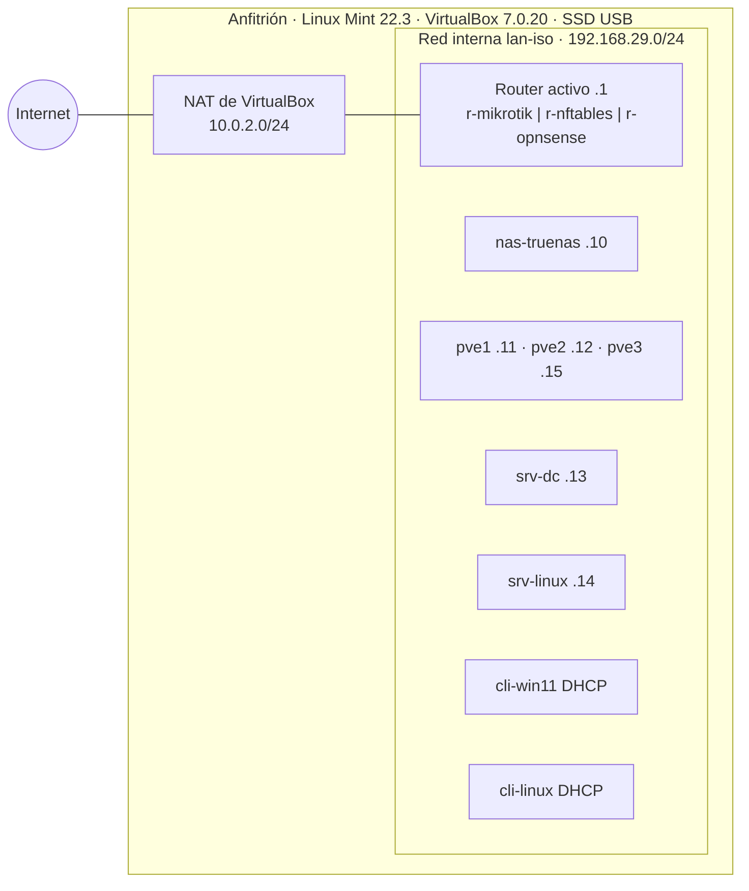

# T0 · Mi entorno de pruebas

| RA | Criterio | Estado |
|---|---|---|
| FDM RA1 | a17 Preparar el entorno propio de pruebas | ✅ 12 VM creadas (11 del diseño + `srv-linux2` para el espejo); 11 instaladas y configuradas |
| FDM RA1 | a18 Identificar los recursos físicos y justificar sus limitaciones | ✅ §2 y §4 (medido en [T7](T7-rendimiento.md)) |
| FDM RA1 | a127 (Apte+) Documentar en Markdown y Git: esquema de VM, recursos y problemas resueltos | ✅ Este repositorio |

Memoria en PDF entregada en su momento: [T0_Mi_entorno_de_pruebas_memoria.pdf](../anexos/memorias/T0_Mi_entorno_de_pruebas_memoria.pdf). Este documento la **sustituye y corrige**.

> **Qué se ha corregido respecto a la memoria del 19/11:**
> 1. Decía «un único ordenador físico» con Core Ultra 5 125H y 30 GiB. Son **dos equipos** (clase y casa) y el entorno viaja en un **SSD USB** ([T2](T2-equipos-clase-y-casa.md)).
> 2. «Debian 13.1 con pantalla negra, causa no determinada» → **causa encontrada y resuelta** (GRUB no instalado, [INC-001](../incidencias/INC-001-cli-linux-pantalla-negra-sin-grub.md)). Es Debian **13.7** y pasa a ser `cli-linux`.
> 3. «Windows 11: instalación no verificada» → **verificada**: arranca hasta la pantalla de bloqueo.
> 4. Solo había 2 de las 11 VM. Ahora están **las 11 creadas** con los recursos del diseño, la red interna y las ISO verificadas.

## 1. Dónde vive el entorno

| Dato | Valor |
|---|---|
| Disco del laboratorio | **SanDisk Portable SSD 931,5 GB (USB)**. Contiene Linux Mint 22.3 (`/`, 122 GB) y `/home` (808 GB, **689 GB libres**) |
| Sistema anfitrión | Linux Mint 22.3 «Zena», núcleo 6.8.0-138 |
| Hipervisor | Oracle VirtualBox **7.0.20** r163906 + Extension Pack |
| Equipos | 🏫 Portátil de clase (Core Ultra 5 125H, 30 GiB) · 🏠 Sobremesa de casa (i5-11400F, 16 GB) |
| Configuración de las VM | `~/VirtualBox-ThinkLab/ISO-individual/<vm>/` (carpeta por defecto de VirtualBox) |
| Discos de las VM | `~/VirtualBox VMs/ISO-individual/<vm>/` |
| ISO | `~/Escritorio/1 ASIX/ISO/` y `…/ISO/isos/` (fuera del repositorio) |
| Credenciales | `~/Escritorio/1 ASIX/ISO/credenciales-lab.txt` con permisos `600`, **fuera del repositorio** |

**Por qué así:** el mismo SSD arranca en los dos equipos, así que el laboratorio está igual en clase y en casa sin copiar nada. El precio es que todo depende de la velocidad del puerto USB ([INC-002](../incidencias/INC-002-ssd-portatil-en-usb2.md)).

## 2. Las 11 máquinas virtuales

Todas en el grupo de VirtualBox `/ISO-individual`, con discos VDI **dinámicos**: el tamaño es el máximo, pero solo ocupan lo escrito.

| VM | Función | Sistema | vCPU | RAM | Disco | Firmware | Red | Estado |
|---|---|---|---:|---:|---|---|---|---|
| [`r-mikrotik`](../maquinas/r-mikrotik/README.md) | Router 1 | RouterOS CHR 7.24.5 | 1 | 256 MB | 89 MB (imagen CHR) | BIOS | NAT + `lan-iso` | ✅ Configurado y probado |
| [`r-opnsense`](../maquinas/r-opnsense/README.md) | Router 2 | OPNsense 26.7.9_3 | 2 | 2 GB | 20 GB | BIOS | NAT + `lan-iso` | ✅ Configurado y probado |
| [`r-nftables`](../maquinas/r-nftables/README.md) | Router 3 | Debian 13.8 + nftables | 1 | 1 GB | 8 GB | BIOS | NAT + `lan-iso` | ✅ Configurado y probado |
| [`nas-truenas`](../maquinas/nas-truenas/README.md) | NAS / copias | TrueNAS 25.10.7 | 2 | 8 GB | 20 + 20 GB | BIOS | `lan-iso` | ✅ Configurado; recibe copias |
| [`pve1`](../maquinas/pve1/README.md) | Nodo Proxmox | Proxmox VE 9.2.2 | 2 | 2 GB (4 previstos) | 32 GB | UEFI, VT-x anidada | `lan-iso` | ✅ En `cluster-iso29` |
| [`pve2`](../maquinas/pve2/README.md) | Nodo Proxmox | Proxmox VE 9.2.2 | 2 | 2 GB (4 previstos) | 32 GB | UEFI, VT-x anidada | `lan-iso` | ✅ En `cluster-iso29` |
| [`pve3`](../maquinas/pve3/README.md) | Nodo Proxmox | Proxmox VE 9.2.2 | 2 | 2 GB (4 previstos) | 32 GB | UEFI, VT-x anidada | `lan-iso` | ✅ En `cluster-iso29` |
| [`srv-dc`](../maquinas/srv-dc/README.md) | Dominio `iso29.lan` | Windows Server 2025 Eval. | 2 | 4 GB | 50 GB | UEFI + TPM 2.0 | `lan-iso` | ✅ DC, OU, GPO y copias |
| [`srv-linux`](../maquinas/srv-linux/README.md) | Servidor Linux + RAID | Debian 13.8 sin escritorio | 1 | 1 GB | 10 GB + 5 × 1 GB | BIOS | `lan-iso` | ✅ RAID 0/1/5 y DRBD |
| [`srv-linux2`](../maquinas/srv-linux2/README.md) | Espejo DRBD (T6) | Debian 13.8 (clon) | 1 | 1 GB | 10 GB + 1 GB | BIOS | `lan-iso` | ✅ Relevo probado |
| [`cli-win11`](../maquinas/cli-win11/README.md) | Cliente Windows | Windows 11 | 2 | 4 GB | 80 GB | UEFI + SB + TPM 2.0 | NAT → `lan-iso` | ✅ Instalado · ⏳ configurar |
| [`cli-linux`](../maquinas/cli-linux/README.md) | Cliente Linux | Debian 13.8 + GNOME | 1 | 2 GB | 20 GB | BIOS | `lan-iso` (DHCP) | ✅ Reparado y configurado |
| | | | **19** | **29,25 GB** (con los nodos Proxmox a 2 GB) | | | | |

## 3. Esquema

Detalle de direcciones e interfaces: [T4](T4-red-individual.md).

## 4. Limitaciones y cómo las gestiono

| Recurso | Limitación (medida) | Decisión |
|---|---|---|
| **RAM** | Las 11 VM suman 34,25 GB. En casa hay 16 GB y en clase 30 GiB. Con 2 VM de escritorio en casa quedan 5,4 GB y con una 3.ª grande empieza el *swap* ([T7](T7-rendimiento.md)) | **Escenarios**: un solo router encendido; servidores sin escritorio (1 GB); clúster Proxmox solo en el equipo de clase |
| **Disco** | En casa el SSD está en **USB 2.0**: 41 MB/s, al 80–93 % con una sola VM de Windows | Cambiar a un puerto USB 3.x ([INC-002](../incidencias/INC-002-ssd-portatil-en-usb2.md)) |
| CPU | 12 hilos en casa y 18 en clase; nunca superó el 15 % | No limita |
| Proxmox dentro de VirtualBox | Virtualización anidada: las VM de dentro van lentas | Solo para practicar clúster y migración |

| Escenario | VM encendidas | RAM asignada | ¿Dónde? |
|---|---|---|---|
| Comunicaciones | 1 router + `srv-linux` + `nas-truenas` | 9,3–10,3 GB | Casa ✅ (probado el 22/11) |
| Clientes | 1 router + `cli-win11` + `cli-linux` | 6,3–8 GB | Casa ✅ |
| Dominio | 1 router + `srv-dc` + `cli-win11` + `cli-linux` | 10,3–12 GB | Casa (justo) / clase |
| Clúster | 1 router + `pve1-3` a 2 GB (sin NAS) | 8–9 GB | Casa ✅ (probado el 22/11) · con NAS y 4 GB por nodo, solo en clase |

## 5. Comparación con el entorno del grupo

| Aspecto | Grupo 3 (aula) | Mi entorno |
|---|---|---|
| Ejecución | Equipos físicos + servidor Proxmox del centro | Un equipo con VirtualBox (el de clase o el de casa) |
| Router | MikroTik hEX **físico**; OPNsense y nftables en VirtualBox | Los tres virtuales (MikroTik como CHR) |
| WAN | Red del aula 172.16.222.0/24 | NAT de VirtualBox |
| LAN | 192.168.30.0/24 con switches físicos | **192.168.29.0/24** (puesto 29), red interna `lan-iso` |
| NAS | TrueNAS en un PC con SSD + HDD de 2 TB | TrueNAS virtual, disco de 20 GB aparte para copias |
| Clientes | Portátiles del aula | `cli-win11` y `cli-linux` |

## 6. Problemas encontrados y soluciones

| # | Problema | Estado |
|---|---|---|
| [INC-001](../incidencias/INC-001-cli-linux-pantalla-negra-sin-grub.md) | Debian arranca en pantalla negra: GRUB no instalado | ✅ Resuelta |
| [INC-002](../incidencias/INC-002-ssd-portatil-en-usb2.md) | SSD del laboratorio en un puerto USB 2.0 en casa | 🔎 Diagnosticada; falta cambiar de puerto |
| [INC-003](../incidencias/INC-003-cli-win11-apagado-colgado.md) | Windows 11 colgado al apagarse | ✅ Recuperada |
| [INC-004](../incidencias/INC-004-instalacion-desatendida-postinstall-fallido.md) | Instalación desatendida: falla el *post-install* | ✅ Resuelta |
| [INC-005](../incidencias/INC-005-truenas-cambio-de-ip-revertido.md) | TrueNAS deshace el cambio de IP | ✅ Resuelta |
| [INC-006](../incidencias/INC-006-mikrotik-sftp-status-4.md) | Copia del MikroTik al NAS: `sftp status 4` | ✅ Resuelta |
| [INC-007](../incidencias/INC-007-debian-hora-y-dns-tras-cambiar-red.md) | Hora +1 h y `resolv.conf` vacío | ✅ Resuelta |
