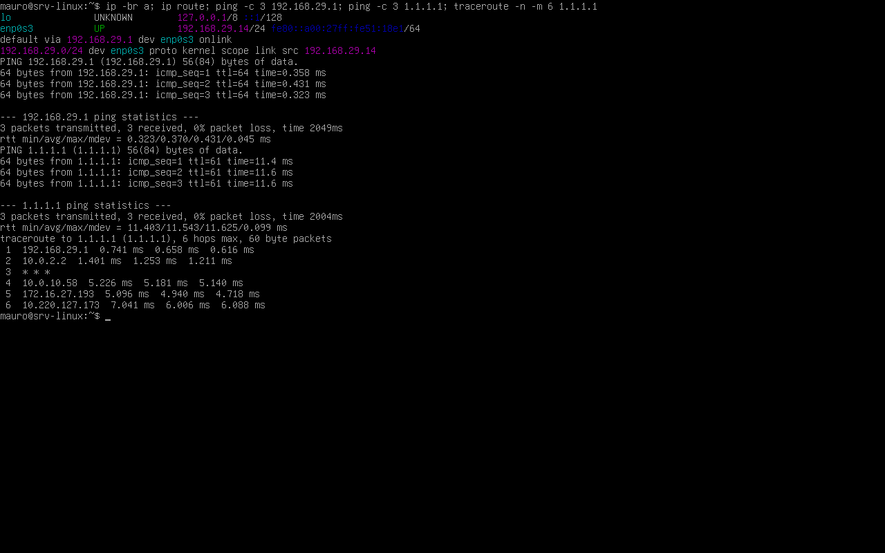
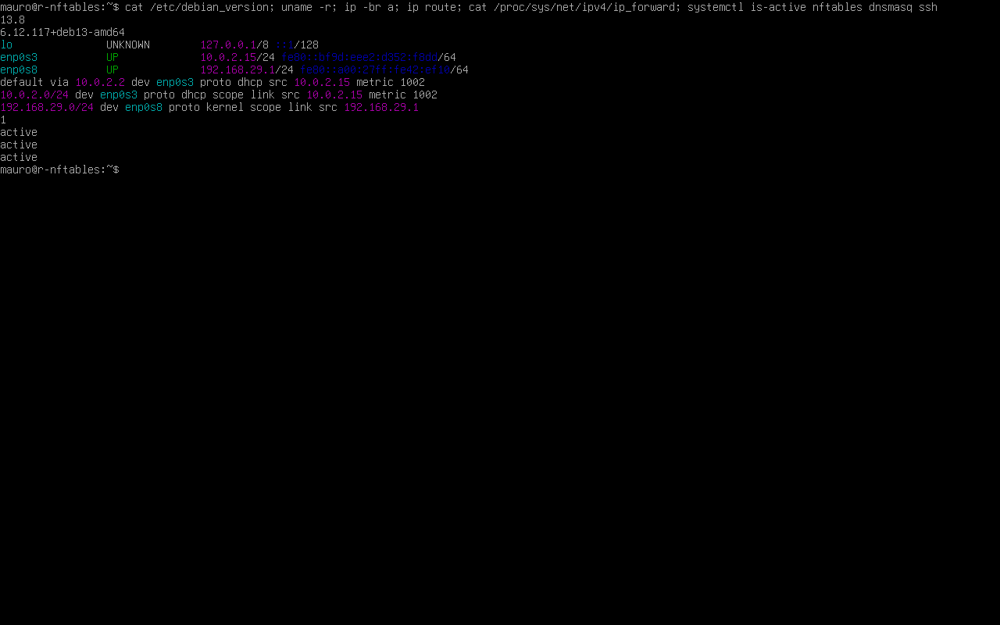

# T4 · Diseño físico y lógico de mi red individual

| RA | Criterio | Estado |
|---|---|---|
| ISO RA1 | a128 Dibujar el esquema de red individual, el montaje virtual y las direcciones previstas | ✅ |
| ISO RA1 | a148 Configuración de cada interfaz y LAN 192.168.**XX**.0/24 según el puesto (XX = **29**); WAN por DHCP (NAT) | ✅ |
| ISO RA1 | a129 · a149 (Apte+) Implementar la red y comprobarla con `ping`, `traceroute`, tablas de rutas y configuración de interfaces, entre VM y hacia el exterior | ✅ Con `r-mikrotik` y con `r-nftables` |

## 1. Decisiones de diseño

| Decisión | Por qué |
|---|---|
| **LAN 192.168.29.0/24** | Mi puesto en el aula es el 29. Así no coincide con la de ningún compañero ni con la del grupo 3 (192.168.30.0/24) |
| **WAN = NAT de VirtualBox** (10.0.2.0/24, DHCP) | Funciona igual en casa y en clase, sin pedir IP al profesorado y sin exponer las VM a la red real. El enunciado recomienda NAT antes que adaptador puente |
| **Red interna `lan-iso`** como switch virtual | Solo la ven las VM que conecto. Modo promiscuo «Permitir todo» para que funcione el reenvío del router y los puentes de Proxmox |
| **Los tres routers usan la misma IP 192.168.29.1** | Se puede cambiar de router sin tocar ningún cliente. **Solo uno conectado a la vez**: el otro queda con el cable desconectado (`VBoxManage controlvm <vm> setlinkstate2 off`) |
| **Servidores con IP fija, clientes por DHCP** | A un servidor hay que poder encontrarlo siempre en la misma IP. A un cliente no lo busca nadie |
| **Dominio DNS interno `iso29.lan`** | `.lan` no existe en Internet, así que no hay conflictos |

## 2. Esquema

```mermaid
flowchart TB
    INET((Internet)) --- HOST["Anfitrión Linux Mint 22.3<br/>casa: enp3s0 192.168.1.180<br/>clase: red del aula"]
    HOST --- NAT["NAT de VirtualBox<br/>10.0.2.0/24 · pasarela 10.0.2.2"]
    NAT -- "WAN DHCP 10.0.2.15" --> MK["r-mikrotik<br/>ether1 WAN · ether2 LAN<br/>192.168.29.1"]
    NAT -. "WAN DHCP 10.0.2.15" .-> NFT["r-nftables<br/>enp0s3 WAN · enp0s8 LAN<br/>192.168.29.1"]
    NAT -. "WAN" .-> OPN["r-opnsense<br/>192.168.29.1<br/>(pendiente)"]
    MK --- SW{{"switch virtual · red interna lan-iso<br/>192.168.29.0/24"}}
    NFT -. "un router a la vez" .- SW
    OPN -. .- SW
    SW --- NAS["nas-truenas<br/>192.168.29.10"]
    SW --- SRV["srv-linux<br/>192.168.29.14<br/>RAID 0/1/5"]
    SW --- DC["srv-dc<br/>192.168.29.13"]
    SW --- PVE["pve1 .11 · pve2 .12 · pve3 .15"]
    SW --- CW["cli-win11<br/>DHCP .100–.200"]
    SW --- CL["cli-linux<br/>DHCP .100–.200"]
```

## 3. Plan de direcciones

| Rango | Uso |
|---|---|
| .1 | Puerta de enlace (el router activo) |
| .2 – .9 | Reservado (infraestructura de red) |
| .10 – .19 | Servidores con IP fija |
| .20 – .29 | Contenedores y VM dentro de Proxmox |
| .100 – .200 | DHCP para clientes |

## 4. Configuración de cada interfaz

| VM | Interfaz (VirtualBox → invitado) | Red | IP / máscara | Puerta de enlace | DNS | Método | Estado |
|---|---|---|---|---|---|---|---|
| `r-mikrotik` | Adaptador 1 → `ether1` | NAT | 10.0.2.15/24 | 10.0.2.2 | 10.0.2.3 | DHCP | ✅ comprobado |
| `r-mikrotik` | Adaptador 2 → `ether2` | `lan-iso` | **192.168.29.1/24** | — | — | Fija | ✅ comprobado |
| `r-nftables` | Adaptador 1 → `enp0s3` | NAT | 10.0.2.15/24 | 10.0.2.2 | 10.0.2.3 | DHCP | ✅ comprobado |
| `r-nftables` | Adaptador 2 → `enp0s8` | `lan-iso` | **192.168.29.1/24** | — | — | Fija | ✅ comprobado |
| `r-opnsense` | Adaptador 1 → `em0` / 2 → `em1` | NAT / `lan-iso` | DHCP / 192.168.29.1/24 | 10.0.2.2 | — | DHCP / Fija | ⏳ previsto |
| `nas-truenas` | Adaptador 1 → `enp0s3` | `lan-iso` | 192.168.29.10/24 | 192.168.29.1 | 192.168.29.1 | Fija | ver [ficha](../maquinas/nas-truenas/README.md) |
| `pve1` / `pve2` / `pve3` | Adaptador 1 → `vmbr0` | `lan-iso` | .11 / .12 / .15 | 192.168.29.1 | 192.168.29.1 | Fija | ⏳ previsto |
| `srv-dc` | Adaptador 1 → Ethernet | `lan-iso` | 192.168.29.13/24 | 192.168.29.1 | 127.0.0.1 (él mismo) | Fija | ⏳ previsto |
| `srv-linux` | Adaptador 1 → `enp0s3` | `lan-iso` | **192.168.29.14/24** | 192.168.29.1 | 192.168.29.1 | Fija | ✅ comprobado |
| `cli-win11` | Adaptador 1 → Ethernet | `lan-iso` (hoy NAT) | .100–.200 | por DHCP | por DHCP | DHCP | ⏳ falta pasarla a `lan-iso` |
| `cli-linux` | Adaptador 1 → `enp0s3` | `lan-iso` (hoy NAT) | .100–.200 | por DHCP | por DHCP | DHCP | ⏳ falta pasarla a `lan-iso` |

Configuraciones reales: [VirtualBox de cada VM](../maquinas/) (`config/virtualbox-showvminfo.txt`) · [interfaces de r-nftables](../maquinas/r-nftables/config/interfaces) · [interfaces de srv-linux](../maquinas/srv-linux/config/interfaces).

## 5. Comprobaciones (ampliación Apte+)

Todas desde `srv-linux` (192.168.29.14), un equipo de la LAN.

### 5.1 Con `r-mikrotik` como router



| Prueba | Resultado | Qué demuestra |
|---|---|---|
| `ip -br a` · `ip route` | `enp0s3 192.168.29.14/24` · `default via 192.168.29.1` | IP fija y ruta por defecto hacia el router |
| `ping 192.168.29.1` | 0 % pérdidas, 0,37 ms | La LAN virtual funciona |
| `ping 1.1.1.1` | 0 % pérdidas, 11,5 ms | Hay salida a Internet (NAT del router + NAT de VirtualBox) |
| `traceroute -n 1.1.1.1` | 1.º salto **192.168.29.1** (router) → 2.º **10.0.2.2** (NAT de VirtualBox) → red de casa → operador | El camino es el previsto: LAN → router → NAT → Internet |
| `dig www.debian.org @192.168.29.1` | `130.89.148.77` | El router resuelve nombres para la LAN |

Salida completa: [06-red-y-cortafuegos-mikrotik.txt](../maquinas/srv-linux/salidas/06-red-y-cortafuegos-mikrotik.txt).
Tabla de rutas del propio router: [captura](../maquinas/r-mikrotik/capturas/mk-05-interfaces-ip.png) (`0.0.0.0/0 → 10.0.2.2`, `192.168.29.0/24 → ether2`).

### 5.2 Con `r-nftables` como router

Se desconecta el cable LAN del MikroTik y se conecta el de r-nftables, **sin tocar `srv-linux`**:

```bash
VBoxManage controlvm r-mikrotik setlinkstate2 off
VBoxManage controlvm r-nftables setlinkstate2 on
```

Mismos resultados: `ping` 0 % de pérdidas y `traceroute` 192.168.29.1 → 10.0.2.2 → … ([salida](../maquinas/srv-linux/salidas/07-red-y-cortafuegos-nftables.txt)). Interfaces y rutas del router:


