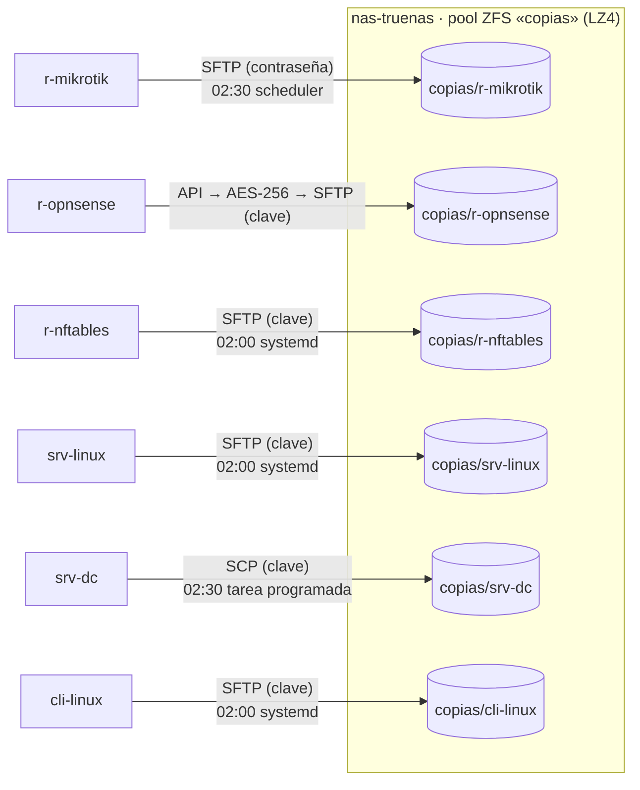

# T5 · Plan de copias de seguridad: qué, cómo, dónde y cuándo

Criterios: **a259** (preparar el espacio de copias en TrueNAS y justificar qué, cómo y dónde), **a208, a215, a222, a231, a240, a245, a250, a255** (copiar la configuración de cada equipo) y **a105** (ampliación Apte+: automatizarlo).

## 1. Dónde: `nas-truenas`

Pool ZFS `copias` en un **disco dedicado** de 20 GB, separado del de sistema, con **un dataset, un usuario y una clave por máquina** (permisos `700`). Detalle: [nas-truenas](../maquinas/nas-truenas/README.md).

## 2. Qué se copia, cómo y cuándo

| Máquina | Qué se copia | Qué **no** y por qué | Cómo | Cuándo | Restauración probada |
|---|---|---|---|---|---|
| `r-mikrotik` | `.backup` binario (cifrado) + `.rsc` de texto | El sistema: es una imagen CHR de 89 MB que se vuelve a descargar | `/tool fetch` SFTP | Diario 02:30 | ✅ **39 s** |
| `r-opnsense` | `config.xml` (cifrado AES-256) | El sistema y los gráficos RRD | API + `openssl` + SFTP | Antes de cada cambio | ✅ **69 s** |
| `r-nftables` | 6 ficheros de configuración (4 KB) | El sistema Debian | `copia-config.sh` + SFTP | Diario 02:00 | ✅ **1,3 s** |
| `srv-linux` | `/etc`, lista de paquetes y definición de los RAID | Los datos de `/srv/raid*` (son de prueba) | `copia-config.sh` + SFTP | Diario 02:00 | — |
| `srv-dc` | AD (`ntds.dit`) + SYSVOL + registro + GPO + CSV de usuarios y grupos | La imagen del servidor (50 GB) | `ntdsutil ifm` + `scp` | Diario 02:30 | — |
| `cli-linux` | `/etc`, lista de paquetes y `/home/mauro` | El sistema (7,8 GB) | `copia-config.sh` + SFTP | Diario 02:00 | — |
| `cli-win11` | Documentos y Escritorio del usuario | Windows y programas (se reinstalan) | `scp` (OpenSSH de Windows) | ⏳ Necesita iniciar sesión en la VM | — |
| `pve1-3` | `/etc/pve` + `vzdump` de las VM y CT | — | — | ⏳ | — |

**Regla general:** se copia lo que **no se puede reconstruir** (configuración y datos). No se copia lo que se reinstala desde una ISO verificada en minutos (el sistema operativo).

## 3. Seguridad de las copias

- **Privilegio mínimo:** cada máquina tiene su usuario en el NAS y solo ve su carpeta. Si se compromete un router, no puede borrar las copias del dominio.
- **Sin contraseñas guardadas:** claves SSH ed25519. La única excepción es MikroTik, porque `/tool fetch` no admite claves ([INC-006](../incidencias/INC-006-mikrotik-sftp-status-4.md)).
- **Cifrado** de las copias con secretos: MikroTik (`.backup` con contraseña) y OPNsense (AES-256).
- **Integridad:** cada copia lleva su `.sha256`, que se comprueba **antes** de restaurar.
- **Retención:** 7 copias locales en cada equipo; en el NAS, ZFS permite añadir instantáneas periódicas.

## 4. Limitaciones y mejora (regla 3-2-1)

La regla **3-2-1** pide 3 copias, en 2 soportes distintos y 1 fuera de la empresa. Ahora hay 2 copias (local + NAS) y las dos están en el mismo equipo físico. **Mejoras propuestas:** replicar el pool con `zfs send` a otro NAS o a la nube y activar las instantáneas diarias de ZFS como protección frente a *ransomware*.
