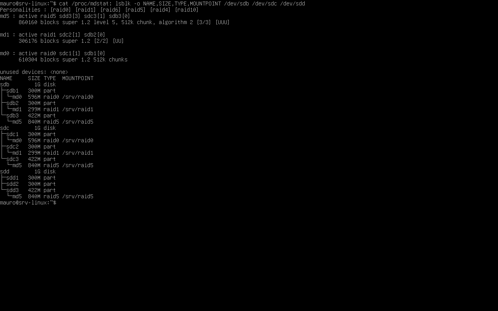
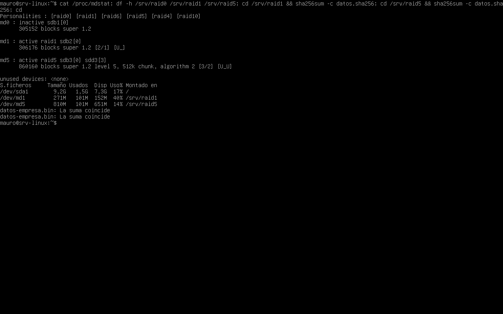
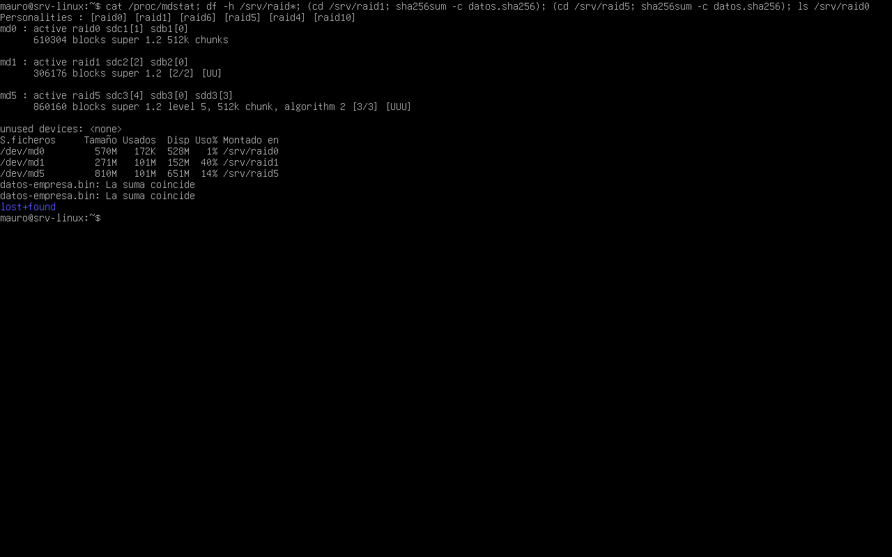

# T6 · Almacenamiento y recuperación

| RA | Criterio | Estado |
|---|---|---|
| ISO RA3 | a102 Crear y verificar al menos tres tipos de RAID | ✅ RAID 0, 1 y 5 en [`srv-linux`](../maquinas/srv-linux/README.md), con fallo y reconstrucción |
| ISO RA3 | a103 Explicar qué aporta cada tipo de RAID | ✅ §1 |
| ISO RA3 | a107 (Apte+) Investigar y justificar el espejo entre discos de dos equipos | ✅ §4 |
| ISO RA3 | a108 · a109 (Apte+) Implementarlo, verificarlo y explicar un caso de uso | ✅ DRBD entre `srv-linux` y `srv-linux2`: caída del primario, relevo en 3,5 s y cero pérdida ([§5](#5-espejo-drbd-implementado-a108-a109)) |

## 1. Qué aporta cada RAID

| Nivel | Cómo guarda los datos | Discos mín. | Capacidad útil | Soporta perder | Para qué |
|---|---|---|---|---|---|
| **RAID 0** (*striping*) | Reparte cada fichero en trozos entre los discos | 2 | 100 % (n × disco) | **0 discos**: si cae uno se pierde todo | Velocidad y espacio para datos temporales o recalculables (caché, renders) |
| **RAID 1** (*mirroring*) | Escribe lo mismo en todos los discos | 2 | 50 % (1 disco) | n − 1 | Sistema operativo y datos críticos pequeños; lectura rápida y reconstrucción sencilla |
| **RAID 5** (paridad distribuida) | Trozos de datos + un bloque de **paridad XOR** repartido entre todos | 3 | (n − 1) × disco | **1 disco** | Equilibrio entre capacidad y seguridad: servidores de ficheros |

> **Un RAID no es una copia de seguridad.** Protege contra la avería de un disco, no contra un borrado, un *ransomware* o un incendio. Por eso además hay copias en el NAS ([nas-truenas](../maquinas/nas-truenas/README.md)).

## 2. Montaje en `srv-linux`

Cuatro discos virtuales de 1 GB (`sdb`–`sde`). `sdb`, `sdc` y `sdd` se parten en tres particiones de tipo *Linux RAID* (300 MB, 300 MB y 422 MB), y `sde` queda de **repuesto**. Así, un mismo disco forma parte de los tres arrays y **una sola avería afecta a los tres a la vez**, lo que permite comparar cómo reacciona cada nivel.

```bash
printf 'label: gpt\n,300M,R\n,300M,R\n,,R\n' | sudo sfdisk /dev/sdX      # R = Linux RAID
sudo mdadm --create /dev/md0 --level=0 --raid-devices=2 /dev/sdb1 /dev/sdc1
sudo mdadm --create /dev/md1 --level=1 --raid-devices=2 /dev/sdb2 /dev/sdc2
sudo mdadm --create /dev/md5 --level=5 --raid-devices=3 /dev/sdb3 /dev/sdc3 /dev/sdd3
sudo mkfs.ext4 -L raidN /dev/mdN ; echo 'LABEL=raidN /srv/raidN ext4 defaults,nofail 0 2' | sudo tee -a /etc/fstab
sudo mdadm --detail --scan | sudo tee -a /etc/mdadm/mdadm.conf ; sudo update-initramfs -u
```

`nofail` en `fstab` hace que, si un array no arranca, el servidor **arranque igualmente** en lugar de quedarse en modo de emergencia.



| Array | Capacidad teórica | Real (`df -h`) |
|---|---|---|
| RAID 0 (2 × 300 MB) | 600 MB | 570 MB |
| RAID 1 (2 × 300 MB) | 300 MB | 271 MB |
| RAID 5 (3 × 422 MB) | 844 MB | 810 MB |

La diferencia es el espacio que reserva ext4 para sus metadatos. Salida completa: [02-raid-creacion.txt](../maquinas/srv-linux/salidas/02-raid-creacion.txt).

**Datos de prueba:** 100 MB aleatorios en cada array + su suma SHA256 ([03-raid-datos-y-velocidad.txt](../maquinas/srv-linux/salidas/03-raid-datos-y-velocidad.txt)).

> Sobre la velocidad: `dd … oflag=direct` dio 32,7 MB/s (RAID 0), 1,2 GB/s (RAID 1) y 744 MB/s (RAID 5). **No son comparables:** la caché de VirtualBox absorbe las escrituras y todos los «discos» están en el mismo SSD USB 2.0 ([INC-002](../incidencias/INC-002-ssd-portatil-en-usb2.md)). Con discos físicos, RAID 0 sería el más rápido al escribir y RAID 5 el más lento, por el cálculo de la paridad.

## 3. Prueba de avería y reconstrucción

1. **Avería:** con la VM apagada se **desconecta** `raid2.vdi` (el disco `sdc`), como si se hubiera estropeado: `VBoxManage storageattach srv-linux --storagectl SATA --port 2 --medium none`.
2. **Al arrancar**, los tres arrays aparecen `inactive`: Debian **no arranca automáticamente un RAID degradado**, por seguridad. Hay que decidirlo a mano:

   ```bash
   sudo mdadm --run /dev/md1   # started
   sudo mdadm --run /dev/md5   # started
   sudo mdadm --run /dev/md0   # failed to start array /dev/md0: Invalid argument
   ```

3. **Resultado** ([04-raid-fallo-de-disco.txt](../maquinas/srv-linux/salidas/04-raid-fallo-de-disco.txt)):

   | Array | Estado | Datos |
   |---|---|---|
   | RAID 0 | No puede arrancar | ❌ **Perdidos** (la mitad de cada fichero estaba en `sdc`) |
   | RAID 1 | `[2/1] [U_]` *clean, degraded* | ✅ `sha256sum -c` → **La suma coincide** |
   | RAID 5 | `[3/2] [U_U]` *clean, degraded* | ✅ `sha256sum -c` → **La suma coincide** (lo que faltaba se recalcula con la paridad) |

   

4. **Sustitución** por el disco de repuesto, que el sistema ve ahora como `/dev/sdc` ([05-raid-reconstruccion.txt](../maquinas/srv-linux/salidas/05-raid-reconstruccion.txt)):

   ```bash
   sudo sfdisk -d /dev/sdb | sudo sfdisk /dev/sdc         # misma tabla de particiones
   sudo mdadm --manage /dev/md1 --add /dev/sdc2
   sudo mdadm --manage /dev/md5 --add /dev/sdc3
   # recovery = 17.6% … speed=18133K/sec   →   reconstrucción completa en 13 s
   sudo mdadm --stop /dev/md0 && sudo mdadm --create /dev/md0 --level=0 … /dev/sdb1 /dev/sdc1   # RAID 0: crear de nuevo, vacío
   ```

5. **Verificación final:** `md1 [UU]`, `md5 [UUU]`, sumas correctas; `md0` vacío (solo `lost+found`).

   

**Conclusión:** RAID 1 y RAID 5 cumplieron su función (cero pérdida y servicio continuo); RAID 0 perdió todo. Los datos de un RAID 0 solo se recuperan desde una copia de seguridad.

## 4. Espejo entre discos de dos equipos (investigación, a107)

Un RAID 1 protege contra la avería de un **disco**, pero no contra la caída del **equipo** (fuente de alimentación, placa, sistema). Para eso hace falta replicar entre dos máquinas:

| Solución | Cómo funciona | A favor | En contra | ¿Para mi laboratorio? |
|---|---|---|---|---|
| **DRBD** | «RAID 1 por red»: un dispositivo de bloques `/dev/drbd0` replicado en tiempo real (protocolo C = síncrono) entre dos servidores | Ligero, en el núcleo de Linux, 2 nodos, transparente para el sistema de ficheros | Solo un nodo monta los datos a la vez (primario/secundario); conmutación manual o con Pacemaker | ✅ **Elegida**: 2 VM Debian de 1 GB caben en casa |
| GlusterFS (volumen *replica 2*) | Sistema de ficheros distribuido que replica ficheros | Los dos nodos pueden leer | Con 2 réplicas hay riesgo de *split-brain* (recomienda 3 o un árbitro) | Posible, más pesado |
| Ceph | Almacenamiento distribuido de objetos y bloques | Escala y se integra con Proxmox | Mínimo 3 nodos y mucha RAM | ❌ No cabe |
| ZFS `send/receive` | Instantáneas enviadas periódicamente a otro equipo | Muy eficiente, ya disponible en TrueNAS | No es tiempo real (se pierde lo escrito desde la última instantánea) | Complementa, no sustituye |
| `rsync` periódico | Copia de ficheros cada X minutos | Sencillísimo | No es un espejo, es una copia | Ya se usa para las copias |

**Caso de uso:** el servidor de ficheros de *Administración* replicado entre dos servidores. Si el primario se apaga, el secundario se promueve a primario (`drbdadm primary`), se montan los datos y el servicio sigue con **cero pérdida** de lo ya escrito.

**Órdenes de la implementación (a108, a109):**

```bash
# 1. Clonar srv-linux como srv-linux2 (192.168.29.16) y añadir un disco de 1 GB a cada uno
VBoxManage clonevm srv-linux --name srv-linux2 --register
# 2. En los dos nodos
sudo apt install drbd-utils
# /etc/drbd.d/espejo.res:  resource espejo { protocol C; on srv-linux { device /dev/drbd0; disk /dev/sdf; address 192.168.29.14:7789; meta-disk internal; } on srv-linux2 { … 192.168.29.16:7789 … } }
sudo drbdadm create-md espejo && sudo drbdadm up espejo
# 3. Solo en el primario
sudo drbdadm primary --force espejo && sudo mkfs.ext4 /dev/drbd0 && sudo mount /dev/drbd0 /srv/espejo
# 4. Prueba: escribir datos → apagar srv-linux → en srv-linux2: drbdadm primary espejo; mount; sha256sum -c
```

## 5. Espejo DRBD implementado (a108, a109)

| Prueba | Resultado |
|---|---|
| Sincronización inicial (1 GB, protocolo C) | 55 s → `UpToDate/UpToDate` |
| Caída del primario (`poweroff` de srv-linux) | srv-linux2 promovido a primario y datos montados en **3,5 s** |
| Integridad | `sha256sum -c` → **La suma coincide** en srv-linux2 |
| Trabajo durante la caída | Fichero nuevo creado en srv-linux2 |
| Vuelta del nodo caído | Entra como secundario, recibe los cambios y vuelve a ser primario **con el fichero nuevo** |

Detalle completo, capturas y caso de uso: [`maquinas/srv-linux2`](../maquinas/srv-linux2/README.md).
